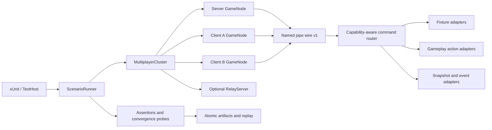

# TestAutomation v2 设计

状态：设计基线；M0 已实现，M1 已推进至环境、睡眠与玩家火焰完整覆盖契约
目标分支：`codex/api-mp-integration`
适用范围：核心玩法联机自动化、直连与中继、多客户端、失败取证和长期稳定性测试

## 1. 结论与关键决策

TestAutomation v2 不重写现有测试框架，而是在已经稳定的命名管道控制面、无界面进程模型和场景产物之上增加完整的领域驱动能力。设计采用以下决定：

1. 保持长度前缀 JSON 的 wire protocol v1，不因增加命令或快照字段破坏现有 TestHost 与运行时配对。
2. 单独引入可演进的 Automation API（当前为 v10）和 `StateSnapshotV2.SchemaVersion = 2`；能力版本、线协议版本和快照版本彼此独立。
3. 保留所有现有 v1 命令和 `state.getSnapshot`，以新增命令的方式演进，不修改旧 DTO 的含义。
4. 明确区分 `fixture.*` 布置命令和玩家动作命令。前者用于构造确定性前置条件；后者必须经过真实客户端玩法路径，不能直接伪造最终状态或网络包。
5. 新稳定场景不得使用 `legacy.executeScript`、`FUNC`、`EXEC` 或 UI 点击来验证非 UI 玩法。
6. 场景继续使用强类型 C# 编写，不引入 YAML/JSON 通用脚本 DSL。声明式元数据用于覆盖统计和回放，业务逻辑仍由编译器检查。
7. 真实多进程 L2 使用固定种子和最终一致性断言，但不承诺操作系统 UDP 调度的逐 tick 确定性；完全确定性保留在 L0/L1。

## 2. 目标

- 让核心玩法的联机规则、权限、状态传播、late join、重连和持久化可以完全无人值守验收。
- 将现有 PlayerSync、Terrain、Creature、Inventory、Health、Environment、Mechanics 和 Logic legacy 测试迁移到强类型控制面。
- 同一份玩法场景能够在直连与中继、一服一客与一服两客拓扑上复用。
- 每次失败自动产生动作轨迹、结构化事件、各节点快照、网络指标、日志和可回放输入。
- 为 AI 开发建立可机器检查的功能覆盖契约，避免用“测试数量”代替实际覆盖程度。

## 3. 非目标与自动化边界

- 不用自动测试证明画面观感、音质、操作手感或动画是否自然；自动化只验证渲染/声音事件是否被正确触发。
- 不把真实公网 NAT、路由器兼容性和平台图形驱动纳入每次提交门禁；它们属于发布前设备矩阵。
- 不在 TestAutomation 中重新实现一套游戏规则。动作适配器只驱动现有生产入口，快照适配器只读取现有权威状态。
- 不要求一次迁移全部 legacy 测试。每个领域达到等价或更强覆盖后，再移除对应旧测试。

## 4. 当前基础与缺口

现有框架已经提供：

- wire protocol v1、请求 ID、响应序号、4 MiB 帧上限和主线程调度；
- 隔离数据目录、无界面 GameNodeProcess、真实 RelayServer 和进程回收；
- 世界创建、连接、断线、重载、基础地形修改、模组通道、故障注入和手动时钟命令；
- Snapshot v1 中的世界、玩家基础状态、实体位置/速度、生命值和指定地形单元；
- 原子失败产物、规范化比较和 replay.json。

主要缺口是：

- 命令集中在单个 switch 中，继续扩展会造成领域耦合；
- 缺少命令/快照能力发现，场景无法在启动时声明并检查依赖；
- 缺少玩家真实动作、背包、天气、逻辑电路、机械和瞬态事件的强类型接口；
- Snapshot v1 只能进行基础精确比较，不适合物理容差、收敛、单调性和瞬态事件；
- Core 与 Relay 场景重复管理进程、等待、失败采集和清理；
- replay.json 保存场景参数，但尚未完整保存生成后的动作序列和断言结果。

## 5. 总体架构



### 5.1 Survivalcraft.Testing

保持平台中立的控制 DTO、Snapshot v2、选择器、比较规则、场景运行器、拓扑模型、覆盖清单和进程客户端。

### 5.2 Survivalcraft.TestAutomation

运行在游戏进程内，负责命令路由、主线程执行、领域适配、事件记录和快照采集。它只能存在于测试运行时，不进入正式发行模组集合。

### 5.3 Survivalcraft.TestHost / xUnit

负责建立拓扑、执行场景、轮询最终状态、比较各节点、注入故障和保存产物。游戏进程内不得执行跨节点等待，避免阻塞主线程。

## 6. 版本与能力发现

新增 `system.describe`，返回：

```text
AutomationDescription
├── wireProtocolVersion        = 1
├── automationApiVersion       = 4
├── snapshotSchemaVersions     = [1, 2]
├── supportedCommands          = [...]
├── supportedDomains           = [...]
├── limits                     = {...}
├── buildIdentity              = commit / assembly version
└── legacyExecutionEnabled     = true | false
```

场景定义增加 `RequiredAutomationCapabilities`。GameNode 启动后先调用 `system.describe`；缺少能力时立即返回稳定的 `unsupported_capability`，不进入世界也不等待超时。

兼容规则：

- 新增命令、可选响应字段和新 Snapshot schema 属于兼容扩展，不提升 wire protocol。
- 修改既有命令语义、删除字段或改变帧结构才提升 wire protocol。
- Snapshot v1 与 v2 分别规范化和比较，禁止跨 schema 直接比较。
- replay.json 必须记录三个版本以及所需能力，旧运行时无法回放时给出明确诊断。

## 7. 命令路由与执行模型

### 7.1 领域化路由

将当前单体 switch 逐步替换为注册式路由：

```text
TypedCommandRouter
  Register<TCommand, TResult>(metadata, handler)
  ValidateUniqueCommandNames()
  DescribeCapabilities()
  DispatchOnMainThread()
```

每条命令元数据包含命令名、领域、稳定等级、是否修改状态、允许角色、所需 Project/网络状态和输入上限。重复命令名在模组初始化时直接失败。

### 7.2 三类操作

1. `fixture.*`：直接构造前置状态，只允许显式测试场景使用，并在动作轨迹中标记为 `fixture`。
2. 玩法动作：在客户端驱动与真实输入等价的生产路径，由正常网络包和服务端校验产生最终状态。
3. `state.*`：只读快照、事件和指标，不允许改变 Project。

不得用 fixture 命令作为同一功能的行为断言。例如可以用 `fixture.inventory.setSlot` 放置测试物品，但“放置方块”必须调用 `player.place`，随后观察服务端和其他客户端的地形状态。

### 7.3 动作回执

玩法命令返回统一 `ActionReceipt`：

```text
actionId          默认使用 control request ID
accepted          表示已进入玩法路径，不表示效果已同步完成
queuedTick
actorPlayerIndex
code              queued / rejected / invalid_state / permission_denied / ...
detail
```

TestHost 收到回执后使用结构化快照或事件等待最终效果。任何命令都不能通过固定 sleep 假设同步完成。

### 7.4 稳定错误码

至少定义：

- `invalid_payload`
- `invalid_state`
- `actor_not_found`
- `target_not_found`
- `permission_denied`
- `not_ready`
- `unsupported_capability`
- `limit_exceeded`
- `action_rejected`
- `main_thread_timeout`

异常消息和堆栈仅用于诊断；测试逻辑只断言错误码和结构化字段。

## 8. 动作与事件日志

每个节点维护有界 `ActionEventJournal`：

```text
sequence, timestamp, tick, actionId, role,
domain, eventName, phase, actor, target, code, data
```

phase 至少包括 `queued`、`applied`、`rejected` 和 `observed`。日志默认保留最近 4096 条，单次查询最多 512 条，支持按 `afterSequence` 增量读取。达到上限时淘汰最旧记录并增加 droppedEvents 指标。

新增：

- `state.getEvents`
- `state.resetEvents`，只允许在场景布置阶段调用

瞬态行为如投射物发射、声音、雷电、伤害原因和交互拒绝优先通过事件断言；持续状态仍通过快照断言。

## 9. Snapshot v2

新增 `state.getSnapshotV2`，保留现有 `state.getSnapshot`。Snapshot v2 采用显式投影，调用者必须声明需要的领域和范围，禁止默认抓取整个世界。

### 9.1 根结构

```text
StateSnapshotV2
├── schemaVersion = 2
├── captureId / role / captureTick / timeSeconds
├── node
├── world?
├── network
├── players[]
├── inventories[]
├── entities[]
├── terrain
├── environment?
├── pickables[] / projectiles[]
├── mechanics[] / logicElements[]
├── recentEvents[]
└── diagnostics
```

### 9.2 投影与选择器

`CaptureStateV2Command` 包含：

- `domains`：显式选择 Player、Inventory、Entity、Terrain、Environment、Mechanics、Logic、Network 或 Events；
- `players`：主玩家、玩家索引或名称选择器；
- `entities`：fixture alias、实体 ID、模板和空间范围选择器；
- `terrain`：离散坐标或有上限的长方体区域；
- `eventAfterSequence`；
- `includeVolatileDiagnostics`，默认 false。

初始安全上限：实体 2048 条、地形单元 4096 个、背包槽 1024 个、逻辑元素 1024 个、事件 512 条，并受现有 4 MiB 控制帧总上限约束。超限返回 `limit_exceeded`，不得截断后伪装成完整快照。

### 9.3 稳定身份

- 玩家使用 playerIndex 和 network identity；
- fixture 创建的实体返回稳定 alias，同时保留运行时 entityId 供诊断；
- 背包使用 owner + inventory kind + slot index；
- 地形、逻辑和方块实体使用坐标；
- 不以随机实体 ID 或集合枚举顺序作为跨节点业务断言。

### 9.4 规范化与比较

Snapshot v2 每个集合按稳定身份排序。比较器从“全局五位小数精确相等”扩展为路径规则：

- 离散状态精确相等；
- 位置和速度支持向量距离容差；
- 集合支持按稳定 key 比较；
- 数值支持 epsilon、范围和单调性；
- 状态支持 eventually、持续稳定窗口和收敛截止时间；
- 角色、时间、诊断等非业务字段可以显式投影掉，而不是临时忽略未知路径。

服务端与客户端通常比较同一领域投影，不比较整个根快照，以避免把合理的角色差异误报为失败。

## 10. 领域 API 规划

| 优先级 | 领域 | fixture 命令 | 真实玩法命令 | 主要可观测状态 |
| --- | --- | --- | --- | --- |
| P0 | 玩家 | teleport、setMode、setExperience | move、look、setCreativeFly、respawn | body、look、crouch、fly、experience、spawn state |
| P0 | 玩家交互 | setHeldItem、prepareTarget | use、interact、place、paint、dig、drop、hit、aim | terrain、entity、pickable、projectile、action event |
| P0 | 地形流送 | setCells、prepareRegion | 由玩家移动和交互触发 | loaded chunks、requested range、cell revisions |
| P0 | 实体/生物 | spawn、remove、setBody | hit、collide、mount | lifecycle、body、health、behavior、ownership |
| P1 | 背包 | setSlot、createContainer | move、dragDrop、selectSlot、drop、openContainer | slots、active slot、container viewers、revision |
| P1 | 伤害/生命 | setHealth、setVitalStats | hit、choke、fall request | health、cause、vitals、death event |
| P1 | 环境 | setTime、setWeather、prepareLightning | 合法客户端请求（若产品支持） | time、precipitation、fog、lightning event |
| P2 | 机械 | spawnMount、prepareSleep、ignite | mount、dismount、sleep、wake、fire | mount link、sleep state、fire state |
| P2 | 逻辑电路 | createFixture、setVoltage | edit、press、toggle | settings、voltage、moving blocks、revision |
| P2 | 拾取物/投射物 | spawnPickable、prepareWeapon | pick、drop、fire | owner、position、velocity、lifecycle event |

具体命令使用独立 DTO，不设计一个包含大量可空字段的通用 `PlayerActionCommand`。每个 DTO 在 L0 测试中验证边界和 JSON round-trip。

## 11. 多客户端与传输复用

新增 `MultiplayerCluster`：

```text
server
clients: clientA, clientB, ...
transport: direct | relay
relay?: RelayServerProcess
seed / work directory / fault profiles
```

新增 `IMultiplayerTransportHarness` 隐藏直连和中继的建服差异。玩法场景只表达“连接 clientA/clientB”，同一场景通过参数矩阵分别运行 Direct 和 Relay。

每个核心动作默认验证四个观察点：

1. 发起客户端动作被接收；
2. 服务端权威状态发生预期变化；
3. 发起客户端收到权威结果；
4. 观察者客户端收敛到相同业务状态。

适用功能再增加 late join、原会话重连、服务端重载和并发冲突步骤。冲突必须由服务端给出确定结果，不能只断言“两个客户端最终碰巧一样”。

## 12. 场景运行器

新增 `ScenarioRunner` 与 `ScenarioRunContext`，统一负责：

- 步骤起止、超时和结构化结果；
- 节点与服务进程生命周期；
- 失败时并行抓取所有可用节点的 Snapshot v2、事件、状态和日志；
- 指标汇总、原子写入和临时目录安全清理；
- 重放参数和生成动作的记录。

场景只保留领域步骤，避免 Core/Relay 各自复制进程管理和等待方法。每个节点内部命令仍串行执行，不在同一命名管道并发发送；不同节点可以由 TestHost 并行协调。

## 13. 确定性策略

### L0

DTO、选择器、命令元数据、规范化、比较规则、覆盖清单和编解码；不引用游戏运行时。

### L1

使用手动时钟、固定随机源和小型 Project fixture 验证领域适配器、权限拒绝、动作日志和状态转换；不启动游戏进程。

### L2

真实无界面进程、真实直连/中继和最终一致性等待。固定世界种子、关闭音频和多线程地形更新；网络可以使用固定种子的故障配置，但不要求跨运行逐包时间完全相同。

### L3

定时运行的长时间自动测试：使用稳定 PRNG 预生成并持久化场景、场景种子与故障 profile，逐轮执行真实无窗口进程，并检查工作集、私有内存、句柄、线程、CPU、采样完整性和玩法收敛。完整十场景轮转进入每周计划门禁；增加 iterations 可形成 30 至 60 分钟或更长的 soak，不作为每次提交的快速门禁。

真实网络阶段不得通过暂停所有节点实现伪 lockstep，否则 LiteNetLib 轮询和超时会失真。需要逐 tick 精确性的规则放在 L1，L2 验证真实传输下在截止时间内收敛。

## 14. 产物与回放 v2

在现有产物上增加：

```text
topology.json
capabilities-{role}.json
actions.json
events-{role}.json
assertions.json
snapshot-{role}-{checkpoint}.v2.json
resource-metrics.json
```

`actions.json` 保存实际生成后的动作，而不仅是随机种子；`assertions.json` 保存断言类型、目标角色、投影、截止时间、最后观察值和结果。重放优先使用已记录动作；场景版本不兼容时必须明确失败，不能静默改用新默认值。

所有 JSON 和日志继续采用同目录临时文件、flush-to-disk 和原子替换。进程非正常退出时允许留下带后缀的临时文件，但读取器不得把零长度或含 NUL 的文件当成有效产物。

## 15. 安全与隔离

- 所有游戏进程继续强制 `--headless`、`CreateNoWindow=true`、独立 `--data-dir` 和唯一实例 ID。
- 游戏、命令、日志与 Relay 共享跨进程 UDP 端口租约器；使用非系统临时端口范围、独占可绑定性检查和退出后冷却，支持连续及并行 TestHost 而不发生端口抢占。
- TestAutomation 控制服务只有提供随机 `--control-pipe` 时才启动；后续应增加显式 `--test-automation` 开关作为第二条件。
- fixture 命令只能作用于当前测试 Project，不接受任意文件路径、类型名或 C# 代码。
- 路径参数必须解析并验证位于当前节点数据目录内。
- 所有集合、字符串、区域、事件和快照都有上限，先验证再分配。
- 新稳定场景通过静态检查禁止调用 `legacy.executeScript` 和 `ui.clickWidget`；UI 专项测试可以显式标记例外。
- 测试命令不得绕过服务端权限来宣称玩法路径通过。非法客户端动作必须有专门的拒绝测试。

## 16. 可机器检查的覆盖契约

新增 `Survivalcraft.Testing/Coverage/core-multiplayer.json`。每项能力记录：

```text
featureId
status: planned | covered | quarantined
productionEntry
fixtureCommand
actionCommand
snapshotDomains
directTest
relayTest
lateJoinTest
reconnectTest
authorityTest
faultTest
persistenceTest
```

一个功能只有满足其适用列并且引用的测试能够被发现时才能标为 `covered`。CI 验证清单格式、重复 featureId、缺失测试和 `covered` 项的门禁结果。`quarantined` 必须给出稳定问题编号、原因和最近证据，不能只写“flaky”。

## 17. 迁移阶段

### M0：v2 基础

- `system.describe`、能力检查和稳定错误码；
- 注册式命令路由与领域文件拆分；
- Snapshot v2、投影、比较规则和事件日志；
- MultiplayerCluster、ScenarioRunner 和产物 v2；
- 保证所有现有 fast、doctor 和 L2 测试不回归。

### M1：玩家与交互

- 迁移 PlayerSync 全部测试，而不只迁移当前失败的 8 项；
- 一服两客验证移动、观察、飞行、使用、门、放置、涂色、挖掘、丢弃、命中和发射；
- 对 8 项基线失败逐项分类为产品缺陷或旧测试缺陷并给出结构化证据；
- Direct 与 Relay 使用同一套动作定义。

### M2：地形、实体与生物

- 迁移 TerrainSync、TerrainStreaming、CreatureSync、AnimalPosition 和实体重复复现；
- 引入区块流送快照、实体 alias、物理容差和稳定窗口断言；
- 覆盖 late join、快速创建/删除、碰撞和长期漂移。

### M3：背包、伤害与生命

- 迁移 InventorySync、DamageSync、HealthSync 和 PickableSync；
- 覆盖合法请求、恶意参数、观察者、掉落物和并发背包操作。

### M4：环境、机械与逻辑

- 迁移 EnvironmentSync、MechanicsSync、LogicBlockSync、沙子和地形冻结复现；
- 对瞬态效果使用事件日志，对持久状态使用 Snapshot v2。

### M5：韧性与发布门禁

- 随机可回放动作、故障矩阵和 L3 soak；
- 资源、进程、分片、会话和事件日志泄漏检查；
- 稳定门禁中不再依赖 Roslyn、UDP 文本命令、UI 点击或日志措辞；
- legacy 用例达到等价覆盖后逐组删除。

## 18. 验收门禁

M0 完成必须满足：

- wire v1 现有客户端/服务端 round-trip 测试继续通过；
- Snapshot v1 保持不变，Snapshot v2 有 L0 编解码、规范化、上限和差异测试；
- `system.describe` 能让场景在启动阶段拒绝缺少能力的运行时；
- ScenarioRunner 在任一步骤失败时仍能写出有效、非零、可解析产物；
- 现有平台与游戏 L0/L1、三项原有 L2 保持绿色；
- 所有新进程测试继续无前台窗口。

核心玩法自动化完成必须满足：

- 覆盖清单中所有 required 功能为 `covered`；
- 一服两客在 Direct 与 Relay 下通过同一套核心场景；
- 适用功能均覆盖服务端权威、观察者、late join、重连和非法请求；
- 固定故障配置可以稳定重放，失败时包含动作、事件、快照和断言材料；
- L3 运行达到约定时长且没有持续资源增长或遗留进程；
- 人工测试仅剩视觉、音频感知、操作手感和真实公网/设备矩阵。

## 19. 建议代码布局

```text
Survivalcraft.Testing/
├── Control/
│   ├── ControlProtocol.cs              # 仅保留 wire envelope
│   ├── AutomationDescription.cs
│   └── Commands/{System,Fixture,Player,Inventory,...}.cs
├── Snapshots/V2/{Contracts,Projection,Canonicalizer,Comparer}.cs
├── Assertions/{StateProbe,ConvergenceAssertions}.cs
├── Scenarios/{ScenarioRunner,ScenarioRunContext}.cs
├── Processes/{MultiplayerCluster,TransportHarness}.cs
└── Coverage/core-multiplayer.json

Survivalcraft.TestAutomation/
├── Control/TypedCommandRouter.cs
├── Domains/{Fixture,Player,Inventory,Terrain,Entity,...}Automation.cs
├── State/StateSnapshotV2Builder.cs
└── State/ActionEventJournal.cs
```

实现时先拆分新代码，不必立刻移动全部 v1 类型。等 M1 稳定后再机械整理旧文件，避免把架构迁移与玩法修复混在同一个难以审查的提交中。

## 20. 第一实施切片

第一切片只实现 M0 中最小纵向链路：

1. `system.describe`；
2. 命令元数据与注册式 router；
3. Snapshot v2 的 Node、Network、Player 和 Events 四个领域；
4. `ActionEventJournal`；
5. MultiplayerCluster 支持 server + clientA + clientB；
6. 一个不依赖 UI/脚本的 `player.setCreativeFly` Direct/Relay 场景；
7. 对应 L0/L1、失败产物和覆盖清单条目。

这一切片能够同时验证版本策略、真实玩家动作路径、多客户端观察、Snapshot v2、事件日志和传输复用。如果它稳定，再扩展 place/dig/use 等复杂目标动作。

## 21. M0 首个切片实施记录

已实现并进入自动门禁的内容：

- 控制 wire protocol 仍为 v1，新增 `system.describe` 与独立 Automation API 能力校验；库存/生命阶段为 v3，环境/mechanics 为 v4，骑乘为 v5，逻辑为 v6，生产路径证明为 v7，pickable/projectile 为 v8，会话/通道生命周期为 v9，熔炉/容器结果后当前为 v10；
- 现有控制命令由注册式 `TypedCommandRouter` 统一分派，重复命令名在初始化阶段失败；
- 新增有界 `ActionEventJournal`、`state.getEvents` 和 `state.resetEvents`；
- 新增 Node、Network、Players、Events 投影的 Snapshot v2、稳定排序和玩家领域容差比较；
- 新增 `MultiplayerCluster`、Direct/Relay transport harness 和 `ScenarioRunner`；
- `player.setCreativeFly` 进入 `ComponentGui.TrySetCreativeFlyEnabled` 生产入口，再走现有 `PlayerCreativeFlyPacket`，没有直接修改远端状态或伪造数据包；
- 同一 `CreativeFlyMultiplayerScenario` 已在一服两客 Direct 与 Relay 下真实通过，并作为两项 L2 Theory 进入测试程序集；
- 失败产物 v2 与机器可检查覆盖清单已经落地；`actions.json` 保存强类型动作载荷，回放会校验场景/wire/API/snapshot 版本并重新执行记录动作；
- 当前回归结果为平台 L0/L1 57 项、游戏 L0/L1 14 项、包含五项既有场景及地形交互与人物运动各两项的 L2 9 项全部通过。

当前创飞覆盖尚不标记为完整：创飞自身仍需加入 late join、重连、持久化与更完整的权限拒绝矩阵。

## 22. M1 玩家地形交互完整覆盖实施记录

本切片完成 `player.use`、`player.place` 和 `player.dig` 的一条可回放生产链：

- 新增强类型动作 DTO，以及服务端准备/客户端应用两阶段受控夹具；夹具只建立手持物、站位和方块前置条件，不写动作最终状态；
- 动作经 `ComponentInput -> ComponentPlayer -> ComponentMiner` 执行，现有 `PlayerInteractPacket` / `PlayerDigPacket` 将事件送到服务端，服务端从权威眼位重新射线检测；
- use 使用油漆桶涂木板，place 在支撑块相邻格放木板，dig 使用工具移除泥土，三者均验证服务端、发起客户端和观察客户端收敛；
- Terrain Snapshot v2 新增投影、稳定排序、比较规则和 `isLoaded`，并去除异步光照位；区块缺失不再与空气混淆；
- 动作适配器发布 `queued`、`observed`、`applied` 或 `rejected` 事件，场景还验证服务端节点不能发起玩家动作、客户端不能选择不可达目标；
- 场景升级为一服三客：use 后 client-c late join，place 在固定延迟、抖动、100% 复制和 50% 重排下执行，client-a 随后断线并以稳定 PlayerIndex 重连，再执行 dig；
- 服务端在三种动作完成后保存并停止世界，重新加载存档并重建 Direct/Relay host；服务端和重新加入的 client-c 都与保存前 Terrain Snapshot v2 做坐标级比较；
- 重连矩阵暴露并修复了观察客户端旧远端 `PlayerData` 残留。`PlayerAddPacket` 现在清理同索引失效记录，并把仍活跃的重复 add 作为幂等确认处理；四个节点都显式断言 PlayerIndex 唯一；
- `ScenarioReplayV2` 记录 `networkFaults`，Host 会连同三个强类型动作载荷重放完整生命周期；
- `TerrainInteractionMultiplayerScenario` 已在 Direct 与 Relay 的真实无窗口拓扑通过，Direct 产物也已由 Host 完整回放；
- 覆盖清单和 L2 Theory 已记录 Direct、Relay、权威、观察者、late join、重连、故障与持久化证据，PowerShell 的 `m1-direct`、`m1-relay` 和 `m1` 入口执行完整矩阵。

`player.place-dig-use` 现已标记为 `covered`。创飞仍需补齐它自己的 late join、重连和持久化矩阵，不能借用其他功能证据提升状态。

## 23. M1 人物运动、视角与蹲伏完整覆盖实施记录

本切片完成 `player.move`、`player.look` 和 `player.setCrouch` 的可回放生产输入链：

- 新增强类型 move/look/setCrouch DTO，以及服务端准备、actor 客户端应用的两阶段人物夹具；夹具只创建平坦平台并设置站位、零速度、零视角与非蹲伏前置条件，不写动作最终状态；
- 输入适配器在 `ComponentInput.Update` 后注入固定帧的 Move/Look 或一次 ToggleCrouch，生产代码继续负责 `ComponentPlayer` 控制、`ComponentLocomotion` 积分和 `PlayerBodyUpdatePacket` 权威同步；
- setCrouch 使用目标状态语义。人物尚未真正落地时，适配器等待 `StandingOnValue` 并按有界间隔重试生产 ToggleCrouch；目标一旦改变立即停止，避免重复 toggle 反转状态；
- Player Snapshot v2 以兼容的可选字段新增头部 `lookAngles` 和身体四元数 `rotation`；规范化器支持两者，比较器对视角使用向量容差、对旋转使用忽略四元数符号的角度容差，旧 v2 JSON 缺少字段时仍可读取；
- 一服三客 Direct/Relay 场景验证服务端不能发起玩家输入、非 owner 客户端不能驱动 actor，move/look/crouch 均产生 queued、observed、applied 事件并在服务端、actor 与 observer 收敛；
- 三个初始动作在固定延迟、抖动、100% 复制和 50% 重排下执行；client-c 随后 late join 并恢复位置、视角与蹲伏；
- client-a 断线后以稳定 PlayerIndex 重连，四个节点断言玩家索引唯一。实体重建语义被显式区分：ComponentFrame 保存的位置与身体四元数朝向继续存在，ComponentLocomotion.LookAngles 与 ComponentBody crouch 不保存，因此必须复位；
- 重连后重新建立同位置夹具，再通过生产输入执行 look/crouch；服务端保存、停止、重载并重建 transport，重新加入的 actor 与 client-c observer 再次验证位置/身体朝向持久而头部视角/蹲伏复位；
- `ScenarioReplayV2` 严格记录并校验五个动作的角色、命令顺序、强类型载荷与网络故障配置；Direct 与 Relay 产物均已完整回放；
- `PlayerMotionMultiplayerScenarioTest`、覆盖清单和 PowerShell 的 `motion-direct`、`motion-relay`、`motion` 入口把完整矩阵纳入无窗口自动门禁。

`player.motion-look-crouch` 现已标记为 `covered`。创飞生命周期补全继续保留为独立小任务。

## 24. 地形流送与单调修订完整覆盖实施记录

本切片把真实区块 loadedness、视距移动和地形包乱序恢复纳入同一条可回放生产链：

- wire protocol 提升到 revision 3；`TerrainSyncChunkListPacket`、单格与批量改单包携带服务端每区块单调 revision，客户端以有界 revision window 应用连续改单、缓存缺口，并忽略重复或旧快照；
- Snapshot v2 的地形格新增 `revision` 与 `chunkState`，streaming 投影暴露 update locations、allocated/ready/pending/sent chunk 数，以及快照、改单、旧包、未加载改单、缓冲和溢出指标；旧 revision 与正常视距外丢弃分别计数，修订比较为显式选项，使 Project 重载后的合法 revision 重建仍可单独断言；
- 强类型 `fixture.terrain.prepareRegion` 在服务端建立远端探针、actor 边界和 observer 已加载视图，`fixture.terrain.applyView` 只设置客户端前置视图；actor 初始探针必须 unallocated，observer 与 server 必须已加载同值同 revision；
- `player.move` 仍从 `ComponentInput` 驱动真实身体。无窗口执行跳过绘制阶段，适配器仅在身体实际跨过原生 8 格滞回后补做生产相机交接，随后由 `TerrainUpdater.SetUpdateLocation -> TerrainViewDistancePacket` 驱动服务端真实区块流送，不直接分配客户端区块；
- 服务端 `terrain.runRevisionBurst` 通过真实 `SubsystemTerrain.ChangeCell` 连续产生三次 revision，并额外排入改变前的旧全量区块快照；固定故障配置对所有节点施加 18 ms 延迟、4 ms 抖动、100% 复制和 50% 重排，初始客户端必须收敛到最高 revision、记录旧包被忽略且 revision 缓冲归零；
- client-c late join 直接取得最高 revision；client-a 断线后以稳定 PlayerIndex 重连并恢复相同 baseline；保存重载后方块值继续存在，而 per-Project revision tracker 清空并以 revision 0 重建；
- 两动作 `actions.json` 严格限定为 client-a `player.move`、server `terrain.runRevisionBurst`，Direct 与 Relay 的原运行和完整回放均真实无窗口通过；
- `TerrainStreamingMultiplayerScenarioTest`、覆盖清单和 PowerShell 的 `streaming-direct`、`streaming-relay`、`streaming` 入口将这条矩阵纳入门禁。

`terrain.streaming-and-revisions` 现已标记为 `covered`。后续核心主线可以进入实体/生物生命周期与物理，复用本切片的 revision window 和 loadedness 断言模式。

## 25. 实体生命周期与生物权威物理完整覆盖实施记录

本切片把实体世代、墓碑和非玩家生物身体同步纳入同一条严格可回放生产链：

- wire protocol 提升到 revision 4；`EntityLoadPacket` 和 `EntityRemovePacket` 携带服务端按 EntityId 单调递增的生命周期 revision，客户端以墓碑窗口拒绝重复、旧加载和旧删除，因此旧世代不能复活或覆盖同 ID 的新实体；
- `BehaviorSyncPacket` 在原行为状态之外携带实体 revision 与服务端身体位置、速度、旋转；客户端只对当前世代应用快照，并通过既有 `NetworkBodyInterpolation` 平滑。非玩家生物在客户端被标记为网络控制，服务端继续承担物理权威；
- Entity Snapshot v2 可按 ID 投影存在性、模板、生物/玩家类型、身体、健康、hitpoints、revision 和 tombstone；生命周期指标区分服务端/客户端追踪数、已应用加载/删除、忽略旧包和墓碑数；
- `fixture.entity.prepareLifecycle` 只在服务端创建稳定 Cow 前置条件；`entity.applyImpulse` 调用真实 `ComponentBody.ApplyImpulse` 并运行固定帧；`entity.runLifecycleBurst` 对同一 ID 执行删除和新 Cow 替换，同时删除 Duck 形成墓碑，最后排入捕获的旧加载包；
- 一服三客 Direct/Relay 场景在 18 ms 延迟、4 ms 抖动、100% 复制和 50% 重排下验证身体收敛、新世代保留、墓碑不复活和客户端 server-only 权限拒绝；
- client-c late join 只取得当前权威实体，client-a 断线后以稳定 PlayerIndex 重连；保存、停止、重载和重建 transport 后，存活 Cow 与替换 Cow 继续存在，已删除 Duck 仍不存在，而每 Project 内存 revision 窗口允许重新建立；
- `actions.json` 严格包含 server `entity.applyImpulse`、server `entity.runLifecycleBurst` 两个动作且旧加载注入必须开启；Direct 与 Relay 原运行和完整回放均真实无窗口通过；
- L0 覆盖 lifecycle window、包编解码、Snapshot 规范化/差异和 replay 拒绝规则；L2 Theory、覆盖清单及 PowerShell 的 `entity-direct`、`entity-relay`、`entity` 入口纳入完整门禁。

`entity-creature.lifecycle-physics` 现已标记为 `covered`。下一条核心主线进入 inventory/container operations，并复用实体生命周期 revision 处理容器实体失效后的陈旧动作。

## 26. 库存、容器、生命、伤害与重生完整覆盖实施记录

本切片把两个相互依赖的核心玩法域放入同一条严格可回放生产链，同时把 Automation API 提升到 v3：

- wire protocol 提升到 revision 5。`InventorySyncPacket`、`ActiveSlotChangePacket`、`HealthSyncPacket`、`InjureEventPacket` 和 `DamageSyncPacket` 携带按 inventory/entity 与领域隔离的单调 revision，并绑定现有实体 lifecycle revision；客户端拒绝旧状态、失效世代和无效数值；
- 所有会改变库存、伤害或重生状态的客户端请求都有 64 位 request ID。服务端按 `ClientSession + mutation domain + request ID` 做有界精确去重，既允许不同请求乱序到达，也避免网络复制让 move、drop、hit 或 respawn 执行两次；
- 库存服务端权威检查覆盖玩家库存所有权、附近容器访问距离、slot/count 边界和任意 `SetSlotItemPacket` 客户端写入。远端 active-slot 请求由服务端直接提升 revision 并广播确认，避免旧完整快照在客户端造成选择回滚；
- 生命链以服务端重新计算的近战射线和距离为准，客户端不能指定任意伤害；自伤请求只接受固定的本人 choke 语义，重生只接受当前已死亡的玩家。客户端不再独立再生生命，死亡时间、死因和清空死亡状态由权威快照精确同步；
- Snapshot v2 新增 `inventories`、`health` 和 state-revision metrics。库存按 inventory ID、实体/组件类型、槽、active slot、容器坐标和 revision 投影；生命按实体存在性、玩家身份、Health/Damage 数值、死亡状态、死因和三类 revision 投影；规范化器和比较器支持精确或显式忽略重载后的内存 revision；
- 强类型夹具只建立有限 Survival 库存、真实箱子、近战 actor 与真实 Cow。动作分别走 `MoveItemPacket`、`ActiveSlotChangePacket`、输入驱动的 `PlayerDropPacket`、`PlayerHitPacket` 和 `PlayerRestartPacket`，不会直接写动作最终状态；
- 一服三客 Direct/Relay 场景先验证控制角色与伪造 observer move 被拒绝，再让 observer 发送伪造命中几何与冒用 actor 身份的重生请求，服务端必须分别保持目标未受伤和 actor 死亡；随后在 18 ms 延迟、4 ms 抖动、100% 复制和 50% 重排下执行 move/select/drop、库存旧快照 burst、真实命中/死亡、健康旧快照 burst 和合法玩家死亡/重生，所有初始节点必须同时满足语义状态与权威 revision 收敛；
- client-c late join、actor 同身份重连、保存/停止/重载及 transport 重建均被覆盖。战斗目标和持久化健康实体职责分离：前者验证死亡链，后者从未死亡，因而存档断言不会把正常尸体清理语义误报为丢失；
- `actions.json` 严格包含 client-a move、select、drop，server inventory burst，client-a hit，server health burst，client-a respawn 七个动作；Direct 与 Relay 的原运行和完整回放均真实无窗口通过；
- L0 覆盖 revision window、请求去重并发、扩展包编解码、Snapshot 规范化/差异、协议 round-trip 和 replay 拒绝规则；L2 Theory、覆盖清单及 PowerShell 的 `inventory-health-direct`、`inventory-health-relay`、`inventory-health` 入口纳入完整门禁。

`inventory.container-operations` 与 `health-damage-respawn` 均已标记为 `covered`。后续可继续推进环境、骑乘/睡眠/火焰、电路/移动方块和 pickable/projectile 生命周期，复用 request identity、lifecycle revision 与强类型快照模式。

## 27. 环境、睡眠与玩家火焰完整覆盖实施记录

本切片把全局环境状态和玩家 mechanics 状态放入同一条严格可回放生产链，同时把 Automation API 提升到 v4：

- wire protocol 提升到 revision 6。时间、天气和雷电包显式区分 `State` 与 `Request`；客户端只提交目标时间偏移、合法天气动作或视线附近雷击请求，服务端重新验证 Playing 会话、创造模式、方向/位置和值域，并拒绝客户端伪造的权威状态；
- 时间、天气和雷电分别使用隔离的单调 revision，天气快照包含完整降水与雾调度。雷电是瞬时事件，只向当时在线节点广播，不给 late joiner 伪造历史雷击；
- 睡眠和唤醒请求绑定发送会话的真实 `ComponentPlayer` 与当前实体 ID，并带 64 位 request ID。状态包绑定实体 lifecycle revision 与 sleep revision，能同步睡眠和明确的 awake 基线；
- 玩家着火包只接受服务端到客户端方向，绑定 lifecycle/fire revision，携带明确的 on/off 与剩余时长。`ComponentOnFire` 在显式灭火和自然归零时广播灭火状态，late join/reconnect 不再依赖本地推断；
- Snapshot v2 新增 `environment` 与 `mechanics` 投影，包含游戏模式、时间、年内进度、完整天气调度、最后雷击、sleep/fire/lifecycle revision 和剩余火焰时长；规范化器稳定排序实体并规范化所有浮点字段；
- 强类型命令新增 `fixture.environment.set`、`environment.requestChange`、`environment.runRevisionBurst`、`fixture.mechanics.prepare`、`fixture.mechanics.setPlayerFire`、`player.sleep`、`player.ignite` 和 `mechanics.runRevisionBurst`。夹具只建立确定性前置条件，合法动作仍进入生产包路径；
- 一服三客 Direct/Relay 场景验证控制角色拒绝、Survival 模式环境请求拒绝、同 revision 权威快照纠正请求端乐观时间/天气状态、伪造环境/火焰状态、跨玩家睡眠冒用、观察者收敛、100% 复制与 50% 重排下的旧状态拒绝、late join、稳定 PlayerIndex 与新实体世代重连，以及环境/睡眠/剩余着火状态的保存重载；
- `actions.json` 严格包含 client-a 的 time、precipitation、fog、lightning、sleep，server 的 environment/fire revision burst，以及 client-a wake 八个动作。Direct 与 Relay 原运行、严格回放和 xUnit L2 Theory 均真实无窗口通过；
- L0 覆盖生产包编解码、AutoTest v4 DTO、Snapshot 规范化、覆盖清单和 replay 拒绝规则；PowerShell 的 `environment-mechanics-direct`、`environment-mechanics-relay`、`environment-mechanics` 入口及 `full` 门禁已经接入。

`environment.time-weather-lightning` 与 `mechanics.sleep-fire` 现已标记为 `covered`。

## 28. 骑乘、下马与双实体生命周期完整覆盖实施记录

本切片把骑手与坐骑的双向关系纳入服务端权威生产链，并把 Automation API 提升到 v5、wire protocol 提升到 revision 7：

- `ComponentMountPacket` 显式区分 mount/dismount request 与 authoritative state；请求绑定 Playing 会话、真实骑手实体、骑手 lifecycle、目标坐骑 lifecycle、期望 mount revision 和 64 位 request ID，服务端重新校验距离、存活、占用、忙碌状态与模组钩子，并对拒绝请求发送同 revision 权威关系用于修复请求端乐观状态；
- 客户端拒绝伪造方向、旧 mount revision、旧骑手世代和旧坐骑世代；实体移除会解除关联，重新加入的 rider 会向所有已有观察者广播实体与明确的未骑乘基线，避免稳定 PlayerIndex 重连后保留旧关系；
- `ComponentRider` 将本地输入请求与服务端直接状态变更分离，自动下马只由服务端决定；下马动画结束会清理瞬时标志，存档只保存稳定关系所需实体而不把跨 Project 引用带入重载；
- Snapshot v2 的 mechanics 投影包含 rider/mount 双侧 ID、动画/下马状态、mount revision 与目标 lifecycle revision；通用比较器可完整比较睡眠、火焰和骑乘语义，并可在保存重载边界显式忽略内存 revision；state-revision metrics 分开记录 stale 与 lifecycle 拒绝；
- 强类型命令新增 `fixture.mechanics.prepareMount`、`player.mount`、`mechanics.runMountRevisionBurst` 和 `mechanics.runMountLifecycleBurst`。夹具创建真实 Boat，只布置近距与 12 格外目标；合法动作仍通过生产包，安全探针覆盖跨玩家骑手冒用、客户端伪造 State 和超距请求；
- 一服三客 Direct/Relay 场景在 18 ms 延迟、4 ms 抖动、100% 复制和 50% 重排下验证 mount/dismount、观察者收敛、旧 revision 拒绝、坐骑同 ID 世代替换与延迟旧包拒绝；随后覆盖 client-c late join、骑手断线释放坐骑、稳定身份但新实体世代重连，以及已挂载保存后重载为安全下马且 Boat 继续持久化的边界；
- `actions.json` 严格包含 mount、dismount、故障下 mount、服务端 revision burst、服务端 lifecycle burst、断线前 remount 和重连后 mount 七个动作。Direct 与 Relay 的原运行和严格回放均真实无窗口通过；
- L0 覆盖生产包编解码、AutoTest v5 DTO、Snapshot 规范化/双向差异、覆盖清单和 replay 角色/顺序/安全开关拒绝规则；PowerShell 的 `mount-direct`、`mount-relay`、`mount` 入口与 `full` 门禁已经接入。

`mechanics.mount` 现已标记为 `covered`。下一条核心主线可进入 `logic.electricity-and-moving-blocks`，继续复用会话所有权、request identity、生命周期世代和严格回放模式。

## 29. 逻辑电路、电力状态与移动方块完整覆盖实施记录

本切片把九类可编辑逻辑方块、电力持久状态和活塞/移动方块生命周期纳入同一条服务端权威生产链，并把 Automation API 提升到 v6、wire protocol 提升到 revision 8：

- Adjustable Delay Gate、Battery、Button、Switch、Piston、Memory Bank、Truth Table、Sign 和 Dispenser 状态包显式区分 request 与 authoritative state；请求绑定 Playing 会话、64 位 request ID、期望 logic revision 和目标 terrain revision，服务端重新校验发送者、距离、目标方块、背包/编辑权限与数据范围；
- 编辑请求按会话幂等，逻辑、电力和移动方块使用彼此隔离的单调 revision。Moving block add/remove 绑定 generation，并保留 tombstone；同世代的延迟 add 不能复活已移除集合，只有更新世代可以重新创建。无标签 moving set 另有线端稳定 instance ID，因此两个相同业务 ID 的并发集合不会被错误合并；
- 客户端不再自主推进活塞地形变更，活塞伸缩与移动集合只接受服务端权威结果。电力全量状态在按 revision 合并后仍恢复有序模拟队列，使 Memory Bank 等动态输出在观察端一致收敛；
- late join/reconnect 的 StatePacket 会合并运行期权威状态与 Memory Bank、Truth Table、Sign 的持久字典，并将已由存档预载但尚未登记 instance ID 的无标签 moving set 与权威基线对账。若逻辑基线先于目标地形区块到达，则进入按目标去重、最多 4096 项、确定性淘汰最久未更新目标的队列，并在区块流送落地后按最新 revision 重放，避免静默丢失与无界内存增长；
- Snapshot v2 的 logic 投影包含目标地形格、九类结构化状态、Memory Bank 动态输出、持久电压、moving block 内容/位置/instance ID/generation/tombstone，以及 logic/electricity/moving revision 与拒绝指标；比较器可联合 terrain value/revision 判断真正收敛；
- 强类型命令新增 `fixture.logic.prepare`、`fixture.logic.apply`、`logic.edit`、`logic.interact`、`logic.runRevisionBurst`、`logic.runMovingBlockLifecycleBurst` 和 `logic.runPistonLifecycle`。夹具只建立确定性方块、玩家位置与流送视图，合法动作仍进入生产包和真实交互路径；
- 一服三客 Direct/Relay 场景验证控制命令角色拒绝、跨玩家冒用、超距请求、伪造 state、旧 expected revision、九类编辑、真实开关交互幂等、观察者收敛、100% 复制与 50% 重排下的旧 revision/旧 generation 拒绝、两个同 ID 无标签移动集合并存、真实活塞生命周期、late join、稳定身份重连和保存重载；
- `actions.json` 严格包含四个安全探针、九类编辑、开关交互、logic revision burst、moving-block lifecycle burst 和 piston lifecycle 共十七个动作。Direct 与 Relay 的原运行和严格回放均真实无窗口通过；PowerShell 的 `logic-direct`、`logic-relay`、`logic` 入口与 `full` 门禁已经接入。

`logic.electricity-and-moving-blocks` 现已标记为 `covered`。随后进入 `pickable-projectile.lifecycle`，并继续复用生产路径证明、revision、墓碑和严格回放契约。

## 30. M5 自动测试可信度实施记录

本切片不新增玩法捷径，而是为全部强类型玩法建立不能虚高的共同证据层：

- Coverage Contract v2 把 action、snapshot、production path、Direct、Relay、observer、authority、late join、reconnect、fault、persistence 与 open gaps 变成 `covered` 的硬条件；生产面库存当前精确覆盖 104 个 hook 和 110 个 packet class。
- Automation API 自 v7 起在 action receipt 与 event journal 中加入 provenance 和 production entry，当前 API 为 v10。`ScenarioArtifactWriter.WriteV2Async` 对成功结果执行 fail-closed attestation，任何夹具/观察证据冒充生产动作、入口不一致、缺 queued 或缺明确 `applied` terminal event 都会失败。
- `ProductionPathGateway` 成为测试模组唯一的直接 packet queue 边界，源码哨兵同时禁止私有旁路；fixture synchronization、production request、authoritative state 与 fault injection 四类路径被明确区分。
- revision/lifecycle 旧状态注入在最终权威包稳定 30 个游戏帧后再交付，消除故障重排导致“旧包先到”的非确定性假阴性。
- 每个游戏节点从控制通道 ready 起每 250 ms 采样工作集、私有内存、句柄、线程与 CPU。当前十个 v2 场景在 dispose 前把资源摘要写入 metrics；L3 对无样本、峰值、增长量和故障待发队列实行硬预算。Snapshot v2 还记录按 packet class 聚合的排队次数、故障传输次数和字节数，soak 失败会指出最高流量包型，避免只得到一个不可诊断的队列数字。
- `MultiplayerSoakSchedule` 对十个完整场景生成可序列化的故障轮转，默认随机化 latency、jitter、reorder delay/rate 与 bandwidth 并始终触发 duplicate/reorder 哨兵；可选 loss 模式加入确定性的 1–3% 丢包。
- `MultiplayerSoakRunner` 在执行前保存 schedule，在每轮后原子更新 summary，允许失败后继续收集证据或 fail fast。任一玩法断言、生产路径证明或资源预算失败都会使最终退出码非零。
- 第一次完整九场景精确回放真实暴露了三类问题：游戏帧远快于墙钟时的观察截止条件、带宽调度错误施加的每包 1 ms 下限，以及生产 `VitalStatSyncPacket` 每帧广播造成的流量风暴。包型证据显示逻辑场景曾排队 118296 个生命值包、形成 473184 次故障传输，服务端待发队列峰值 196826；生产修复改为 5 Hz 同步并加入 lifecycle/revision 防重排后，同一故障配置分别降为 45、180 和 14。库存场景的待发峰值也从 13709 降到 49，默认 10000 包硬门槛未被放宽。
- 修复后，原九场景 schedule 在一服三客无窗口拓扑精确重放 9/9 通过，原计划与重放 `fault-schedule.json` 的 SHA-256 均为 `03F025CDE1CE972B33F489B39C49C944879C01CC45D974E55C093E7CA598B555`；计划任务每周运行完整轮转并保留 30 天产物。TestHost 同时允许用 `--fault-seed`、latency、jitter、loss、duplication、reorder、reorder delay 和 bandwidth 参数逐项复现单一 profile，不再只把这些选项显示在帮助文本里。
- 未分层 legacy 套件不再以一个会漂移的失败总数判断。版本化 `legacy-known-failures.json` 将每个允许失败绑定到 coverage feature、迁移原因和 Direct/Relay 替代证据；只有明确未覆盖的 UI 行为可以标为 `coverage-gap`。139 项仍全部执行，新增失败、测试改名/漏跑或未完成会阻断，已知失败和偶发恢复则分别写入 observed/resolved。M5 终审为 121 passed、18 known failed、0 unexpected、0 missing、2 resolved。

这使自动测试更接近真实验收，但不宣称替代尚未覆盖的玩法。coverage trust 报告会持续列出 partial/planned 域，下一条开发主线仍应按风险清单补齐生产场景。

## 31. 掉落物与投射物生命周期完整覆盖实施记录

本切片把可持久掉落物、吸引移动、真实弩箭输入和瞬态投射物事件放入同一条可回放生产链，并把 Automation API 提升到 v8：

- Pickable create/update/delete/sync/attract 包携带按 `PickableId` 单调递增的 revision。客户端维护存在窗口和墓碑，拒绝旧 create、旧 update 与重复 delete；ID 被生产系统合法复用时，只有更高 revision 的新生命周期可以重新出现。
- Projectile 事件携带服务端生成的 64 位 event ID，客户端使用有界窗口去重，因此应用层 100% 复制不会生成第二支观察端投射物；late join、重连和 Project 重载不重放历史瞬态事件。
- `player.fireProjectile` 不直接排 `PlayerAimPacket` 或 `ProjectilePacket`。适配器只向 `ComponentInput` 提供 Aim，在 headless 下补做生产 ViewWidget 布局和相机矩阵准备，再由 `ComponentPlayer -> PlayerAimPacket -> SubsystemCrossbowBlockBehavior.OnAim` 完成真实发射。只有明确的 `AimEvent.Complete` 才记录 `applied`；仅观察到输入会在截止帧 fail closed。
- 强类型命令新增 `fixture.pickable.prepareLifecycle`、`fixture.pickable.applyLifecycle`、`pickable.attract`、`player.fireProjectile` 和 `pickable.runLifecycleBurst`；Snapshot v2 新增 pickables、projectiles、生命周期窗口、事件去重与陈旧包计数。
- 一服三客 Direct/Relay 场景验证控制角色拒绝、实时 create 收敛、服务端吸引、真实客户端发射、观察者事件恰好一次、100% 复制与 50% 重排、陈旧 create 墓碑哨兵、late join、稳定身份重连、保存重载和投射物瞬态边界。
- 场景允许已释放的 Pickable ID 被更高 revision 的新对象合法复用。随机 L3 首次暴露了箭矢落地后复用墓碑 ID 的测试假阴性；修正后同一持久化 schedule 原样重放通过，证明断言区分“旧生命周期复活”和“新生命周期复用”。
- `actions.json` 严格包含 server attraction、client-a 真实 Aim 发射、server stale-create lifecycle burst 三个动作。Direct 与 Relay 的原运行和独立 replay 均真实无窗口通过；PowerShell、xUnit L2、当前十场景 soak 轮转和每周 CI 已接入。

`pickable-projectile.lifecycle` 现已标记为 `covered`，置信级别保守标为 `mutation`：它具备陈旧创建复活哨兵并已进入 L3，但尚不把单轮随机样本夸大为长期 soak 或人工 reality 证据。本切片完成时覆盖契约为 21 个 feature：11 个 `covered`、5 个 `partial`、5 个 `planned`。

## 32. M6 会话兼容性、玩家生命周期与 API 通道完整覆盖实施记录

本切片把“握手成功”推进为可审计的 typed session admission，并把 Automation API 提升到 v9、联机协议 revision 提升到 9：

- 新增 `NetworkSessionAdmissionState`、稳定拒绝码、4 KiB 有界 wire codec 与 `SessionAdmissionResultPacket`。只有兼容清单和模组通道目录均接受后，连接才能进入 admission；空身份、同 session 改换身份、超时和被更新连接取代都返回机器可读结果。
- 每个 Direct/Relay 连接持有独立 session ID。相同稳定玩家身份的新连接采用 latest-session-wins，服务端为旧连接记录 `Superseded` 并将其回收；`ConnectPacket` 与 `PlayerCreatePacket` 的重复交付是幂等确认，不再创建第二份玩家或实体。
- 并发重连实测发现 `PlayerAddPacket` 可能先于客户端 Project 完成加载并触发空引用。生产修复引入按 session 隔离、最多 4096 项的 `ClientPacketDispatcher`：依赖 Project 的包在加载完成后有序刷新，断线或 session 切换时全部清除，旧 session 包不能泄漏到新世界。
- 故障 profile 新增最多 64 个精确 `TargetPacketTypes`。兼容场景分别黑洞 Hello、Result、Catalog、CatalogResult、Connect 和 AdmissionResult 六个阶段，并要求前四类得到 `HandshakeTimeout`、后两类得到 `AdmissionTimeout`，每一步都必须观测到真实丢包计数。
- Snapshot v2 的 network 域新增 session 列表、admission/lifecycle 计数、最多 512 条生命周期事件和 mod-channel 收发、丢弃、重复、限流、处理器异常等指标；规范化器固定排序，证据不依赖日志措辞。
- 新增 `network.runTestModTrafficBurst` 与 `network.replayPlayerCreate`。一服四客 Direct/Relay 场景覆盖五类兼容性拒绝、并发首次加入、并发重连、实体创建期断线、重复创建、稳定身份取代、晚加入目录、逐会话限流/恢复、带宽背压和处理器异常隔离。
- `MultiplayerSoakSchedule` 当前轮转十个场景。session-lifecycle 在 loss 计划下额外强制一个 `PlayerCreatePacket` 100% 丢包哨兵，避免低概率 profile 因样本恰巧未丢包而形成假证据；只有 `faultDropped >= 1`、待发队列归零和所有资源预算同时满足才通过。
- 2026-07-30 的最终无窗口证据包括平台 L0/L1 109/109、游戏 L0/L1 68/68、完整游戏 L2 25/25（含兼容矩阵与 Direct/Relay 生命周期），以及一轮带 loss 的 session-only L3。Direct/Relay 都返回 5 类拒绝、4 个稳定身份、至少 18 次重复创建抑制和 32 次限流；L3 五节点峰值工作集约 471–505 MiB。

`network.session-compatibility`、`api.mod-channel` 和 `player.session-lifecycle` 现均标记为 `covered/soak`。当前 21 个 feature 为 14 个 `covered`、2 个 `partial`、5 个 `planned`；该等级表示已有可重放自动证据，不代表人工 reality 验收或所有未来模组协议都自动正确。

## 33. M7 熔炉与容器交互完整覆盖实施记录

本切片补齐此前仍停留在部分覆盖的真实容器 UI 请求与熔炉加工链，把 Automation API 提升到 v10、联机协议 revision 提升到 10：

- 容器开启请求新增 64 位 request ID，并由服务端返回有界、强类型的 `Accepted`、`InvalidRequest`、`InventoryNotFound`、`PermissionDenied` 或 `UnsupportedInventory` 结果。客户端用 256 项已见窗口保证同一结果只执行一次，延迟重复包不会反复打开界面或播放声音。自动化不再依据日志或本地 UI 推断成功，而是等待对应请求的生产结果；成功路径仍创建真实容器 widget。
- `ComponentFurnacePacket` 绑定 inventory ID、实体 lifecycle revision 和独立 furnace revision，限制单包最多 1024 项并拒绝非有限或越界状态；服务端对更大的合法已加载集合自动分片。客户端先验证实体世代，再按炉体领域的单调窗口拒绝旧包，避免库存 revision 与燃烧进度相互覆盖。
- 熔炉消耗燃料、爆炸和完成冶炼时都会触发库存同步；`SmeltingProgress` 进入存档，避免保存重载后把正在加工的炉体静默重置。
- 强类型夹具建立相邻的真实箱子与熔炉，并只提供原料和燃料。十四动作场景先验证按坐标、按 ID 开启成功，再验证玩家库存越权和远距容器拒绝，随后通过真实 `MoveItemPacket` 投料、加煤并等待生产更新把生肉与燃料消耗为熟肉。
- Snapshot v2 增加炉火、热量、加工进度、槽位索引和 furnace revision。场景分别验证初始观察者收敛、故障下旧炉体包拒绝、late join、稳定身份重连及保存重载；revision 在运行期严格比较，在新 Project 边界按显式策略忽略内存计数器。
- 最终无窗口门禁为平台 L0/L1 110/110、游戏 L0/L1 73/73、完整游戏 L2 25/25，Direct/Relay 定点 Theory 另行 2/2 通过。首轮全量在并行负载下暴露了“内容相同、revision 尚未收敛”的等待竞态，加入服务端最终 revision 下限后定点与全量均复验通过。
- Direct L3 使用 seed `20260730`，在延迟、抖动、100% 重复、重排和带宽调度下通过，四节点峰值工作集约 406–454 MiB，句柄峰值 901、线程峰值 36，最终故障队列为零。全部真实游戏进程均保持 headless/no-window。

`inventory.furnace-container` 现已从 `partial` 提升为 `covered/mutation`。覆盖契约当前为 15 个 `covered`、1 个 `partial`、5 个 `planned`，生产面库存为 104 个 hook 和 110 个 packet class。
