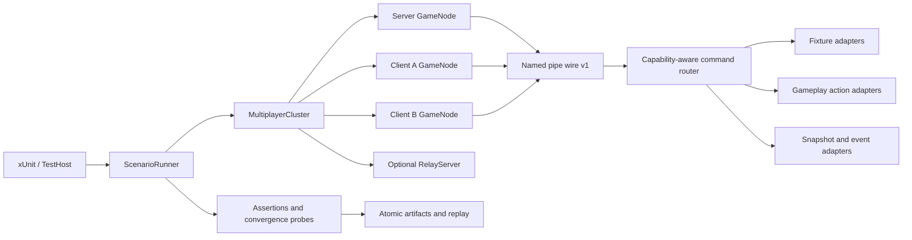

# TestAutomation v2 设计

状态：设计基线；M0 已实现，M1 玩家地形交互已达到完整覆盖契约
目标分支：`codex/api-mp-integration`
适用范围：核心玩法联机自动化、直连与中继、多客户端、失败取证和长期稳定性测试

## 1. 结论与关键决策

TestAutomation v2 不重写现有测试框架，而是在已经稳定的命名管道控制面、无界面进程模型和场景产物之上增加完整的领域驱动能力。设计采用以下决定：

1. 保持长度前缀 JSON 的 wire protocol v1，不因增加命令或快照字段破坏现有 TestHost 与运行时配对。
2. 单独引入 `AutomationApiVersion = 2` 和 `StateSnapshotV2.SchemaVersion = 2`；能力版本、线协议版本和快照版本彼此独立。
3. 保留所有现有 v1 命令和 `state.getSnapshot`，以新增命令的方式演进，不修改旧 DTO 的含义。
4. 明确区分 `fixture.*` 布置命令和玩家动作命令。前者用于构造确定性前置条件；后者必须经过真实客户端玩法路径，不能直接伪造最终状态或网络包。
5. 新稳定场景不得使用 `legacy.executeScript`、`FUNC`、`EXEC` 或 UI 点击来验证非 UI 玩法。
6. 场景继续使用强类型 C# 编写，不引入 YAML/JSON 通用脚本 DSL。声明式元数据用于覆盖统计和回放，业务逻辑仍由编译器检查。
7. 真实多进程 L2 使用固定种子和最终一致性断言，但不承诺操作系统 UDP 调度的逐 tick 确定性；完全确定性保留在 L0/L1。

## 2. 目标

- 让核心玩法的联机规则、权限、状态传播、late join、重连和持久化可以完全无人值守验收。
- 将现有 PlayerSync、Terrain、Creature、Inventory、Health、Environment、Mechanics 和 Logic legacy 测试迁移到强类型控制面。
- 同一份玩法场景能够在直连与中继、一服一客与一服两客拓扑上复用。
- 每次失败自动产生动作轨迹、结构化事件、各节点快照、网络指标、日志和可回放输入。
- 为 AI 开发建立可机器检查的功能覆盖契约，避免用“测试数量”代替实际覆盖程度。

## 3. 非目标与自动化边界

- 不用自动测试证明画面观感、音质、操作手感或动画是否自然；自动化只验证渲染/声音事件是否被正确触发。
- 不把真实公网 NAT、路由器兼容性和平台图形驱动纳入每次提交门禁；它们属于发布前设备矩阵。
- 不在 TestAutomation 中重新实现一套游戏规则。动作适配器只驱动现有生产入口，快照适配器只读取现有权威状态。
- 不要求一次迁移全部 legacy 测试。每个领域达到等价或更强覆盖后，再移除对应旧测试。

## 4. 当前基础与缺口

现有框架已经提供：

- wire protocol v1、请求 ID、响应序号、4 MiB 帧上限和主线程调度；
- 隔离数据目录、无界面 GameNodeProcess、真实 RelayServer 和进程回收；
- 世界创建、连接、断线、重载、基础地形修改、模组通道、故障注入和手动时钟命令；
- Snapshot v1 中的世界、玩家基础状态、实体位置/速度、生命值和指定地形单元；
- 原子失败产物、规范化比较和 replay.json。

主要缺口是：

- 命令集中在单个 switch 中，继续扩展会造成领域耦合；
- 缺少命令/快照能力发现，场景无法在启动时声明并检查依赖；
- 缺少玩家真实动作、背包、天气、逻辑电路、机械和瞬态事件的强类型接口；
- Snapshot v1 只能进行基础精确比较，不适合物理容差、收敛、单调性和瞬态事件；
- Core 与 Relay 场景重复管理进程、等待、失败采集和清理；
- replay.json 保存场景参数，但尚未完整保存生成后的动作序列和断言结果。

## 5. 总体架构



### 5.1 Survivalcraft.Testing

保持平台中立的控制 DTO、Snapshot v2、选择器、比较规则、场景运行器、拓扑模型、覆盖清单和进程客户端。

### 5.2 Survivalcraft.TestAutomation

运行在游戏进程内，负责命令路由、主线程执行、领域适配、事件记录和快照采集。它只能存在于测试运行时，不进入正式发行模组集合。

### 5.3 Survivalcraft.TestHost / xUnit

负责建立拓扑、执行场景、轮询最终状态、比较各节点、注入故障和保存产物。游戏进程内不得执行跨节点等待，避免阻塞主线程。

## 6. 版本与能力发现

新增 `system.describe`，返回：

```text
AutomationDescription
├── wireProtocolVersion        = 1
├── automationApiVersion       = 2
├── snapshotSchemaVersions     = [1, 2]
├── supportedCommands          = [...]
├── supportedDomains           = [...]
├── limits                     = {...}
├── buildIdentity              = commit / assembly version
└── legacyExecutionEnabled     = true | false
```

场景定义增加 `RequiredAutomationCapabilities`。GameNode 启动后先调用 `system.describe`；缺少能力时立即返回稳定的 `unsupported_capability`，不进入世界也不等待超时。

兼容规则：

- 新增命令、可选响应字段和新 Snapshot schema 属于兼容扩展，不提升 wire protocol。
- 修改既有命令语义、删除字段或改变帧结构才提升 wire protocol。
- Snapshot v1 与 v2 分别规范化和比较，禁止跨 schema 直接比较。
- replay.json 必须记录三个版本以及所需能力，旧运行时无法回放时给出明确诊断。

## 7. 命令路由与执行模型

### 7.1 领域化路由

将当前单体 switch 逐步替换为注册式路由：

```text
TypedCommandRouter
  Register<TCommand, TResult>(metadata, handler)
  ValidateUniqueCommandNames()
  DescribeCapabilities()
  DispatchOnMainThread()
```

每条命令元数据包含命令名、领域、稳定等级、是否修改状态、允许角色、所需 Project/网络状态和输入上限。重复命令名在模组初始化时直接失败。

### 7.2 三类操作

1. `fixture.*`：直接构造前置状态，只允许显式测试场景使用，并在动作轨迹中标记为 `fixture`。
2. 玩法动作：在客户端驱动与真实输入等价的生产路径，由正常网络包和服务端校验产生最终状态。
3. `state.*`：只读快照、事件和指标，不允许改变 Project。

不得用 fixture 命令作为同一功能的行为断言。例如可以用 `fixture.inventory.setSlot` 放置测试物品，但“放置方块”必须调用 `player.place`，随后观察服务端和其他客户端的地形状态。

### 7.3 动作回执

玩法命令返回统一 `ActionReceipt`：

```text
actionId          默认使用 control request ID
accepted          表示已进入玩法路径，不表示效果已同步完成
queuedTick
actorPlayerIndex
code              queued / rejected / invalid_state / permission_denied / ...
detail
```

TestHost 收到回执后使用结构化快照或事件等待最终效果。任何命令都不能通过固定 sleep 假设同步完成。

### 7.4 稳定错误码

至少定义：

- `invalid_payload`
- `invalid_state`
- `actor_not_found`
- `target_not_found`
- `permission_denied`
- `not_ready`
- `unsupported_capability`
- `limit_exceeded`
- `action_rejected`
- `main_thread_timeout`

异常消息和堆栈仅用于诊断；测试逻辑只断言错误码和结构化字段。

## 8. 动作与事件日志

每个节点维护有界 `ActionEventJournal`：

```text
sequence, timestamp, tick, actionId, role,
domain, eventName, phase, actor, target, code, data
```

phase 至少包括 `queued`、`applied`、`rejected` 和 `observed`。日志默认保留最近 4096 条，单次查询最多 512 条，支持按 `afterSequence` 增量读取。达到上限时淘汰最旧记录并增加 droppedEvents 指标。

新增：

- `state.getEvents`
- `state.resetEvents`，只允许在场景布置阶段调用

瞬态行为如投射物发射、声音、雷电、伤害原因和交互拒绝优先通过事件断言；持续状态仍通过快照断言。

## 9. Snapshot v2

新增 `state.getSnapshotV2`，保留现有 `state.getSnapshot`。Snapshot v2 采用显式投影，调用者必须声明需要的领域和范围，禁止默认抓取整个世界。

### 9.1 根结构

```text
StateSnapshotV2
├── schemaVersion = 2
├── captureId / role / captureTick / timeSeconds
├── node
├── world?
├── network
├── players[]
├── inventories[]
├── entities[]
├── terrain
├── environment?
├── pickables[] / projectiles[]
├── mechanics[] / logicElements[]
├── recentEvents[]
└── diagnostics
```

### 9.2 投影与选择器

`CaptureStateV2Command` 包含：

- `domains`：显式选择 Player、Inventory、Entity、Terrain、Environment、Mechanics、Logic、Network 或 Events；
- `players`：主玩家、玩家索引或名称选择器；
- `entities`：fixture alias、实体 ID、模板和空间范围选择器；
- `terrain`：离散坐标或有上限的长方体区域；
- `eventAfterSequence`；
- `includeVolatileDiagnostics`，默认 false。

初始安全上限：实体 2048 条、地形单元 4096 个、背包槽 1024 个、逻辑元素 1024 个、事件 512 条，并受现有 4 MiB 控制帧总上限约束。超限返回 `limit_exceeded`，不得截断后伪装成完整快照。

### 9.3 稳定身份

- 玩家使用 playerIndex 和 network identity；
- fixture 创建的实体返回稳定 alias，同时保留运行时 entityId 供诊断；
- 背包使用 owner + inventory kind + slot index；
- 地形、逻辑和方块实体使用坐标；
- 不以随机实体 ID 或集合枚举顺序作为跨节点业务断言。

### 9.4 规范化与比较

Snapshot v2 每个集合按稳定身份排序。比较器从“全局五位小数精确相等”扩展为路径规则：

- 离散状态精确相等；
- 位置和速度支持向量距离容差；
- 集合支持按稳定 key 比较；
- 数值支持 epsilon、范围和单调性；
- 状态支持 eventually、持续稳定窗口和收敛截止时间；
- 角色、时间、诊断等非业务字段可以显式投影掉，而不是临时忽略未知路径。

服务端与客户端通常比较同一领域投影，不比较整个根快照，以避免把合理的角色差异误报为失败。

## 10. 领域 API 规划

| 优先级 | 领域 | fixture 命令 | 真实玩法命令 | 主要可观测状态 |
| --- | --- | --- | --- | --- |
| P0 | 玩家 | teleport、setMode、setExperience | move、look、setCreativeFly、respawn | body、look、crouch、fly、experience、spawn state |
| P0 | 玩家交互 | setHeldItem、prepareTarget | use、interact、place、paint、dig、drop、hit、aim | terrain、entity、pickable、projectile、action event |
| P0 | 地形流送 | setCells、prepareRegion | 由玩家移动和交互触发 | loaded chunks、requested range、cell revisions |
| P0 | 实体/生物 | spawn、remove、setBody | hit、collide、mount | lifecycle、body、health、behavior、ownership |
| P1 | 背包 | setSlot、createContainer | move、dragDrop、selectSlot、drop、openContainer | slots、active slot、container viewers、revision |
| P1 | 伤害/生命 | setHealth、setVitalStats | hit、choke、fall request | health、cause、vitals、death event |
| P1 | 环境 | setTime、setWeather、prepareLightning | 合法客户端请求（若产品支持） | time、precipitation、fog、lightning event |
| P2 | 机械 | spawnMount、prepareSleep、ignite | mount、dismount、sleep、wake、fire | mount link、sleep state、fire state |
| P2 | 逻辑电路 | createFixture、setVoltage | edit、press、toggle | settings、voltage、moving blocks、revision |
| P2 | 拾取物/投射物 | spawnPickable、prepareWeapon | pick、drop、fire | owner、position、velocity、lifecycle event |

具体命令使用独立 DTO，不设计一个包含大量可空字段的通用 `PlayerActionCommand`。每个 DTO 在 L0 测试中验证边界和 JSON round-trip。

## 11. 多客户端与传输复用

新增 `MultiplayerCluster`：

```text
server
clients: clientA, clientB, ...
transport: direct | relay
relay?: RelayServerProcess
seed / work directory / fault profiles
```

新增 `IMultiplayerTransportHarness` 隐藏直连和中继的建服差异。玩法场景只表达“连接 clientA/clientB”，同一场景通过参数矩阵分别运行 Direct 和 Relay。

每个核心动作默认验证四个观察点：

1. 发起客户端动作被接收；
2. 服务端权威状态发生预期变化；
3. 发起客户端收到权威结果；
4. 观察者客户端收敛到相同业务状态。

适用功能再增加 late join、原会话重连、服务端重载和并发冲突步骤。冲突必须由服务端给出确定结果，不能只断言“两个客户端最终碰巧一样”。

## 12. 场景运行器

新增 `ScenarioRunner` 与 `ScenarioRunContext`，统一负责：

- 步骤起止、超时和结构化结果；
- 节点与服务进程生命周期；
- 失败时并行抓取所有可用节点的 Snapshot v2、事件、状态和日志；
- 指标汇总、原子写入和临时目录安全清理；
- 重放参数和生成动作的记录。

场景只保留领域步骤，避免 Core/Relay 各自复制进程管理和等待方法。每个节点内部命令仍串行执行，不在同一命名管道并发发送；不同节点可以由 TestHost 并行协调。

## 13. 确定性策略

### L0

DTO、选择器、命令元数据、规范化、比较规则、覆盖清单和编解码；不引用游戏运行时。

### L1

使用手动时钟、固定随机源和小型 Project fixture 验证领域适配器、权限拒绝、动作日志和状态转换；不启动游戏进程。

### L2

真实无界面进程、真实直连/中继和最终一致性等待。固定世界种子、关闭音频和多线程地形更新；网络可以使用固定种子的故障配置，但不要求跨运行逐包时间完全相同。

### L3

定时运行的长时间自动测试：随机但可回放的动作序列、网络矩阵、30 至 60 分钟 soak、资源增长和进程泄漏检查。不作为每次提交的快速门禁。

真实网络阶段不得通过暂停所有节点实现伪 lockstep，否则 LiteNetLib 轮询和超时会失真。需要逐 tick 精确性的规则放在 L1，L2 验证真实传输下在截止时间内收敛。

## 14. 产物与回放 v2

在现有产物上增加：

```text
topology.json
capabilities-{role}.json
actions.json
events-{role}.json
assertions.json
snapshot-{role}-{checkpoint}.v2.json
resource-metrics.json
```

`actions.json` 保存实际生成后的动作，而不仅是随机种子；`assertions.json` 保存断言类型、目标角色、投影、截止时间、最后观察值和结果。重放优先使用已记录动作；场景版本不兼容时必须明确失败，不能静默改用新默认值。

所有 JSON 和日志继续采用同目录临时文件、flush-to-disk 和原子替换。进程非正常退出时允许留下带后缀的临时文件，但读取器不得把零长度或含 NUL 的文件当成有效产物。

## 15. 安全与隔离

- 所有游戏进程继续强制 `--headless`、`CreateNoWindow=true`、独立 `--data-dir` 和唯一实例 ID。
- TestAutomation 控制服务只有提供随机 `--control-pipe` 时才启动；后续应增加显式 `--test-automation` 开关作为第二条件。
- fixture 命令只能作用于当前测试 Project，不接受任意文件路径、类型名或 C# 代码。
- 路径参数必须解析并验证位于当前节点数据目录内。
- 所有集合、字符串、区域、事件和快照都有上限，先验证再分配。
- 新稳定场景通过静态检查禁止调用 `legacy.executeScript` 和 `ui.clickWidget`；UI 专项测试可以显式标记例外。
- 测试命令不得绕过服务端权限来宣称玩法路径通过。非法客户端动作必须有专门的拒绝测试。

## 16. 可机器检查的覆盖契约

新增 `Survivalcraft.Testing/Coverage/core-multiplayer.json`。每项能力记录：

```text
featureId
status: planned | covered | quarantined
productionEntry
fixtureCommand
actionCommand
snapshotDomains
directTest
relayTest
lateJoinTest
reconnectTest
authorityTest
faultTest
persistenceTest
```

一个功能只有满足其适用列并且引用的测试能够被发现时才能标为 `covered`。CI 验证清单格式、重复 featureId、缺失测试和 `covered` 项的门禁结果。`quarantined` 必须给出稳定问题编号、原因和最近证据，不能只写“flaky”。

## 17. 迁移阶段

### M0：v2 基础

- `system.describe`、能力检查和稳定错误码；
- 注册式命令路由与领域文件拆分；
- Snapshot v2、投影、比较规则和事件日志；
- MultiplayerCluster、ScenarioRunner 和产物 v2；
- 保证所有现有 fast、doctor 和 L2 测试不回归。

### M1：玩家与交互

- 迁移 PlayerSync 全部测试，而不只迁移当前失败的 8 项；
- 一服两客验证移动、观察、飞行、使用、门、放置、涂色、挖掘、丢弃、命中和发射；
- 对 8 项基线失败逐项分类为产品缺陷或旧测试缺陷并给出结构化证据；
- Direct 与 Relay 使用同一套动作定义。

### M2：地形、实体与生物

- 迁移 TerrainSync、TerrainStreaming、CreatureSync、AnimalPosition 和实体重复复现；
- 引入区块流送快照、实体 alias、物理容差和稳定窗口断言；
- 覆盖 late join、快速创建/删除、碰撞和长期漂移。

### M3：背包、伤害与生命

- 迁移 InventorySync、DamageSync、HealthSync 和 PickableSync；
- 覆盖合法请求、恶意参数、观察者、掉落物和并发背包操作。

### M4：环境、机械与逻辑

- 迁移 EnvironmentSync、MechanicsSync、LogicBlockSync、沙子和地形冻结复现；
- 对瞬态效果使用事件日志，对持久状态使用 Snapshot v2。

### M5：韧性与发布门禁

- 随机可回放动作、故障矩阵和 L3 soak；
- 资源、进程、分片、会话和事件日志泄漏检查；
- 稳定门禁中不再依赖 Roslyn、UDP 文本命令、UI 点击或日志措辞；
- legacy 用例达到等价覆盖后逐组删除。

## 18. 验收门禁

M0 完成必须满足：

- wire v1 现有客户端/服务端 round-trip 测试继续通过；
- Snapshot v1 保持不变，Snapshot v2 有 L0 编解码、规范化、上限和差异测试；
- `system.describe` 能让场景在启动阶段拒绝缺少能力的运行时；
- ScenarioRunner 在任一步骤失败时仍能写出有效、非零、可解析产物；
- 现有平台与游戏 L0/L1、三项原有 L2 保持绿色；
- 所有新进程测试继续无前台窗口。

核心玩法自动化完成必须满足：

- 覆盖清单中所有 required 功能为 `covered`；
- 一服两客在 Direct 与 Relay 下通过同一套核心场景；
- 适用功能均覆盖服务端权威、观察者、late join、重连和非法请求；
- 固定故障配置可以稳定重放，失败时包含动作、事件、快照和断言材料；
- L3 运行达到约定时长且没有持续资源增长或遗留进程；
- 人工测试仅剩视觉、音频感知、操作手感和真实公网/设备矩阵。

## 19. 建议代码布局

```text
Survivalcraft.Testing/
├── Control/
│   ├── ControlProtocol.cs              # 仅保留 wire envelope
│   ├── AutomationDescription.cs
│   └── Commands/{System,Fixture,Player,Inventory,...}.cs
├── Snapshots/V2/{Contracts,Projection,Canonicalizer,Comparer}.cs
├── Assertions/{StateProbe,ConvergenceAssertions}.cs
├── Scenarios/{ScenarioRunner,ScenarioRunContext}.cs
├── Processes/{MultiplayerCluster,TransportHarness}.cs
└── Coverage/core-multiplayer.json

Survivalcraft.TestAutomation/
├── Control/TypedCommandRouter.cs
├── Domains/{Fixture,Player,Inventory,Terrain,Entity,...}Automation.cs
├── State/StateSnapshotV2Builder.cs
└── State/ActionEventJournal.cs
```

实现时先拆分新代码，不必立刻移动全部 v1 类型。等 M1 稳定后再机械整理旧文件，避免把架构迁移与玩法修复混在同一个难以审查的提交中。

## 20. 第一实施切片

第一切片只实现 M0 中最小纵向链路：

1. `system.describe`；
2. 命令元数据与注册式 router；
3. Snapshot v2 的 Node、Network、Player 和 Events 四个领域；
4. `ActionEventJournal`；
5. MultiplayerCluster 支持 server + clientA + clientB；
6. 一个不依赖 UI/脚本的 `player.setCreativeFly` Direct/Relay 场景；
7. 对应 L0/L1、失败产物和覆盖清单条目。

这一切片能够同时验证版本策略、真实玩家动作路径、多客户端观察、Snapshot v2、事件日志和传输复用。如果它稳定，再扩展 place/dig/use 等复杂目标动作。

## 21. M0 首个切片实施记录

已实现并进入自动门禁的内容：

- wire protocol 仍为 v1，新增 `system.describe` 与 Automation API v2 能力校验；
- 现有控制命令由注册式 `TypedCommandRouter` 统一分派，重复命令名在初始化阶段失败；
- 新增有界 `ActionEventJournal`、`state.getEvents` 和 `state.resetEvents`；
- 新增 Node、Network、Players、Events 投影的 Snapshot v2、稳定排序和玩家领域容差比较；
- 新增 `MultiplayerCluster`、Direct/Relay transport harness 和 `ScenarioRunner`；
- `player.setCreativeFly` 进入 `ComponentGui.TrySetCreativeFlyEnabled` 生产入口，再走现有 `PlayerCreativeFlyPacket`，没有直接修改远端状态或伪造数据包；
- 同一 `CreativeFlyMultiplayerScenario` 已在一服两客 Direct 与 Relay 下真实通过，并作为两项 L2 Theory 进入测试程序集；
- 失败产物 v2 与机器可检查覆盖清单已经落地；`actions.json` 保存强类型动作载荷，回放会校验场景/wire/API/snapshot 版本并重新执行记录动作；
- 当前回归结果为平台 L0/L1 53 项、游戏 L0/L1 14 项、包含五项既有场景与两项 M1 场景的 L2 7 项全部通过。

当前创飞覆盖尚不标记为完整：创飞自身仍需加入 late join、重连、持久化与更完整的权限拒绝矩阵。

## 22. M1 玩家地形交互完整覆盖实施记录

本切片完成 `player.use`、`player.place` 和 `player.dig` 的一条可回放生产链：

- 新增强类型动作 DTO，以及服务端准备/客户端应用两阶段受控夹具；夹具只建立手持物、站位和方块前置条件，不写动作最终状态；
- 动作经 `ComponentInput -> ComponentPlayer -> ComponentMiner` 执行，现有 `PlayerInteractPacket` / `PlayerDigPacket` 将事件送到服务端，服务端从权威眼位重新射线检测；
- use 使用油漆桶涂木板，place 在支撑块相邻格放木板，dig 使用工具移除泥土，三者均验证服务端、发起客户端和观察客户端收敛；
- Terrain Snapshot v2 新增投影、稳定排序、比较规则和 `isLoaded`，并去除异步光照位；区块缺失不再与空气混淆；
- 动作适配器发布 `queued`、`observed`、`applied` 或 `rejected` 事件，场景还验证服务端节点不能发起玩家动作、客户端不能选择不可达目标；
- 场景升级为一服三客：use 后 client-c late join，place 在固定延迟、抖动、100% 复制和 50% 重排下执行，client-a 随后断线并以稳定 PlayerIndex 重连，再执行 dig；
- 服务端在三种动作完成后保存并停止世界，重新加载存档并重建 Direct/Relay host；服务端和重新加入的 client-c 都与保存前 Terrain Snapshot v2 做坐标级比较；
- 重连矩阵暴露并修复了观察客户端旧远端 `PlayerData` 残留。`PlayerAddPacket` 现在清理同索引失效记录，并把仍活跃的重复 add 作为幂等确认处理；四个节点都显式断言 PlayerIndex 唯一；
- `ScenarioReplayV2` 记录 `networkFaults`，Host 会连同三个强类型动作载荷重放完整生命周期；
- `TerrainInteractionMultiplayerScenario` 已在 Direct 与 Relay 的真实无窗口拓扑通过，Direct 产物也已由 Host 完整回放；
- 覆盖清单和 L2 Theory 已记录 Direct、Relay、权威、观察者、late join、重连、故障与持久化证据，PowerShell 的 `m1-direct`、`m1-relay` 和 `m1` 入口执行完整矩阵。

`player.place-dig-use` 现已标记为 `covered`。下一条开发主线是 `player.motion-look-crouch`；创飞仍需补齐它自己的 late join、重连和持久化矩阵，不能借用地形交互证据提升状态。
