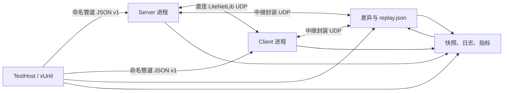

# 联机自动化测试

本分支已经具备不需要鼠标、键盘或人工观察日志的联机验收链路。它会按场景启动隔离的 Survivalcraft 进程：核心场景完成建服、两阶段兼容握手、模组消息、地形同步、断线重连、保存和重载；兼容矩阵验证拒绝、分阶段超时与恢复；会话生命周期场景在 Direct/Relay 上验证四客户端并发加入/重连、实体创建期断线、稳定身份、API 通道晚加入、限流、背压和隔离；中继场景另外启动真实 RelayServer。所有场景都会把可回放的诊断材料写入 `TestResults`。

强类型玩法驱动、Snapshot v2、多客户端拓扑和 legacy 迁移方案见 [TestAutomation v2 设计](TestAutomation-v2-Design.md)。当前已落地 M0 创飞，以及达到完整覆盖契约的会话兼容性、API 模组通道、玩家会话生命周期、use/place/dig、move/look/crouch、terrain streaming/revisions、entity/creature lifecycle/physics、pickable/projectile lifecycle、inventory/container operations、health/damage/respawn、time/weather/lightning、sleep/player-fire、world-fire/explosion events、mount/dismount 和 logic/electricity/moving-blocks 生产链。

## 一键运行

在 Windows PowerShell 中从仓库根目录执行：

```powershell
./scripts/Test-Multiplayer.ps1 -Mode fast
./scripts/Test-Multiplayer.ps1 -Mode trust
./scripts/Test-Multiplayer.ps1 -Mode doctor
./scripts/Test-Multiplayer.ps1 -Mode core
./scripts/Test-Multiplayer.ps1 -Mode compatibility
./scripts/Test-Multiplayer.ps1 -Mode relay
./scripts/Test-Multiplayer.ps1 -Mode v2
./scripts/Test-Multiplayer.ps1 -Mode m1
./scripts/Test-Multiplayer.ps1 -Mode motion
./scripts/Test-Multiplayer.ps1 -Mode streaming
./scripts/Test-Multiplayer.ps1 -Mode entity
./scripts/Test-Multiplayer.ps1 -Mode pickable-projectile
./scripts/Test-Multiplayer.ps1 -Mode inventory-health
./scripts/Test-Multiplayer.ps1 -Mode environment-mechanics
./scripts/Test-Multiplayer.ps1 -Mode mount
./scripts/Test-Multiplayer.ps1 -Mode logic
./scripts/Test-Multiplayer.ps1 -Mode session
./scripts/Test-Multiplayer.ps1 -Mode soak -SoakIterations 10
./scripts/Test-Multiplayer.ps1 -Mode legacy
./scripts/Test-Multiplayer.ps1 -Mode full
```

- `fast`：运行不启动游戏进程的纯协议测试和游戏程序集内生命周期 L0/L1，适合每次 AI 修改后立即执行。
- `trust`：校验 Coverage Contract v2 与生产面库存。报告精确列出 hook、packet、feature、状态和缺口，不输出会掩盖缺口的综合覆盖率百分比。
- `doctor`：构建运行时，以无界面后台实例验证模组加载与控制通道。
- `core`：运行完整双进程核心联机场景，并保存诊断产物。
- `compatibility`：运行协议、API、能力、模组、模组通道和握手超时矩阵，并验证匹配配置可以恢复联机。
- `relay`：运行隐藏 RelayServer 与两个无界面游戏节点，验证中继模组通道、重复帧去重、异常隔离、会话清理和重连。
- `v2-direct` / `v2-relay`：分别运行 TestAutomation v2 的一服两客创飞同步场景。
- `v2`：同一份强类型玩法场景依次通过直连和中继运行；不使用 UI 点击、UDP 文本命令或 Roslyn 脚本。
- `m1-direct` / `m1-relay`：分别运行一服三客 use/place/dig 生产输入路径与生命周期场景；version 3 会额外定向丢弃全部正常 `PlayerDigPacket`，要求请求/确认兜底恢复地形。
- `m1`：同一份 M1 场景依次通过直连和中继运行，覆盖 late join、actor 重连、确定性网络故障、服务端保存重载，以及 `PlayerDigRequestPacket`/`PlayerDigConfirmationPacket` 的完整流量证据，并保存可回放的动作与故障载荷。
- `motion-direct` / `motion-relay`：分别运行一服三客 move/look/setCrouch 生产输入与生命周期场景。
- `motion`：依次运行上述 Direct/Relay 场景，覆盖所有权拒绝、观察者收敛、late join、同身份重连、确定性故障，以及“位置与身体朝向持久、头部视角和蹲伏复位”的保存语义。
- `streaming-direct` / `streaming-relay`：分别运行一服三客的真实区块流送和单调修订场景。
- `streaming`：依次运行 Direct/Relay，覆盖 loadedness 边界、真实移动触发视距、旧快照与重复/乱序包、late join、同身份重连、保存重载和严格双动作回放契约。
- `entity-direct` / `entity-relay`：分别运行一服三客的实体生命周期与生物权威物理场景。
- `entity`：依次运行 Direct/Relay，覆盖真实实体生成和冲量、同 ID 世代替换、墓碑、旧加载包与重复/乱序、late join、同身份重连、保存重载和严格双动作回放契约。
- `pickable-projectile-direct` / `pickable-projectile-relay`：分别运行一服三客的掉落物生命周期、吸引和真实弩箭发射场景。
- `pickable-projectile`：依次运行 Direct/Relay，覆盖服务端角色约束、真实 `ComponentInput -> PlayerAimPacket -> Crossbow -> ProjectilePacket` 路径、观察者瞬态事件去重、单调 pickable revision、陈旧 create 复活哨兵、合法 ID 复用、late join、同身份重连、保存重载和严格三动作回放。
- `inventory-health-direct` / `inventory-health-relay`：分别运行一服三客的库存、容器、伤害、死亡和重生场景。
- `inventory-health`：依次运行 Direct/Relay，覆盖按坐标和 ID 打开真实容器、所有权与距离拒绝、真实熔炉投料/燃烧/产出、move/select/drop/melee/respawn 生产路径、请求 ID 幂等、库存与熔炉独立单调 revision、100% 重复与 50% 重排、观察者、late join、同身份重连、保存重载和严格十四动作回放。
- `environment-mechanics-direct` / `environment-mechanics-relay`：分别运行一服三客的环境时间、降水、雾、雷电、睡眠、唤醒、玩家着火、世界火焰生命周期和爆炸事件场景。
- `environment-mechanics`：依次运行 Direct/Relay，覆盖非创造模式拒绝及同 revision 权威快照纠正客户端乐观时间/天气状态、Playing 会话所有权、伪造权威状态和跨玩家请求拒绝、客户端本地爆炸与伪造爆炸包拒绝、环境/玩家火焰/世界火焰单调 revision、火焰移除墓碑、相关联且有界分块的爆炸格与音效、100% 重复与 50% 重排、观察者、late join、玩家身份稳定但实体世代变化的重连、保存重载和严格十动作回放。late join、重连和重载只恢复当前存在的世界火焰；雷电、爆炸和已移除火焰都不会作为历史事件重放。
- `mount-direct` / `mount-relay`：分别运行一服三客的真实 Boat 骑乘、下马和实体世代场景。
- `mount`：依次运行 Direct/Relay，覆盖 Playing 会话所有权、跨玩家冒用、伪造权威状态、距离与占用校验、骑手/坐骑双向关系、单调 mount revision、目标 lifecycle 世代、100% 重复与 50% 重排、观察者、late join、骑手移除释放坐骑、稳定身份重连、安全下马的保存重载边界和严格七动作回放。
- `logic-direct` / `logic-relay`：分别运行一服三客的九类逻辑方块、电力状态和移动方块/活塞生命周期场景。
- `logic`：依次运行 Direct/Relay，覆盖 Playing 会话、跨玩家冒用、超距、伪造 state 与旧 expected revision 拒绝，请求 ID 幂等，九类逻辑编辑和真实开关交互，单调 logic/electricity/moving revision，moving instance ID/generation/tombstone、相同业务 ID 的无标签集合并发，100% 重复与 50% 重排、观察者、late join 预载对账、稳定身份重连、保存重载和严格十七动作回放。
- `session-direct` / `session-relay`：分别运行一服四客的 typed admission、兼容性拒绝、会话生命周期与 API 模组通道压力场景。
- `session`：依次运行 Direct/Relay，覆盖五类兼容性拒绝、并发加入/重连风暴、latest-session-wins、重复 `PlayerCreatePacket` 幂等、实体创建期断线、晚加入目录、逐会话限流恢复、背压和异常隔离。
- `soak`：运行 L3 随机但可重放的故障轮转。默认按十条高价值场景生成种子固定的 schedule，每轮保存场景种子、故障类别和完整 profile，并对每个隐藏节点的工作集、私有内存、句柄、线程、CPU、样本数与故障待发队列执行预算门禁。`-SoakIterations`、`-SoakTransport`、`-SoakSeed` 和 `-SoakIncludeLoss` 可调整生成计划；`-SoakReplaySchedule PATH` 会原样重放已有 `fault-schedule.json`。
- `legacy`：单独运行全部未分层历史测试，同时输出控制台日志、`legacy-audit.trx` 和 `legacy-audit-summary.json`。门禁按 `legacy-known-failures.json` 的测试全名比较，不按失败数量猜测：任何新增失败、基线测试被改名/漏跑或套件未完整执行都会返回非零；已知失败仍逐项出现在结果中。每个测试另有 5 分钟 hang watchdog，卡死会被终止并留下 Sequence 诊断。若外层编排器在完整 TRX 落盘后意外退出，可运行 `./scripts/Summarize-LegacyAudit.ps1 -ArtifactDirectory <legacy 产物目录>` 恢复同一份 schema v2 严格门禁结论，无需重跑游戏。
- `full`：依次执行 fast、trust、doctor、compatibility、core、relay、M0、地形交互、人物运动、地形流送、实体/生物、掉落物/投射物、库存/生命、环境/睡眠/玩家火焰/世界火焰/爆炸、骑乘、逻辑/电力/移动方块及会话生命周期的直连/中继场景和全部未分层原有测试；同一次调用只构建一次运行时，也不会重复执行 L0/L1。legacy 允许集合不是“全绿”声明，但属于新增回归硬门禁。
- `-UseAngle`：构建 Windows ANGLE 兼容运行时，适合没有完整 OpenGL 驱动的 CI 机器。
- `-NoBuild`：复用已构建的二进制文件。

也可以把 L2 场景当作普通 xUnit 测试运行：

```powershell
dotnet test ./Survivalcraft.Test/Survivalcraft.Test.csproj `
  -c Debug --filter "Layer=L2"
```

## 分层模型

| 层级 | 运行内容 | 是否启动游戏 | 目标反馈时间 |
| --- | --- | --- | --- |
| L0 | 协议编解码、规范化快照、精确差异 | 否 | 秒级以内 |
| L1 | 手动时钟、确定性调度器、模拟网络、产物写入 | 否 | 秒级以内 |
| L2 | 真实进程的兼容矩阵、直连核心、中继和 v2 多客户端玩法场景 | 是（强制无界面） | 按全套场景与机器负载变化 |
| L3 | 可重放故障轮转、资源高水位与长时 soak | 是（强制无界面） | 单轮约 30 秒，完整轮转按机器负载变化 |
| Legacy/full | 历史功能、复现场景和已知失败增量门禁 | 是 | 分钟到更长 |

AI 开发循环应先跑 L0/L1；涉及加载、ECS、网络包或持久化的改动再跑 L2。准备合并时必须通过 fast、trust、doctor、compatibility、core、relay 和受影响玩法场景；L3 由计划任务和风险较高的长时开发运行，full 另外执行 legacy 已知失败增量门禁。这样能够让高频修改尽快失败，同时保留真实进程验收。

## Legacy 基线说明

`Survivalcraft.Testing/Coverage/legacy-known-failures.json` 是受版本控制和 L0/L1 校验的债务清单。每组都必须绑定 Coverage Contract feature、原因和测试全名；标为 `superseded` 时还必须引用该 feature 已声明的 Direct/Relay 替代场景。唯一没有声称替代的是服毒/窒息 UI，它以 `coverage-gap` 绑定到仍为 `planned` 的 `player.progression-vitals`。清单当前最多允许 20 个测试失败，L0 硬编码该数量以阻止失败名单悄悄增长，L1 再用反射保证每个测试仍真实存在。

2026-07-31 的 M8 终审全程无窗口执行全部 140 项：121 项通过、19 项失败，19 项全部命中允许集合，unexpected=0、missing=0；客户端窒息请求历史项本轮恢复，记为 resolved=1。`legacy-audit-summary.json` 使用 schema v2 保存 observed、unexpected、resolved、missing、baselineMatched 与 gatePassed；底层 `dotnet test` 可因已知失败返回 1，但脚本只有在完整执行且无基线外失败时才返回 0。

2026-08-08 合入母仓 `3f3fc8fd` 后的当前审计再次完整执行 140 项：125 项通过、15 项失败，known=15、unexpected=0、resolved=5、missing=0，`baselineMatched=true`、`gatePassed=true`。上游已移除跨网络生物声音包，原声音同步测试因此改为验证服务端本地播放不会篡改客户端状态、客户端能从相同玩法事件本地派生声音；该测试通过，失败允许集合仍保持 20 项上限不变。

这个机制不把 121/140 描述成“全部通过”，也不把已知失败从执行列表移除。已知项恢复通过不会阻断，但会进入 `resolvedKnownFailures`，便于后续确认稳定后缩小清单；任何新失败立即阻断 full。核心联机信心仍来自强类型 Direct/Relay、严格 replay 和 L3，legacy 则负责持续暴露迁移债务与新增回归。

## 运行结构



`GameNodeProcess` 从一份只读构建目录启动多个实例。每个实例都有唯一的 `--instance-id`、端口、命名管道和 `--data-dir`，因此不再为每个角色复制约 49 MiB 的完整运行时，也不会共享世界、设置或存档。新框架和 legacy `GameContext` 的游戏、命令、日志与 Relay UDP 端口统一通过 `UdpPortLeaseAllocator` 分配：它使用独立于系统临时端口的范围、跨 TestHost 进程的独占租约文件和 15 分钟冷却期，并在落租约前实际尝试独占绑定。连续或并行的 AI 测试任务因此不会立即复用刚退出节点的端口，也不会让日志/Relay 抢占尚未启动监听的游戏端口。

所有自动测试中的游戏启动器都强制追加 `--headless`。新框架的 `GameNodeProcess` 和历史测试的 `GameContext` 同时使用 `UseShellExecute=false`、`CreateNoWindow=true`、独立 `--data-dir` 与 `SC_TEST_DISABLE_RESTART=1`；测试中若游戏请求内部重启，只允许原进程退出并由宿主判错，不会丢失 headless 参数后生成不可追踪的窗口进程。因此 `doctor`、L2、L3 和 legacy/full 都不会弹出或抢占前台游戏窗口。L0 还有源码门禁，若 `GameNodeProcess` 丢失上述三个隐藏启动条件，测试会直接失败。测试世界、设置、日志和缓存也不会写入开发者日常游戏目录；中继与中心服务进程同样使用无窗口启动并在用例结束时等待回收。

当前的 `--headless` 是“64×64 不可见窗口 + 跳过绘制提交”，仍然创建图形上下文以满足内容和纹理初始化；它不是完全没有图形设备的纯服务器。因此 Windows 机器仍需可用的 OpenGL ES 或 ANGLE/D3D 环境。CI 使用 `UseAngle=true` 降低对显卡驱动的依赖，但整个测试过程不会显示游戏界面。

弩箭场景仍从真实 `ComponentInput` 注入 Aim。由于 headless 会跳过正常绘制布局，测试适配器只补做生产 `GameWidget` 的 Measure/Arrange 和相机矩阵准备，使屏幕射线验证拥有真实 viewport；它不会直接调用弩或投射物包。若生产 Aim 没有产生明确的 `applied` 事件，场景按截止帧 fail closed，单纯看到输入值不能冒充动作成功。

## 强类型控制协议

游戏内的 `Survivalcraft.TestAutomation` 模组通过本机命名管道提供有版本号、请求 ID、长度前缀和 4 MiB 帧上限的 JSON 协议。核心命令包括：

- 节点：`system.ping`、`node.getStatus`、`node.configure`
- 世界：`world.create`、`world.save`、`world.reload`
- 联机：`network.connect`、`network.startRelayHost`、`network.connectRelay`、`network.getRelayStatus`、`network.disconnect`、`network.setFaults`、`network.configureCompatibility`、`network.getCompatibility`、`network.replayPlayerCreate`
- 模组通道：`network.configureModChannels`、`network.getModChannels`、`network.sendTestModMessage`、`network.runTestModTrafficBurst`、`network.getTestModMessages`、`network.resetTestModMessages`
- 玩家和地形：`player.enterWorld`、`terrain.changeCell`
- v2 玩法：`player.setCreativeFly`、`player.move`、`player.look`、`player.setCrouch`、`player.use`、`player.place`、`player.dig`、`terrain.runRevisionBurst`、`entity.applyImpulse`、`entity.runLifecycleBurst`、`pickable.attract`、`player.fireProjectile`、`pickable.runLifecycleBurst`、`inventory.move`、`inventory.selectSlot`、`inventory.drop`、`inventory.runRevisionBurst`、`player.hit`、`player.requestRespawn`、`health.runRevisionBurst`、`player.mount`、`mechanics.runMountRevisionBurst`、`mechanics.runMountLifecycleBurst`、`mechanics.runWorldFireLifecycleBurst`、`mechanics.triggerExplosion`、`mechanics.probeExplosionAuthority`、`mechanics.forgeWorldFireState`、`logic.edit`、`logic.interact`、`logic.runRevisionBurst`、`logic.runMovingBlockLifecycleBurst`、`logic.runPistonLifecycle`
- v2 夹具：`fixture.player.prepareMotion`、`fixture.player.applyMotion`、`fixture.player.prepareTerrainInteraction`、`fixture.player.applyTerrainInteraction`、`fixture.terrain.prepareRegion`、`fixture.terrain.applyView`、`fixture.entity.prepareLifecycle`、`fixture.pickable.prepareLifecycle`、`fixture.pickable.applyLifecycle`、`fixture.inventory.prepare`、`fixture.inventory.apply`、`fixture.health.prepare`、`fixture.health.apply`、`fixture.health.set`、`fixture.mechanics.prepareMount`、`fixture.mechanics.prepareWorld`、`fixture.logic.prepare`、`fixture.logic.apply`
- 可观测性：`state.getSnapshot`、`state.getSnapshotV2`、`state.getEvents`、`state.resetEvents`
- 能力发现：`system.describe`
- 确定性：`time.setClock`、`time.advanceTicks`

每个游戏命令都被调度到游戏主线程执行，失败会返回结构化错误，而不是靠搜索一行日志判断结果。旧 UDP 文本命令和 Roslyn 脚本仍为历史测试保留；新核心场景不依赖任意脚本执行。

## TestAutomation v2 纵向切片

M0 的首个可运行切片保持 wire protocol v1，并独立发布 Automation API v2 与 Snapshot schema v2。`system.describe` 会在进入世界前返回命令元数据、领域、版本、上限和构建身份；场景缺少必需能力时立即以 `unsupported_capability` 失败。

`CreativeFlyMultiplayerScenario` 使用 `MultiplayerCluster` 启动一台服务端、客户端 A、客户端 B，以及可选的隐藏 RelayServer。客户端 A 调用 `player.setCreativeFly` 时，自动化适配器进入 `ComponentGui.TrySetCreativeFlyEnabled` 生产路径，由现有 `PlayerCreativeFlyPacket` 经过服务端权威校验后广播；场景分别在服务端、发起客户端和观察客户端轮询 Snapshot v2，验证启用与关闭均最终收敛。动作会产生 `queued`、`applied` 或 `rejected` 结构化事件。

`TerrainInteractionMultiplayerScenario` 使用一服三客拓扑，依次执行涂色 use、方块 place 和工具 dig。客户端动作从 `ComponentInput` 的受控输入边界进入 `ComponentPlayer` 与 `ComponentMiner`，再通过现有 `PlayerInteractPacket` / `PlayerDigPacket` 到服务端；服务端从玩家眼位重新计算权威射线，场景不直接发送玩法包或写最终状态。夹具只负责在服务端布置方块与手持物、在客户端同步玩家前置位置。每个动作都检查发起端结构化事件以及服务端、发起端、观察端的 Terrain Snapshot v2 收敛。

生命周期顺序固定为：use 完成后 client-c 首次加入并恢复既有地形；place 在固定种子的 18 ms 延迟、4 ms 抖动、重复包和重排下执行；随后清除故障，client-a 主动断线并以同一玩家身份重连，四个节点必须只有唯一的 PlayerIndex 投影；重连后的 actor 再执行 dig。最后服务端保存并停止世界，重新加载存档、重建直连或中继房间，服务端和重新加入的 client-c 都必须与保存前 Terrain Snapshot v2 完全一致。

该重连测试发现并修复了生产路径中的旧远端 `PlayerData` 残留：观察客户端收到同索引的新 `PlayerAddPacket` 时会清理失效记录，同时把仍活跃的重复 add 作为幂等确认处理。测试不会通过忽略重复玩家投影来掩盖问题。

Terrain Snapshot v2 返回去除动态光照位的稳定方块值、contents、data 和 `isLoaded`。场景必须先确认所有观察节点的目标区块已加载，不能把“区块缺失时读到的 0”误判为空气；这避免权威改单包因客户端区块尚不存在而被正常丢弃。

`PlayerMotionMultiplayerScenario` 同样使用一服三客，但动作全部由新的强类型输入适配器注入 `ComponentInput`，再由 `ComponentPlayer`、`ComponentLocomotion` 和 `PlayerBodyUpdatePacket` 执行及同步。两阶段夹具只建立平坦平台、站位、零视角和非蹲伏前置条件；`player.move` 持续固定输入帧，`player.look` 持续固定视角输入帧，`player.setCrouch` 仅在游戏的站立条件满足时重试 ToggleCrouch，均不直接写动作最终状态。Snapshot v2 的玩家 body 额外暴露可规范化、可容差比较的头部 `lookAngles` 和身体四元数 `rotation`；四元数比较把 `q` 与 `-q` 视为同一朝向。

人物运动生命周期先在固定故障配置下连续执行 move、look、setCrouch，并验证服务端、actor 和 observer 的位置、身体朝向、头部视角与蹲伏收敛；client-c 随后 late join。client-a 断线后必须以原 PlayerIndex 重连，位置与身体朝向保留而头部视角与蹲伏复位；重建夹具后再执行 look/crouch，保存并重载世界，重新连接的 actor 与 observer 必须再次证明持久/瞬时状态边界。五个动作及故障配置会按固定顺序严格回放。

`TerrainStreamingMultiplayerScenario` 从客户端真实 `player.move` 输入开始。无窗口模式不执行 `TerrainUpdater.PrepareForDrawing`，测试适配器只在真实身体位移跨过生产代码的 8 格滞回阈值后补做相机到 `TerrainUpdater.SetUpdateLocation` 的交接；后续 `TerrainViewDistancePacket`、服务端 update location、区块快照与修订包全部沿生产路径运行。场景先证明 actor 看不到而 observer 已加载同一探针区块，再在 100% 复制和 50% 重排下发送三次权威改单及一份旧全量快照，所有初始客户端必须收敛到最高修订且无待处理缺口。随后还验证 late join、稳定身份重连，以及方块值持久但每 Project 内存修订在重载后从 0 重新建立的边界。

Terrain Snapshot v2 因此新增每格 `revision`、`chunkState`，并提供 streaming update locations、ready/allocated/pending/sent chunk 计数和修订窗口指标。重复/旧 revision 与“区块未加载而忽略改单”分别计数，避免把正常视距过滤误当成乱序恢复证据。revision 比较保持显式选择，避免旧场景把 Project 重载后的合法修订重建误判为状态回归。

`EntityCreatureMultiplayerScenario` 在服务端创建真实 Cow，并通过 `ComponentBody.ApplyImpulse` 进入生产物理路径；服务端在 `BehaviorSyncPacket` 中同步带生命周期 revision 的权威位置、速度和旋转，客户端生物由 `NetworkBodyInterpolation` 驱动，避免各端独立模拟漂移。生命周期 burst 对同一 EntityId 执行 remove/add 世代替换，同时为另一实体建立墓碑，再故意晚发旧 `EntityLoadPacket`。在 100% 复制和 50% 重排下，客户端必须保留最新替换实体、拒绝陈旧复活，并暴露 applied/ignored/tombstone 指标。场景随后验证 client-c late join、actor 同身份重连，以及存活实体和替换实体持久、已移除实体不复活的保存重载边界。

Entity Snapshot v2 支持按 ID 投影实体存在性、模板、生物/玩家标志、身体位置/速度/四元数、健康、hitpoints、revision 和 tombstone，并提供生命周期追踪器指标。实体比较器默认比较 revision，身体使用明确容差，四元数同样把 `q` 与 `-q` 视为同一朝向。

`InventoryHealthMultiplayerScenario` 使用有限容量的 Survival 玩家库存和真实箱子。actor 依次通过 `MoveItemPacket`、`ActiveSlotChangePacket` 与 `PlayerDropPacket` 完成移动、选槽和丢弃；观察客户端发送针对 actor 库存的伪造 move 请求，服务端必须按会话所有权拒绝。生命链先让 observer 发送有限但伪造的命中几何并证明目标持续未受伤，再由 actor 用真实近战射线击杀 Cow；actor 死亡后 observer 又冒用其 PlayerIndex 发送 `PlayerRestartPacket`，服务端必须保持 actor 死亡，最后只接受 actor 自己的重生请求。家具锤链使用真实 `FurnitureHammerPacket` 与结构化结果，分别验证未装备、超距、空源、合法但材料错配以及限流拒绝，再在重复/重排下提交一次权威设计。所有变更请求携带稳定 request ID，服务端以每会话有界窗口精确去重；库存、Health、Damage 与家具设计同时受生命周期或单调状态约束。

该场景在 100% 应用层重复和 50% 重排下要求服务端、actor、observer 收敛，并记录旧状态被拒绝的指标；之后验证 client-c late join、actor 同身份重连。保存前另建一个从未死亡的稳定健康实体，避免把尸体清理语义误当成持久化失败；重载后箱子内容、稳定实体健康、玩家身份、家具设计和产出掉落物必须在服务端与重连客户端一致。Inventory、Health 与家具 Snapshot v2 支持精确槽位、生命周期、revision、设计指纹及掉落物内容；十五个动作按角色和顺序严格回放。

`EnvironmentMechanicsMultiplayerScenario` 还把世界火焰与爆炸纳入 mechanics Snapshot v2：火焰记录当前存在性、格坐标、权威 revision、应用/忽略/墓碑指标；Project 内全局单调 revision 与 4096 次变更墓碑窗口共同保证旧 add 不复活且历史内存有界。爆炸记录关联 event ID、已应用格分块与音效计数、重复/过期拒绝和活动窗口。场景以世界火焰 lifecycle burst 和真实 `SubsystemExplosions.AddExplosion` 作为第八、九个生产动作，随后唤醒；late join、同身份重连和保存重载必须只恢复当前火焰基线，不重放爆炸或已删除火焰。

覆盖契约位于 `Survivalcraft.Testing/Coverage/core-multiplayer.json`。当前 22 个 feature 中有 17 个 `covered`、1 个 `partial`、4 个 `planned`；家具锤、会话兼容性、API 模组通道、玩家会话生命周期以及爆炸/世界火焰均具备 Direct、Relay、观察者、权限、late join、重连、定向故障和显式持久化边界证据。仍为 partial/planned 的领域继续按真实缺口保留，不能借用其他场景提升状态。

## 确定性边界

- `ManualClock`、`DeterministicScheduler` 和 `SimulatedNetwork` 用于 L0/L1 的完全确定性验证。
- 游戏内可以显式切换手动时钟并推进固定 tick，适合物理、状态机和包处理的定点测试。
- 核心 L2 场景在加载和 LiteNetLib 传输阶段使用真实时间，因为窗口事件循环和底层传输需要持续轮询；它通过固定世界种子、固定游戏随机计数器、关闭音频和多线程地形更新来降低抖动。
- 生产路径上的网络故障注入器作用于直连和中继的应用层出站帧，可设置固定种子的延迟、抖动、丢包、重复、重排和带宽限制。中继建房/入房控制帧和测试控制管道不经过故障注入，因此即使游戏数据网络异常，测试仍能取回状态与日志。

核心验收默认使用 12 ms 延迟和 3 ms 确定性抖动，不启用丢包。强类型玩法场景默认使用可回放的 18 ms 延迟、4 ms 抖动、100% 应用层复制和 50% 重排，不启用丢包；这样能稳定验证重复/乱序幂等性，同时避免单次动作帧被不可恢复地丢弃。L3 在安全范围内随机化 latency、jitter、reorder、delay 和 bandwidth，同时保持必经的 duplicate/reorder 哨兵；`-SoakIncludeLoss` 另外启用确定性的 1–3% 应用层丢包，用于暴露尚未具备重试语义的真实缺口。

## 核心验收场景

`CoreMultiplayerScenario` 依次验证：

1. 两个隔离实例加载到主菜单；
2. 服务端直接创建固定种子世界并进入游戏；
3. 客户端完成 API/模组清单和通道目录两阶段握手，连接并创建玩家；
4. 客户端消息被服务端处理并回显，确定性重复包只投递一次，服务端广播到达客户端；
5. 模组处理器的主动异常被隔离，后续消息仍可正常收发；
6. 启用可复现网络延迟，在服务端修改一个玻璃方块，客户端观察到完全相同的值；
7. 客户端主动断线，服务端清理会话；原客户端进程重新连接后，玩家、方块和模组通道仍正确；
8. 服务端保存、退出并重新加载世界，第三次连接仍能使用模组通道；
9. 方块跨重载存在，规范化地形快照差异为空。

每一步都有独立超时，不包含固定的“睡几秒然后猜测成功”。等待逻辑轮询结构化状态，通常每 50 ms 检查一次。

## 兼容性矩阵

`CompatibilityMatrixScenario` 在同一对真实进程中依次验证：

1. 协议修订号不一致返回 `ProtocolMismatch`；
2. API 版本不一致返回 `ApiVersionMismatch`；
3. 缺少必要能力返回 `MissingCapabilities`；
4. 客户端多出模组返回 `ExtraClientMod`；
5. 客户端缺少服务端声明的模组通道返回 `MissingClientChannel`；
6. 分别将 `CompatibilityHelloPacket`、`CompatibilityResultPacket`、`ModChannelCatalogPacket`、`ModChannelCatalogResultPacket` 定向黑洞，客户端返回 `HandshakeTimeout` 并清理会话；
7. 分别将 `ConnectPacket`、`SessionAdmissionResultPacket` 定向黑洞，客户端返回 `AdmissionTimeout` 并清理会话；
8. 清除测试覆盖并恢复无故障网络后，匹配清单和通道目录能够完成握手、typed admission 和项目加载。

每个拒绝均断言客户端未加载服务端项目、传输已停止且服务端会话数回到零。结果包含稳定错误码、逐项差异、状态快照和丢包指标。

## 会话与 API 通道生命周期场景

`SessionLifecycleMultiplayerScenario` 使用一服四客，并以同一份步骤在 Direct 与 Relay 上执行：

1. 在选定传输上逐项验证协议、API、能力、额外模组和缺少通道五种拒绝码；
2. 三客户端并发首次加入，typed admission 为每个连接分配唯一 session ID，并在项目未就绪时将依赖 Project 的玩家包放入按 session 隔离、最多 4096 项的有界队列；
3. 重放 `PlayerCreatePacket`，断言重复创建只计数不复制玩家实体；随后验证晚加入客户端目录协商与逐会话消息隔离；
4. 四客户端并发流量触发每对端 128 条/秒限流，其他会话不受牵连；窗口恢复后消息重新可达，故障带宽背压期间待发队列保持有界并最终归零；
5. 在玩家实体创建包被定向丢弃时立即断开客户端，服务端清理半完成生命周期；重新连接后只出现一个稳定身份；
6. 三客户端同时断开并重连，最后让相同稳定身份的新 session 淘汰旧 session，验证 latest-session-wins 与最终零残留会话。

场景产物包含 session admission、玩家 lifecycle 和 mod-channel 的 Snapshot v2 指标。启用 L3 loss 时还会强制执行一次 `PlayerCreatePacket` 100% 丢包哨兵，只有实际观察到 `faultDropped >= 1` 且待发队列归零才允许通过。

## 中继模组通道场景

`RelayModChannelScenario` 使用 `RelayServerProcess` 以 `UseShellExecute=false`、`CreateNoWindow=true` 启动当前构建的真实 RelayServer，然后验证：

1. 服务端在已加载世界上创建房间并取得结构化房间状态；
2. 客户端通过房间码连接，完成相同的核心清单和模组通道目录协商；
3. 客户端到服务端的模组消息经中继回显，服务端广播经中继到达客户端；
4. 客户端出站中继帧以 100% 确定性重复，服务端只投递一次并记录去重指标；
5. 服务端模组处理器抛出异常后会话与通道继续工作；
6. 客户端断线后，服务端中继会话数归零；同一客户端使用原房间码重连后继续发送消息；
7. RelayServer、两个游戏节点的日志、快照、步骤、指标和回放输入统一进入失败产物。

游戏中继主机也会对未完成兼容握手的会话执行 20 秒上限，并通过受限的 host-to-relay 命令让中继断开指定对端，避免静默连接长期占用房间。

## 失败产物与回放

成功和失败都会生成同一套目录：

```text
TestResults/{core-multiplayer,compatibility-matrix,relay-mod-channel,session-lifecycle}-*/
├── outcome.json
├── scenario.json
├── replay.json
├── steps.json
├── metrics.json
├── state.diff.json
├── snapshot-*.json
├── server.log
├── client.log
└── relay.log                 # 仅中继场景
```

v2 场景另外写入 `replay-v2.json`、`topology.json`、`capabilities-*.json`、`actions.json`、`events-*.json`、`assertions.json` 和 `snapshot-*.v2.json`。这些文件保存实际动作角色、命令名、强类型载荷、动作 ID、动作回执、事件阶段、故障配置及各拓扑节点每个检查点的投影快照；成功和失败使用相同格式。快照中的 `queuedPacketsByType`、`faultTransmissionsByType` 与 `faultBytesByType` 提供按生产 packet class 聚合的流量证据，并在每次配置新的故障 profile 时重置。

成功的 v2 场景还必须写出 `attestations.json`。每个动作回执都声明 provenance 与稳定的 production entry，且 queued/terminal 事件必须逐项匹配；`Fixture`、`Observation`、空入口、缺事件或伪造入口都不能通过。TestAutomation 内所有直接 `NetworkManager.Queue` 调用被源码门禁限制在唯一的 `ProductionPathGateway`，并明确分类为 fixture synchronization、production request、authoritative state 或 fault injection。这样可以阻止“测试写了最终状态却声称覆盖生产路径”的虚高。

L3 根目录另外包含 `fault-schedule.json` 和每轮原子更新的 `soak-summary.json`。前者是实际执行计划，后者包含每轮结果、场景 metrics、预算违规、按角色的故障队列峰值、最高流量包型和跨轮次资源高水位；每轮子目录仍保留完整 v2 产物。重放示例：

```powershell
./scripts/Test-Multiplayer.ps1 -Mode soak `
  -SoakReplaySchedule ./TestResults/l3/fault-schedule.json `
  -Artifacts ./TestResults/l3-replay -NoBuild
```

同一个 `replay` 命令会自动识别 `replay-v2.json`，校验场景/wire/API/snapshot 四个版本后，以原种子、传输方式、`actions.json` 中的动作载荷和记录的 `networkFaults` 重新运行；当前支持创飞、terrain-interaction、player-motion、terrain-streaming、entity-creature、pickable-projectile、inventory-health、environment-mechanics、mount、logic 和 session-lifecycle 十一个 v2 场景，`--runtime` 和 `--artifacts` 仍可覆盖。terrain-interaction version 3 除严格的 use/place/dig 三动作外，还重建定向 `PlayerDigPacket` 全丢失 profile，并要求客户端请求和服务端确认计数同时出现；player-motion 回放严格要求五个动作的角色与顺序一致；terrain-streaming 严格要求 client-a 的 `player.move` 后紧接 server 的 `terrain.runRevisionBurst`；entity-creature 严格要求 server 的 `entity.applyImpulse` 后紧接 `entity.runLifecycleBurst`，并要求旧实体加载注入保持启用；pickable-projectile 严格要求 server attraction、client-a 真实 Aim 发射、server stale-create lifecycle burst 三个动作，且陈旧创建注入必须启用；inventory-health 严格要求按坐标打开熔炉、按 ID 打开熔炉、玩家库存越权拒绝、远距容器拒绝、熔炉投料、熔炉加燃料、熔炉 revision burst、箱子 move、select、drop、库存 revision burst、hit、健康 revision burst、respawn，以及最后一次带同 ID 重复注入的家具锤提交，共十五个动作；environment-mechanics 严格要求 time、precipitation、fog、lightning、sleep、environment revision burst、player-fire revision burst、world-fire lifecycle burst、explosion、wake 十个动作，并要求陈旧世界火焰 add 与重复/过期爆炸分块注入保持启用；mount 严格要求 mount、dismount、故障下 mount、revision burst、同 ID lifecycle burst、重连前 remount 和重连后 mount 七个动作，且旧 revision 与旧 lifecycle 注入必须启用；logic 严格要求四个权限/安全探针、九类编辑、真实开关交互、logic revision burst、moving lifecycle burst 和 piston lifecycle 十七个动作，并要求旧 revision、旧 generation 与墓碑注入保持启用；session-lifecycle 回放保持原传输、种子和故障 profile，重新执行全部拒绝、风暴、限流与清理哨兵。

- `steps.json` 给出第一个失败步骤、起止时间和异常。
- `snapshot-*.json` 已排序并规范化浮点数，适合机器比较。
- `state.diff.json` 给出 JSON 路径级差异。
- `replay.json` 保存场景版本、种子、网络参数和原运行时位置。

回放一次已有配置：

```powershell
dotnet run --project ./Survivalcraft.TestHost -- replay `
  ./TestResults/core-multiplayer-20260728-120000 `
  --runtime ./Survivalcraft.Test/bin/Debug/net10.0-windows/win-x64
```

运行时路径可以覆盖，因此从 CI 下载产物后也能在另一台机器复现。

## 添加新场景的约束

1. 优先扩展强类型命令和快照字段，不要给新场景添加 Roslyn 字符串脚本。
2. 断言业务状态，不断言易变化的日志措辞或随机实体 ID。
3. 每个轮询都必须有截止时间，并在异常中附带角色、最后状态和最近日志。
4. 无论成功失败都写产物；输入参数必须进入 `replay.json`。
5. 纯协议 L0/L1 保持平台中立；注册和卸载生命周期 L1 可以引用游戏程序集，但不得启动游戏进程或窗口；L2 才启动真实运行时。
6. 新的基础联机场景应能独立重复运行，并使用唯一端口和数据目录。

## CI

`.github/workflows/multiplayer-tests.yml` 在 Windows 上运行三层门禁：先执行 L0/L1；再校验 Coverage Contract/生产面库存，并用 ANGLE 运行 doctor 与全部 L2；每周计划任务随后执行十场景 L3 直连故障轮转。CI 从根目录 `global.json` 安装确定的 .NET SDK 特性带；L2/L3 无论成功失败都会上传 `TestResults`，L3 证据保留 30 天，便于 AI 或开发者下载后精确重放。

当前远端位于 CNB，而 GitHub Workflow 只有在仓库镜像到 GitHub 后才会自动执行。CNB 支持由组织启用的 Windows 自托管构建节点，启用后可把脚本中的同样命令接入 `.cnb.yml`；在节点尚未配置前不提交一个必然排队或失败的 CNB 任务。测试框架和 PowerShell 入口本身不依赖 GitHub API。参见 [CNB 构建节点文档](https://docs.cnb.cool/zh/build/build-node.html)。

## Autotest 可信度门禁

当前框架把“场景通过”与“场景真的覆盖生产行为”分成两道独立门禁，当前 Automation API 为 v12、多人联机 wire revision 为 13：

- `production-surfaces.json` 对源码发现到的 103 个联机 hook 与 111 个 packet class 做精确库存；新增、删除或改名必须显式更新库存，避免生产面悄悄脱离测试计划。
- `core-multiplayer.json` 使用 Coverage Contract v2。一个 feature 只有同时具备 action、snapshot、production path、Direct、Relay、observer、authority、late join、reconnect、fault、persistence 且没有 open gap 时才能标为 `covered`；当前 22 个 feature 为 17 covered、1 partial、4 planned。家具锤已用独立 typed action 与结构化结果覆盖合法提交、五类拒绝、同 ID 幂等、Direct/Relay、观察者、late join、重连和保存重载，因此提升为 `covered/mutation`。
- Automation API 自 v7 起由 `ActionReceipt` 与动作事件携带 provenance 和 production entry；M6 新增流量 burst、PlayerCreate replay 与会话快照后为 v9，M7 新增容器开启结果、熔炉动作与熔炉快照后为 v10，M8 新增世界火焰 lifecycle、爆炸事件动作及 Snapshot 证据后为 v11，M9 新增家具锤夹具、动作、结构化结果与设计/掉落物投影后为 v12。成功场景在产物落盘时重新构建 `ProductionPathAttestation` 并 fail closed；夹具证据、观察证据、空入口、回执/事件不一致或缺明确 `applied` terminal event 都会把原本的 passed 结果改写为 failed。
- `ProductionPathGateway` 是 TestAutomation 唯一允许直接调用 `NetworkManager.Queue` 的位置。源码哨兵禁止旁路，并要求 fixture、production request、authoritative state、fault injection 这几类 API 都有真实调用点；延迟旧状态注入使用固定游戏帧 settle，避免重排让“旧包”先到而产生伪随机结果。
- `GameNodeProcess` 从控制通道就绪后每 250 ms 旁路采样进程资源。每个 v2 `metrics.json` 都包含各角色的初始/最终/峰值工作集、私有内存、增长量、句柄、线程、CPU 与采样时长；采样失败不会伪装成 0 通过，L3 的 minimum-samples 门禁会拒绝无观测结果。
- `MultiplayerSoakSchedule` 使用稳定 PRNG 生成场景、场景种子及故障 profile，开跑前先持久化。`MultiplayerSoakRunner` 每轮立即原子更新 summary，玩法失败、生产路径证明失败、进程资源超预算或任一节点故障队列超过默认 10000 包都会让 L3 返回非零；门槛不会为迁就失败而自动放宽。第一次完整精确回放据此抓到了生命值每帧广播的生产流量风暴，修复后原九场景计划以相同 SHA-256 在隔离目录 9/9 无窗口重放通过。
- 游戏运行时构建使用 `-m:1`，消除同一 MSBuild 图并行写入 `EntitySystem.dll` 的机器负载相关自锁。该约束只降低构建并发，不改变游戏节点并行运行。

默认 L3 不启用 loss，因为当前强类型动作帧并非全部具备应用层确认/重试；这不是把丢包问题排除在外。`-SoakIncludeLoss` 会生成确定性的 1–3% 丢包计划，失败会保留完整 schedule 和场景证据，作为下一阶段补齐可靠请求语义的输入。
