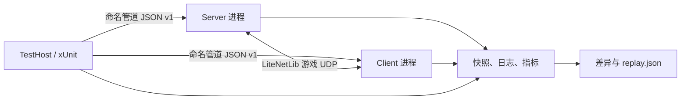

# 联机自动化测试

本分支已经具备一条不需要鼠标、键盘或人工观察日志的核心联机验收链路。它会启动两个真实的 Survivalcraft 进程，完成建服、进入世界、客户端连接、地形同步、断线重连、保存和重载，并把可回放的诊断材料写入 `TestResults`。

## 一键运行

在 Windows PowerShell 中从仓库根目录执行：

```powershell
./scripts/Test-Multiplayer.ps1 -Mode fast
./scripts/Test-Multiplayer.ps1 -Mode doctor
./scripts/Test-Multiplayer.ps1 -Mode core
```

- `fast`：运行不启动游戏的 L0/L1 测试，适合每次 AI 修改后立即执行。
- `doctor`：构建运行时，启动一个隐藏窗口实例，验证模组加载与控制通道。
- `core`：运行完整双进程核心联机场景，并保存诊断产物。
- `full`：依次执行 fast、core 和原有非 L2 测试；原有测试数量多、耗时长，仅在合并前或定时任务中使用。
- `-UseAngle`：构建 Windows ANGLE 兼容运行时，适合没有完整 OpenGL 驱动的 CI 机器。
- `-NoBuild`：复用已构建的二进制文件。

也可以把 L2 场景当作普通 xUnit 测试运行：

```powershell
dotnet test ./Survivalcraft.Test/Survivalcraft.Test.csproj `
  -c Debug --filter "Layer=L2"
```

## 分层模型

| 层级 | 运行内容 | 是否启动游戏 | 目标反馈时间 |
| --- | --- | --- | --- |
| L0 | 协议编解码、规范化快照、精确差异 | 否 | 秒级以内 |
| L1 | 手动时钟、确定性调度器、模拟网络、产物写入 | 否 | 秒级以内 |
| L2 | 两个真实进程的核心纵向联机场景 | 是 | 当前约 12 秒 |
| Legacy/full | 历史功能和复现场景集合 | 是 | 分钟到更长 |

AI 开发循环应先跑 L0/L1；涉及加载、ECS、网络包或持久化的改动再跑 L2；准备合并时跑 full。这样能够让高频修改尽快失败，同时保留真实进程验收。

## 运行结构



`GameNodeProcess` 从一份只读构建目录启动多个实例。每个实例都有唯一的 `--instance-id`、端口、命名管道和 `--data-dir`，因此不再为每个角色复制约 49 MiB 的完整运行时，也不会共享世界、设置或存档。

当前的 `--headless` 是“64×64 不可见窗口 + 跳过绘制提交”，仍然创建图形上下文以满足内容和纹理初始化；它不是完全没有图形设备的纯服务器。因此 Windows 机器仍需可用的 OpenGL ES 或 ANGLE/D3D 环境。CI 使用 `UseAngle=true` 降低对显卡驱动的依赖。

## 强类型控制协议

游戏内的 `Survivalcraft.TestAutomation` 模组通过本机命名管道提供有版本号、请求 ID、长度前缀和 4 MiB 帧上限的 JSON 协议。核心命令包括：

- 节点：`system.ping`、`node.getStatus`、`node.configure`
- 世界：`world.create`、`world.save`、`world.reload`
- 联机：`network.connect`、`network.disconnect`、`network.setFaults`
- 玩家和地形：`player.enterWorld`、`terrain.changeCell`
- 可观测性：`state.getSnapshot`
- 确定性：`time.setClock`、`time.advanceTicks`

每个游戏命令都被调度到游戏主线程执行，失败会返回结构化错误，而不是靠搜索一行日志判断结果。旧 UDP 文本命令和 Roslyn 脚本仍为历史测试保留；新核心场景不依赖任意脚本执行。

## 确定性边界

- `ManualClock`、`DeterministicScheduler` 和 `SimulatedNetwork` 用于 L0/L1 的完全确定性验证。
- 游戏内可以显式切换手动时钟并推进固定 tick，适合物理、状态机和包处理的定点测试。
- 核心 L2 场景在加载和 LiteNetLib 传输阶段使用真实时间，因为窗口事件循环和底层传输需要持续轮询；它通过固定世界种子、固定游戏随机计数器、关闭音频和多线程地形更新来降低抖动。
- 生产路径上的网络故障注入器作用于应用层出站包，可设置固定种子的延迟、抖动、丢包、重复、重排和带宽限制。控制管道不经过故障注入，因此即使游戏网络异常，测试仍能取回状态与日志。

核心验收默认使用 12 ms 延迟和 3 ms 确定性抖动，不启用丢包。高损耗和乱序应作为单独场景添加，避免把“基础功能是否成立”和“极端网络韧性”混成一个不稳定门禁。

## 核心验收场景

`CoreMultiplayerScenario` 依次验证：

1. 两个隔离实例加载到主菜单；
2. 服务端直接创建固定种子世界并进入游戏；
3. 客户端连接并创建玩家，双方达到可玩状态；
4. 启用可复现网络延迟，在服务端修改一个玻璃方块；
5. 客户端快照观察到完全相同的方块值；
6. 客户端主动断线，服务端清理会话；
7. 原客户端进程重新连接，玩家与方块状态仍正确；
8. 服务端保存、退出并重新加载世界，方块仍存在；
9. 规范化地形快照差异必须为空。

每一步都有独立超时，不包含固定的“睡几秒然后猜测成功”。等待逻辑轮询结构化状态，通常每 50 ms 检查一次。

## 失败产物与回放

成功和失败都会生成同一套目录：

```text
TestResults/core-multiplayer-*/
├── outcome.json
├── scenario.json
├── replay.json
├── steps.json
├── metrics.json
├── state.diff.json
├── snapshot-*.json
├── server.log
└── client.log
```

- `steps.json` 给出第一个失败步骤、起止时间和异常。
- `snapshot-*.json` 已排序并规范化浮点数，适合机器比较。
- `state.diff.json` 给出 JSON 路径级差异。
- `replay.json` 保存场景版本、种子、网络参数和原运行时位置。

回放一次已有配置：

```powershell
dotnet run --project ./Survivalcraft.TestHost -- replay `
  ./TestResults/core-multiplayer-20260728-120000 `
  --runtime ./Survivalcraft.Test/bin/Debug/net10.0-windows
```

运行时路径可以覆盖，因此从 CI 下载产物后也能在另一台机器复现。

## 添加新场景的约束

1. 优先扩展强类型命令和快照字段，不要给新场景添加 Roslyn 字符串脚本。
2. 断言业务状态，不断言易变化的日志措辞或随机实体 ID。
3. 每个轮询都必须有截止时间，并在异常中附带角色、最后状态和最近日志。
4. 无论成功失败都写产物；输入参数必须进入 `replay.json`。
5. L0/L1 不引用游戏程序集；L2 才启动真实运行时。
6. 新的基础联机场景应能独立重复运行，并使用唯一端口和数据目录。

## CI

`.github/workflows/multiplayer-tests.yml` 在 Windows 上运行两个门禁：先执行 L0/L1，再用 ANGLE 运行 doctor 和 L2。CI 从根目录 `global.json` 安装确定的 .NET SDK 特性带；L2 无论成功失败都会上传 `TestResults`，便于 AI 或开发者下载诊断。

当前远端位于 CNB，而 GitHub Workflow 只有在仓库镜像到 GitHub 后才会自动执行。CNB 支持由组织启用的 Windows 自托管构建节点，启用后可把脚本中的同样命令接入 `.cnb.yml`；在节点尚未配置前不提交一个必然排队或失败的 CNB 任务。测试框架和 PowerShell 入口本身不依赖 GitHub API。参见 [CNB 构建节点文档](https://docs.cnb.cool/zh/build/build-node.html)。
