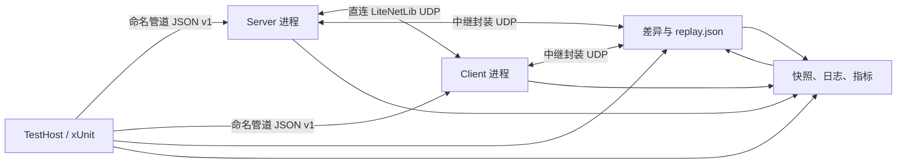

# 联机自动化测试

本分支已经具备不需要鼠标、键盘或人工观察日志的联机验收链路。它会按场景启动隔离的 Survivalcraft 进程：核心场景完成建服、两阶段兼容握手、模组消息、地形同步、断线重连、保存和重载；兼容矩阵验证拒绝、超时与恢复；中继场景另外启动真实 RelayServer，验证房间协商、模组消息、故障注入和同房间重连。所有场景都会把可回放的诊断材料写入 `TestResults`。

强类型玩法驱动、Snapshot v2、多客户端拓扑和 legacy 迁移方案见 [TestAutomation v2 设计](TestAutomation-v2-Design.md)。当前已落地 M0 创飞，以及达到完整覆盖契约的 M1 use/place/dig 与 move/look/crouch 两条生产输入场景。

## 一键运行

在 Windows PowerShell 中从仓库根目录执行：

```powershell
./scripts/Test-Multiplayer.ps1 -Mode fast
./scripts/Test-Multiplayer.ps1 -Mode doctor
./scripts/Test-Multiplayer.ps1 -Mode core
./scripts/Test-Multiplayer.ps1 -Mode compatibility
./scripts/Test-Multiplayer.ps1 -Mode relay
./scripts/Test-Multiplayer.ps1 -Mode v2
./scripts/Test-Multiplayer.ps1 -Mode m1
./scripts/Test-Multiplayer.ps1 -Mode motion
./scripts/Test-Multiplayer.ps1 -Mode full
```

- `fast`：运行不启动游戏进程的纯协议测试和游戏程序集内生命周期 L0/L1，适合每次 AI 修改后立即执行。
- `doctor`：构建运行时，以无界面后台实例验证模组加载与控制通道。
- `core`：运行完整双进程核心联机场景，并保存诊断产物。
- `compatibility`：运行协议、API、能力、模组、模组通道和握手超时矩阵，并验证匹配配置可以恢复联机。
- `relay`：运行隐藏 RelayServer 与两个无界面游戏节点，验证中继模组通道、重复帧去重、异常隔离、会话清理和重连。
- `v2-direct` / `v2-relay`：分别运行 TestAutomation v2 的一服两客创飞同步场景。
- `v2`：同一份强类型玩法场景依次通过直连和中继运行；不使用 UI 点击、UDP 文本命令或 Roslyn 脚本。
- `m1-direct` / `m1-relay`：分别运行一服三客 use/place/dig 生产输入路径与生命周期场景。
- `m1`：同一份 M1 场景依次通过直连和中继运行，覆盖 late join、actor 重连、确定性网络故障、服务端保存重载，并保存可回放的动作与故障载荷。
- `motion-direct` / `motion-relay`：分别运行一服三客 move/look/setCrouch 生产输入与生命周期场景。
- `motion`：依次运行上述 Direct/Relay 场景，覆盖所有权拒绝、观察者收敛、late join、同身份重连、确定性故障，以及“位置与身体朝向持久、头部视角和蹲伏复位”的保存语义。
- `full`：依次执行 fast、doctor、compatibility、core、relay、M0、地形交互和人物运动的直连/中继场景及未分层原有测试；同一次调用只构建一次运行时，也不会重复执行 L0/L1。原有测试数量多、耗时长，而且仍有少量依赖 UI/日志措辞的历史债务，仅用于迁移审计或定时任务，不作为当前稳定门禁。
- `-UseAngle`：构建 Windows ANGLE 兼容运行时，适合没有完整 OpenGL 驱动的 CI 机器。
- `-NoBuild`：复用已构建的二进制文件。

也可以把 L2 场景当作普通 xUnit 测试运行：

```powershell
dotnet test ./Survivalcraft.Test/Survivalcraft.Test.csproj `
  -c Debug --filter "Layer=L2"
```

## 分层模型

| 层级 | 运行内容 | 是否启动游戏 | 目标反馈时间 |
| --- | --- | --- | --- |
| L0 | 协议编解码、规范化快照、精确差异 | 否 | 秒级以内 |
| L1 | 手动时钟、确定性调度器、模拟网络、产物写入 | 否 | 秒级以内 |
| L2 | 真实进程的兼容矩阵、直连核心、中继和 v2 多客户端玩法场景 | 是（强制无界面） | 当前合计约 3 分钟 |
| Legacy/full | 历史功能和复现场景集合 | 是 | 分钟到更长 |

AI 开发循环应先跑 L0/L1；涉及加载、ECS、网络包或持久化的改动再跑 L2。准备合并时必须通过 fast、doctor、compatibility、core 和 relay；full 用于额外观察历史迁移债务。这样能够让高频修改尽快失败，同时保留真实进程验收。

## Legacy 基线说明

本阶段以功能开发前的 `e52073f2` 做过同机、同构建配置、全程无界面的逐项对照：未分层套件共 124 项，107 项通过、17 项失败。失败集合由 PlayerSync 8 项、TerrainStreaming 3 项、CreatureSync 2 项，以及 HealthSync、EnvironmentSync、AnimalPositionSync、WorldReproducibility 各 1 项组成。

功能分支首次 full 审计的 18 项失败中，上述 17 项与基线测试名完全一致；唯一新增项是旧 RelayStartup UI helper 把新世界启动时的瞬时 `GameScreen` 误判为玩家已经进入世界。helper 改为确认主玩家存在后，该真实中心服/中继服用例已定点复跑 1/1 通过。因此当前没有已知的本分支独有 legacy 回归。由于其中若干历史用例受实时模拟影响，后续审计应比较失败测试名与诊断内容，而不要只比较总数；在这些旧债务被逐项迁移或修复前，full 仍可能返回非零。

## 运行结构



`GameNodeProcess` 从一份只读构建目录启动多个实例。每个实例都有唯一的 `--instance-id`、端口、命名管道和 `--data-dir`，因此不再为每个角色复制约 49 MiB 的完整运行时，也不会共享世界、设置或存档。

所有自动测试中的游戏启动器都强制追加 `--headless`。新框架的 `GameNodeProcess` 和历史测试的 `GameContext` 同时使用 `UseShellExecute=false`、`CreateNoWindow=true` 与独立 `--data-dir`，所以 `doctor`、L2 和 legacy/full 都不会弹出或抢占前台游戏窗口。测试世界、设置、日志和缓存也不会写入开发者日常游戏目录；中继与中心服务进程同样使用无窗口启动并在用例结束时等待回收。

当前的 `--headless` 是“64×64 不可见窗口 + 跳过绘制提交”，仍然创建图形上下文以满足内容和纹理初始化；它不是完全没有图形设备的纯服务器。因此 Windows 机器仍需可用的 OpenGL ES 或 ANGLE/D3D 环境。CI 使用 `UseAngle=true` 降低对显卡驱动的依赖，但整个测试过程不会显示游戏界面。

## 强类型控制协议

游戏内的 `Survivalcraft.TestAutomation` 模组通过本机命名管道提供有版本号、请求 ID、长度前缀和 4 MiB 帧上限的 JSON 协议。核心命令包括：

- 节点：`system.ping`、`node.getStatus`、`node.configure`
- 世界：`world.create`、`world.save`、`world.reload`
- 联机：`network.connect`、`network.startRelayHost`、`network.connectRelay`、`network.getRelayStatus`、`network.disconnect`、`network.setFaults`、`network.configureCompatibility`、`network.getCompatibility`
- 模组通道：`network.configureModChannels`、`network.getModChannels`、`network.sendTestModMessage`、`network.getTestModMessages`、`network.resetTestModMessages`
- 玩家和地形：`player.enterWorld`、`terrain.changeCell`
- v2 玩法：`player.setCreativeFly`、`player.move`、`player.look`、`player.setCrouch`、`player.use`、`player.place`、`player.dig`
- v2 夹具：`fixture.player.prepareMotion`、`fixture.player.applyMotion`、`fixture.player.prepareTerrainInteraction`、`fixture.player.applyTerrainInteraction`
- 可观测性：`state.getSnapshot`、`state.getSnapshotV2`、`state.getEvents`、`state.resetEvents`
- 能力发现：`system.describe`
- 确定性：`time.setClock`、`time.advanceTicks`

每个游戏命令都被调度到游戏主线程执行，失败会返回结构化错误，而不是靠搜索一行日志判断结果。旧 UDP 文本命令和 Roslyn 脚本仍为历史测试保留；新核心场景不依赖任意脚本执行。

## TestAutomation v2 纵向切片

M0 的首个可运行切片保持 wire protocol v1，并独立发布 Automation API v2 与 Snapshot schema v2。`system.describe` 会在进入世界前返回命令元数据、领域、版本、上限和构建身份；场景缺少必需能力时立即以 `unsupported_capability` 失败。

`CreativeFlyMultiplayerScenario` 使用 `MultiplayerCluster` 启动一台服务端、客户端 A、客户端 B，以及可选的隐藏 RelayServer。客户端 A 调用 `player.setCreativeFly` 时，自动化适配器进入 `ComponentGui.TrySetCreativeFlyEnabled` 生产路径，由现有 `PlayerCreativeFlyPacket` 经过服务端权威校验后广播；场景分别在服务端、发起客户端和观察客户端轮询 Snapshot v2，验证启用与关闭均最终收敛。动作会产生 `queued`、`applied` 或 `rejected` 结构化事件。

`TerrainInteractionMultiplayerScenario` 使用一服三客拓扑，依次执行涂色 use、方块 place 和工具 dig。客户端动作从 `ComponentInput` 的受控输入边界进入 `ComponentPlayer` 与 `ComponentMiner`，再通过现有 `PlayerInteractPacket` / `PlayerDigPacket` 到服务端；服务端从玩家眼位重新计算权威射线，场景不直接发送玩法包或写最终状态。夹具只负责在服务端布置方块与手持物、在客户端同步玩家前置位置。每个动作都检查发起端结构化事件以及服务端、发起端、观察端的 Terrain Snapshot v2 收敛。

生命周期顺序固定为：use 完成后 client-c 首次加入并恢复既有地形；place 在固定种子的 18 ms 延迟、4 ms 抖动、重复包和重排下执行；随后清除故障，client-a 主动断线并以同一玩家身份重连，四个节点必须只有唯一的 PlayerIndex 投影；重连后的 actor 再执行 dig。最后服务端保存并停止世界，重新加载存档、重建直连或中继房间，服务端和重新加入的 client-c 都必须与保存前 Terrain Snapshot v2 完全一致。

该重连测试发现并修复了生产路径中的旧远端 `PlayerData` 残留：观察客户端收到同索引的新 `PlayerAddPacket` 时会清理失效记录，同时把仍活跃的重复 add 作为幂等确认处理。测试不会通过忽略重复玩家投影来掩盖问题。

Terrain Snapshot v2 返回去除动态光照位的稳定方块值、contents、data 和 `isLoaded`。场景必须先确认所有观察节点的目标区块已加载，不能把“区块缺失时读到的 0”误判为空气；这避免权威改单包因客户端区块尚不存在而被正常丢弃。

`PlayerMotionMultiplayerScenario` 同样使用一服三客，但动作全部由新的强类型输入适配器注入 `ComponentInput`，再由 `ComponentPlayer`、`ComponentLocomotion` 和 `PlayerBodyUpdatePacket` 执行及同步。两阶段夹具只建立平坦平台、站位、零视角和非蹲伏前置条件；`player.move` 持续固定输入帧，`player.look` 持续固定视角输入帧，`player.setCrouch` 仅在游戏的站立条件满足时重试 ToggleCrouch，均不直接写动作最终状态。Snapshot v2 的玩家 body 额外暴露可规范化、可容差比较的头部 `lookAngles` 和身体四元数 `rotation`；四元数比较把 `q` 与 `-q` 视为同一朝向。

人物运动生命周期先在固定故障配置下连续执行 move、look、setCrouch，并验证服务端、actor 和 observer 的位置、身体朝向、头部视角与蹲伏收敛；client-c 随后 late join。client-a 断线后必须以原 PlayerIndex 重连，位置与身体朝向保留而头部视角与蹲伏复位；重建夹具后再执行 look/crouch，保存并重载世界，重新连接的 actor 与 observer 必须再次证明持久/瞬时状态边界。五个动作及故障配置会按固定顺序严格回放。

覆盖契约位于 `Survivalcraft.Testing/Coverage/core-multiplayer.json`。`player.place-dig-use` 和 `player.motion-look-crouch` 均已记录 Direct、Relay、服务端权威、观察者、非法请求、late join、重连、确定性故障和保存重载证据，因此状态为 `covered`；创飞仍保持 `planned`，等待它自己的生命周期矩阵。

## 确定性边界

- `ManualClock`、`DeterministicScheduler` 和 `SimulatedNetwork` 用于 L0/L1 的完全确定性验证。
- 游戏内可以显式切换手动时钟并推进固定 tick，适合物理、状态机和包处理的定点测试。
- 核心 L2 场景在加载和 LiteNetLib 传输阶段使用真实时间，因为窗口事件循环和底层传输需要持续轮询；它通过固定世界种子、固定游戏随机计数器、关闭音频和多线程地形更新来降低抖动。
- 生产路径上的网络故障注入器作用于直连和中继的应用层出站帧，可设置固定种子的延迟、抖动、丢包、重复、重排和带宽限制。中继建房/入房控制帧和测试控制管道不经过故障注入，因此即使游戏数据网络异常，测试仍能取回状态与日志。

核心验收默认使用 12 ms 延迟和 3 ms 确定性抖动，不启用丢包。M1 地形交互与人物运动使用可回放的 18 ms 延迟、4 ms 抖动、100% 应用层复制和 50% 重排，不启用丢包；这样能稳定验证重复/乱序幂等性，同时避免单次动作帧被不可恢复地丢弃。高损耗应进入单独的重试或 soak 场景。

## 核心验收场景

`CoreMultiplayerScenario` 依次验证：

1. 两个隔离实例加载到主菜单；
2. 服务端直接创建固定种子世界并进入游戏；
3. 客户端完成 API/模组清单和通道目录两阶段握手，连接并创建玩家；
4. 客户端消息被服务端处理并回显，确定性重复包只投递一次，服务端广播到达客户端；
5. 模组处理器的主动异常被隔离，后续消息仍可正常收发；
6. 启用可复现网络延迟，在服务端修改一个玻璃方块，客户端观察到完全相同的值；
7. 客户端主动断线，服务端清理会话；原客户端进程重新连接后，玩家、方块和模组通道仍正确；
8. 服务端保存、退出并重新加载世界，第三次连接仍能使用模组通道；
9. 方块跨重载存在，规范化地形快照差异为空。

每一步都有独立超时，不包含固定的“睡几秒然后猜测成功”。等待逻辑轮询结构化状态，通常每 50 ms 检查一次。

## 兼容性矩阵

`CompatibilityMatrixScenario` 在同一对真实进程中依次验证：

1. 协议修订号不一致返回 `ProtocolMismatch`；
2. API 版本不一致返回 `ApiVersionMismatch`；
3. 缺少必要能力返回 `MissingCapabilities`；
4. 客户端多出模组返回 `ExtraClientMod`；
5. 客户端缺少服务端声明的模组通道返回 `MissingClientChannel`；
6. 服务端到客户端的握手结果被确定性丢弃时，客户端在 15 秒后返回 `HandshakeTimeout` 并清理会话；
7. 清除测试覆盖并恢复无故障网络后，匹配清单和通道目录能够完成握手和项目加载。

每个拒绝均断言客户端未加载服务端项目、传输已停止且服务端会话数回到零。结果包含稳定错误码、逐项差异、状态快照和丢包指标。

## 中继模组通道场景

`RelayModChannelScenario` 使用 `RelayServerProcess` 以 `UseShellExecute=false`、`CreateNoWindow=true` 启动当前构建的真实 RelayServer，然后验证：

1. 服务端在已加载世界上创建房间并取得结构化房间状态；
2. 客户端通过房间码连接，完成相同的核心清单和模组通道目录协商；
3. 客户端到服务端的模组消息经中继回显，服务端广播经中继到达客户端；
4. 客户端出站中继帧以 100% 确定性重复，服务端只投递一次并记录去重指标；
5. 服务端模组处理器抛出异常后会话与通道继续工作；
6. 客户端断线后，服务端中继会话数归零；同一客户端使用原房间码重连后继续发送消息；
7. RelayServer、两个游戏节点的日志、快照、步骤、指标和回放输入统一进入失败产物。

游戏中继主机也会对未完成兼容握手的会话执行 20 秒上限，并通过受限的 host-to-relay 命令让中继断开指定对端，避免静默连接长期占用房间。

## 失败产物与回放

成功和失败都会生成同一套目录：

```text
TestResults/{core-multiplayer,compatibility-matrix,relay-mod-channel}-*/
├── outcome.json
├── scenario.json
├── replay.json
├── steps.json
├── metrics.json
├── state.diff.json
├── snapshot-*.json
├── server.log
├── client.log
└── relay.log                 # 仅中继场景
```

v2 场景另外写入 `replay-v2.json`、`topology.json`、`capabilities-*.json`、`actions.json`、`events-*.json`、`assertions.json` 和 `snapshot-*.v2.json`。这些文件保存实际动作角色、命令名、强类型载荷、动作 ID、动作回执、事件阶段、故障配置及各拓扑节点每个检查点的投影快照；成功和失败使用相同格式。

同一个 `replay` 命令会自动识别 `replay-v2.json`，校验场景/wire/API/snapshot 四个版本后，以原种子、传输方式、`actions.json` 中的动作载荷和记录的 `networkFaults` 重新运行；当前支持创飞、terrain-interaction 和 player-motion 三个 v2 场景，`--runtime` 和 `--artifacts` 仍可覆盖。player-motion 回放严格要求 move、look、setCrouch、look、setCrouch 五个动作的角色与顺序一致。

- `steps.json` 给出第一个失败步骤、起止时间和异常。
- `snapshot-*.json` 已排序并规范化浮点数，适合机器比较。
- `state.diff.json` 给出 JSON 路径级差异。
- `replay.json` 保存场景版本、种子、网络参数和原运行时位置。

回放一次已有配置：

```powershell
dotnet run --project ./Survivalcraft.TestHost -- replay `
  ./TestResults/core-multiplayer-20260728-120000 `
  --runtime ./Survivalcraft.Test/bin/Debug/net10.0-windows
```

运行时路径可以覆盖，因此从 CI 下载产物后也能在另一台机器复现。

## 添加新场景的约束

1. 优先扩展强类型命令和快照字段，不要给新场景添加 Roslyn 字符串脚本。
2. 断言业务状态，不断言易变化的日志措辞或随机实体 ID。
3. 每个轮询都必须有截止时间，并在异常中附带角色、最后状态和最近日志。
4. 无论成功失败都写产物；输入参数必须进入 `replay.json`。
5. 纯协议 L0/L1 保持平台中立；注册和卸载生命周期 L1 可以引用游戏程序集，但不得启动游戏进程或窗口；L2 才启动真实运行时。
6. 新的基础联机场景应能独立重复运行，并使用唯一端口和数据目录。

## CI

`.github/workflows/multiplayer-tests.yml` 在 Windows 上运行两个门禁：先执行 L0/L1，再用 ANGLE 运行 doctor，以及包含兼容矩阵、直连核心、中继、M0 创飞、M1 terrain-interaction 和 player-motion Direct/Relay 的全部 L2。CI 从根目录 `global.json` 安装确定的 .NET SDK 特性带；L2 无论成功失败都会上传 `TestResults`，便于 AI 或开发者下载诊断。

当前远端位于 CNB，而 GitHub Workflow 只有在仓库镜像到 GitHub 后才会自动执行。CNB 支持由组织启用的 Windows 自托管构建节点，启用后可把脚本中的同样命令接入 `.cnb.yml`；在节点尚未配置前不提交一个必然排队或失败的 CNB 任务。测试框架和 PowerShell 入口本身不依赖 GitHub API。参见 [CNB 构建节点文档](https://docs.cnb.cool/zh/build/build-node.html)。
