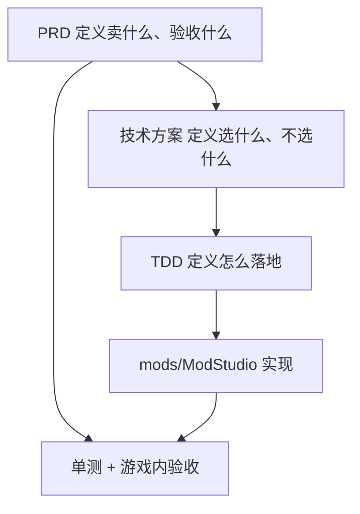

# ModStudio 模组工坊文档索引

生存战争插件版的**模组创作模式**：在游戏内管理模组工作区，编译、打包、安装、卸载，并通过本机 Agent API 让 Cursor / Claude Code 等外部智能体主力或协助开发。

| 项 | 说明 |
|----|------|
| **产品形态** | 工具模组（`.scmod`），不改游戏本体 |
| **发布物** | `ModStudio.scmod`（不发布游戏本体） |
| **本期范围** | **M0** 工作区闭环 + **M1** Agent 工具 API |
| **文档版本** | 1.0.0 |
| **目标 API** | ≥ 1.9.x（编写时宿主为 `1.9.3.1`） |
| **语言** | 简体中文 |

## 文档导航

| 文档 | 读者 | 内容 |
|------|------|------|
| [PRD.md](PRD.md) | 产品 / 验收 / 发行 | 定位、用户、范围、旅程、指标、验收 |
| [Solution.md](Solution.md) | 架构 / 评审 | 选型、分层、安全、风险、与宿主边界 |
| [TDD.md](TDD.md) | 开发 / 联调 / Agent | 数据模型、界面、工具契约、构建测试 |

## 文档关系



## 里程碑摘要

| 里程碑 | 目标 | 本期 |
|--------|------|------|
| **M0** | 工作区 + 模板 + 编译打包 + 安装卸载 + 重载 | **做** |
| **M1** | 本机 HTTP Agent 工具 API（含工具目录） | **做** |
| **M2** | 预览档可卸载 ALC 热循环 | 不做 |
| **M3** | 游戏内对话（OpenAI 兼容） | 不做 |
| **M4** | 一键社区发布 | 不做 |

## 相关宿主文档

- [模组开发入门](../../HowToDevelopAMod.md)
- [modinfo 配置](../../ModInfoConfig.md)
- [架构总览](../../Architecture.md)
- [开发与构建](../../Development.md)
- [UI 系统](../../UiSystem.md)

## 工程位置

实现工程：[`mods/ModStudio/`](../../../mods/ModStudio/)

```bat
dotnet build mods/ModStudio/ModStudio.csproj
dotnet test mods/ModStudio.Tests/ModStudio.Tests.csproj
```
