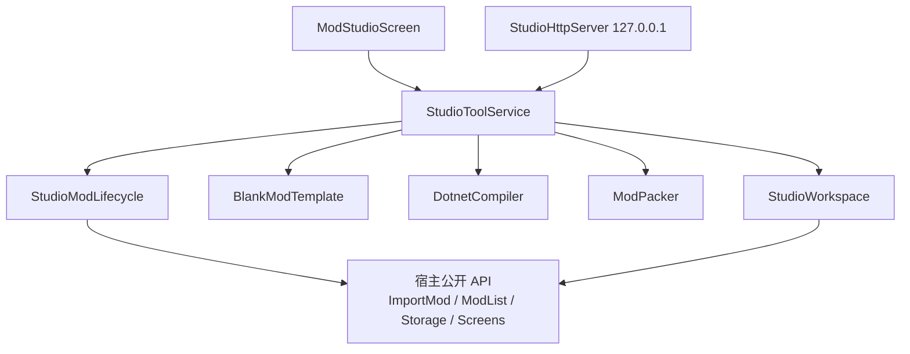
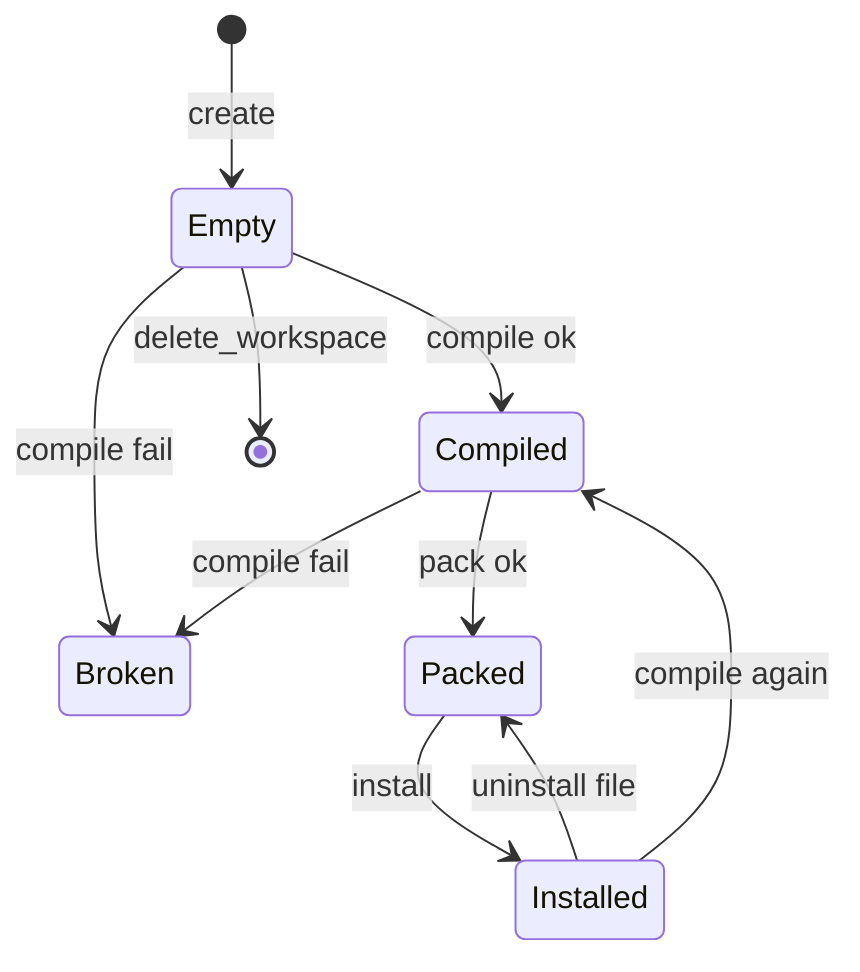

# ModStudio 技术方案

| 字段 | 内容 |
|------|------|
| 文档版本 | 1.0.0 |
| 状态 | 已定稿（按此实现 M0 / M1） |
| 关联需求 | [PRD.md](PRD.md) |
| 关联详细设计 | [TDD.md](TDD.md) |
| 宿主 | Survivalcraft API 1.9.x（编写时 `1.9.3.1`） |
| 发布物 | `ModStudio.scmod`（不发布游戏本体） |

本文回答：**在不改宿主的前提下，如何把「模组创作模式」做成可交付的工具模组，并让外部 Agent 安全地驱动同一套生命周期。**

---

## 1. 目标与约束

### 1.1 要解决的问题

把「模板 → 编译 → `.scmod` → 安装 → 重载 → 卸载」从 IDE 手工作业收拢到游戏进程内，并提供本机工具 API，使 AI Agent 能协助或主力开发。

### 1.2 硬约束

| 约束 | 影响 |
|------|------|
| 以模组交付，不改 `Survivalcraft/` | 不能调用 `internal ModsManager.Reboot()`；不能改 Loading 管线 |
| 程序集进默认 ALC 且不可卸载 | 「运行时编译」对完整档只等于「编完重载」 |
| `FastDebugModEntity` 扫描 `Mods/` 非 scmod 文件 | 源码工作区必须离开 `Mods/` |
| Browser / iOS 无模组 dll | 只承诺桌面 |
| 运行时编译 = 本机任意代码 | API 只绑回环 + Token + 玩家确认重载 |
| 现网社区 Publish 是链接语义 | M1 不做一键发布 |

### 1.3 成功判据（技术侧）

1. 未打开存档即可完成 PRD UC-01 / UC-02。
2. 界面与 HTTP 调用同一 `StudioToolService`，行为一致。
3. 包名、路径沙箱、路由、zip 结构可单测。
4. 卸载 ModStudio 不影响世界存档。

---

## 2. 总体选型

### 2.1 载体：工具模组，而不是改本体

| 方案 | 结论 |
|------|------|
| A. 改宿主加「创作模式」 | 否。污染公开 API，迭代慢 |
| B. 独立外部 CLI + 游戏无 UI | 否。玩家不可达，Agent 也看不到游戏日志闭环 |
| C. 工具模组 + 主菜单 Screen + 本机 HTTP | **采用** |

依据：Tetris3D 已验证 `OnLoadingFinished` + `OnMainMenuScreenCreated` + `ScreensManager.AddScreen`。安装 / 列表 / 存储均为公开 API。

### 2.2 编译：本机 `dotnet`，不内嵌 Roslyn

| 方案 | 结论 |
|------|------|
| 内嵌 Microsoft.CodeAnalysis | 否。体积大，引用解析要自己做 |
| 调用 `dotnet build` | **采用** |
| 只热更 JS（Jint） | 否。不是 C# 模组主力路径 |

代价：依赖本机 .NET 10 SDK。PRD 已把「找不到 SDK」列为可行动错误，而不是静默降级。

### 2.3 重载：公开 API 复刻 Reboot

宿主 `ModsManager.Reboot()` 为 `internal`。公开等价物：

```csharp
SettingsManager.SaveSettings();
foreach (ModEntity mod in ModsManager.ModList.ToArray()) {
    mod.Dispose();
}
ScreensManager.SwitchScreen("Loading");
```

`LoadingScreen.Enter` 会清其它 Screen 并再次 `ModsManager.Initialize()`。  
已知限制与官方 Reboot 相同：**旧 dll 仍留在默认 ALC**。对 M0 可接受。

### 2.4 Agent 面：本机 HTTP + 统一工具，而不是先做 MCP stdio

| 方案 | 结论 |
|------|------|
| 仅游戏内按钮 | 不够 M1 |
| MCP stdio 子进程 | 游戏是 GUI 进程，stdio 对 Cursor 不自然 |
| 本机 HTTP（REST + tools/call） | **采用**。Cursor / 脚本 / 以后的游戏内对话都能打 |
| 监听 0.0.0.0 | 否 |

官方 MCP 适配器可作为 M1 之后的薄客户端，把 HTTP 转 stdio，不进本期。

### 2.5 工作区位置

| 方案 | 结论 |
|------|------|
| `Mods/{name}/` 松散文件 | 否。FastDebug 会吞文件 |
| 仓库 `mods/` | 否。运行时游戏不一定在源码树里 |
| `{DocPath}/ModsStudio/{package}/` | **采用** |

生成工程的 HintPath 指向**当前进程**的 `Survivalcraft.dll` 所在目录，这样玩家发行版与开发版都能编。

---

## 3. 逻辑架构



原则：

- **UI 不直接打 zip / 起进程**，只调工具。
- **HTTP 不复制一套业务**，只做鉴权、路由、JSON。
- **可单测内核**（包名、沙箱、路由、打包）不引用引擎。

### 3.1 分层

| 层 | 职责 | 典型类型 |
|----|------|----------|
| 宿主集成 | Hook、Screen 注册、HTTP 启停 | `ModStudioLoader` |
| 表现 | 列表、详情、日志、Token 展示 | `ModStudioScreen` |
| 应用 | 工具名、参数校验、错误码 | `StudioToolService` |
| 领域 | 工作区、模板、编译、打包、生命周期 | `StudioWorkspace` 等 |
| 适配 | `dotnet`、`HttpListener`、`ZipFile`、`Storage` | Compiler / Server / Packer |

### 3.2 与宿主接触面（只读公开成员）

| API | 用途 |
|-----|------|
| `ModsManager.ImportMod` | 安装 |
| `ModsManager.ModList` / `ModListAll` | 查找已装包、卸载路径 |
| `ModEntity.Dispose` / `ModFilePath` | 重载前释放、删文件 |
| `SettingsManager.SaveSettings` | 重载前落盘 |
| `ScreensManager.AddScreen` / `SwitchScreen` | 界面与重载 |
| `Storage.*` | 工作区与 Mods 目录 |
| `LanguageControl.Get` | 文案 |
| `Dispatcher.Dispatch` | HTTP 线程回主线程 |
| `CommunityContentManager` | **本期不调用** |

禁止：Harmony 补宿主、反射调 `internal`（除非未来宿主主动公开）。

---

## 4. 运行时与数据

### 4.1 目录约定

```
{DocPath}/ModStudio.settings.json     # 端口、Token、开关
{DocPath}/ModsStudio/{package}/       # 工作区
    .scmodstudio.json
    {Assembly}.csproj
    modinfo.json
    AGENTS.md
    Mod/*.cs
    Assets/**
    out/{Assembly}.scmod
{ExternalPath}/Mods/{Assembly}.scmod  # 安装位置（宿主扫描）
```

### 4.2 状态机（单项目）



`Installed` 以磁盘 `Mods/*.scmod` 与 `ModListAll` 为准，不在内存里假装已热加载。

### 4.3 错误模型

稳定 `error.code`（HTTP 与 UI 共用）：

| code | 含义 |
|------|------|
| `invalid_argument` | 缺参、包名非法 |
| `not_found` | 工作区或文件不存在 |
| `already_exists` | 包名冲突 |
| `path_escape` | 路径逃出工作区 |
| `compile_failed` | MSBuild 失败 |
| `sdk_missing` | 找不到 dotnet |
| `forbidden` | 针对受保护包名 |
| `unauthorized` | Token 错 |
| `io_error` | 文件/进程异常 |
| `not_supported` | 平台或未实现 |

---

## 5. 安全设计

1. **网络**：`HttpListener` 前缀仅 `http://127.0.0.1:{port}/`。
2. **鉴权**：`/health` 公开；其余 Bearer Token。Token 不写 Info 日志全文。
3. **沙箱**：`StudioPathGuard` 规范化后必须仍以工作区根为前缀。
4. **保护包**：`survivalcraft`、`fastdebug`、`com.scspm.modstudio` 不可被本工具安装覆盖或卸载。
5. **重载**：默认人工确认。HTTP 需 `confirm=true` 才 `game.reload`。
6. **模板**：无 Harmony、无网络、无读存档。`AGENTS.md` 作为给模型的策略。

不声称「沙箱能阻止已安装模组作恶」——一旦玩家重载，作品 dll 与其它模组同等权限。安全边界是**创作期 API**，不是模组运行时。

---

## 6. 平台策略

| 平台 | M0 UI | M0 编译 | M1 HTTP |
|------|-------|---------|---------|
| Windows | 承诺 | 承诺（PATH 上的 dotnet） | 承诺 |
| Linux | 尽力 | 尽力 | 尽力 |
| Android | 可进界面 | 不承诺 | 默认关 |
| iOS / Browser | 不支持本模组 | — | — |

---

## 7. 风险与缓解（实现向）

| 风险 | 缓解 |
|------|------|
| HttpListener 保留 URL 失败 | 捕获、界面显示错误，M0 不受影响 |
| 编译时文件锁 | 输出到 `bin/Release`，打包拷到 `out/`，避免锁 scmod |
| 重名 `ImportMod` 抛 `FileAlreadyExistsException` | 安装前按包名删旧文件 |
| 生成 HintPath 在换机器后失效 | 设置里展示游戏目录；可重写 csproj 中的 HintPath（M1 `fs.write` 可改） |
| 长日志撑爆 Label | 界面只保留尾部 N 行，完整文本可 `game.log` / 文件 |
| 测试引用游戏程序集过重 | 内核类型不依赖 `Engine` |

---

## 8. 实施路径

1. 内核：包名、路径、打包、路由、工具调度（可先单测）。
2. 工作区 + 模板 + `dotnet` + 生命周期。
3. Screen + 主菜单入口（M0 可玩）。
4. HttpServer + 设置文件（M1）。
5. `dotnet test` + 按 PRD 用例在 Windows 上手工走一遍。

不在本期引入 Roslyn、ALC、聊天、社区上传。
