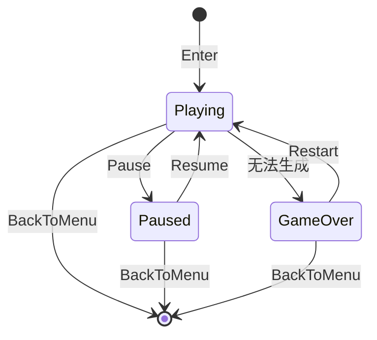

# Tetris3D 模组需求文档（PRD）

| 字段 | 内容 |
|------|------|
| 产品名称 | Tetris3D（俄罗斯方块 · 主菜单版） |
| 文档版本 | 1.0.0 |
| 状态 | 已定稿（可开工） |
| 宿主 | Survivalcraft API（插件版） |
| 发布形态 | `.scmod` 模组（不发布游戏本体） |
| 关联技术方案 | [Solution.md](Solution.md) |
| 关联详细设计 | [TDD.md](TDD.md) |

---

## 1. 背景与目标

### 1.1 背景

生存战争插件版支持通过模组扩展内容与界面。社区需要一个**不依赖生存世界、可在主菜单即玩**的休闲小游戏，用于验证 Screen / ModLoader 集成路径，并为玩家提供轻量娱乐。

### 1.2 产品目标

在插件版主菜单提供功能齐全的经典俄罗斯方块体验，采用伪 3D 立体方块表现，玩家可完整进行一局并返回主菜单。

### 1.3 目标用户

| 角色 | 诉求 |
|------|------|
| 玩家 | 主菜单一键进入、操作清晰、一局可完整结束 |
| 模组作者 / 贡献者 | 需求可验收、技术可落地、里程碑可快速闭环 |
| 发行方 | 只发 `.scmod`，版本与 API 声明清晰 |

### 1.4 成功指标（首版）

| 指标 | 达标标准 |
|------|----------|
| 可达性 | 安装模组后主菜单可见入口，点击进入小游戏 |
| 可玩性 | 能完成至少一局：生成 → 操作 → 消行 → Game Over 或主动退出 |
| 可退出 | 任意时刻可返回主菜单，无卡死、无残留世界状态 |
| 规则完整度 | 满足 §4 功能清单中 M2 及以前全部条目 |
| 发布就绪 | 产出可安装的 `.scmod`，通过 §7 验收用例 |

---

## 2. 范围

### 2.1 In Scope（首版包含）

- 主菜单入口按钮（右下角栏或等价可见位置）
- 独立全屏 `Screen` 内的俄罗斯方块
- 经典规则：七种方块、7-bag、Next≥3、Hold、Ghost、软降/硬降、锁定延迟、SRS 墙踢、消行、等级加速、标准计分
- 暂停 / Game Over / 重新开始
- 本机最高分持久化
- 键鼠 + 触屏基础操作
- 音效与简易 BGM/静音开关
- 中英文案
- 伪 3D（立体感）方块绘制
- 本地测试与 `.scmod` 发布流程说明（见 TDD）

### 2.2 Out of Scope（首版明确不做）

| 排除项 | 说明 |
|--------|------|
| 生存世界内机台 / 方块实体 | 不进入 `Project` / ECS |
| 修改方块表 / 合成表 / Database | 无 `.csv` / `.xdb` / `.cr` |
| 多人联机俄罗斯方块 | 单机本地 |
| T-Spin / Perfect Clear 等高级计分判定 | 降低实现与验收复杂度 |
| Browser 平台 | 宿主不支持模组 |
| 发布整包游戏 | 仅发布模组 |

### 2.3 模组元数据约定

| 字段 | 值 |
|------|------|
| `PackageName` | `com.scspm.tetris3d`（实现时可微调，须全局唯一） |
| `GameplayImpactLevel` | `Cosmetic` |
| `NonPersistentMod` | `true` |
| `LoadOrder` | `10000`～`100000`（辅助类，靠后加载） |

---

## 3. 用户故事与主路径

### 3.1 主路径（Happy Path）


### 3.2 用户故事

| ID | 作为… | 我想要… | 以便… |
|----|--------|---------|--------|
| US-01 | 玩家 | 在主菜单看到入口 | 无需进世界即可打开小游戏 |
| US-02 | 玩家 | 用键盘或触屏控制方块 | 正常游玩 |
| US-03 | 玩家 | 看到 Next / Hold / Ghost / 分数 / 等级 | 做出策略决策 |
| US-04 | 玩家 | 暂停与重新开始 | 中断后继续或重来 |
| US-05 | 玩家 | 查看并刷新本机最高分 | 获得重复游玩动力 |
| US-06 | 玩家 | 一键返回主菜单 | 继续玩生存战争 |
| US-07 | 玩家 | 开关音效 | 在安静环境游玩 |
| US-08 | 作者 | 按里程碑增量交付 | 快速验证与闭环 |

---

## 4. 功能需求

说明：每条含 **优先级**（P0 必须 / P1 应有）与 **验收标准**。里程碑映射见 §6。

### 4.1 入口与导航

| ID | 需求 | 优先级 | 里程碑 | 验收标准 |
|----|------|--------|--------|----------|
| FR-01 | 主菜单显示「俄罗斯方块」入口按钮 | P0 | M0 | Given 模组已启用，When 进入主菜单，Then 可见可点入口 |
| FR-02 | 点击入口进入小游戏 Screen | P0 | M0 | When 点击入口，Then 切换到 Tetris Screen，主菜单不再接收输入 |
| FR-03 | 返回主菜单 | P0 | M0 | When 点返回或系统 Back，Then 回到 `MainMenu`，可再次进入 |
| FR-04 | Screen 名称稳定可切换 | P0 | M0 | `ScreensManager` 中注册名为 `Tetris3D`（或文档与实现一致的唯一名） |

### 4.2 核心玩法

| ID | 需求 | 优先级 | 里程碑 | 验收标准 |
|----|------|--------|--------|----------|
| FR-10 | 场地 10 列 × 20 可见行（含隐藏生成行实现细节见 TDD） | P0 | M1 | 场地宽度恒为 10；可见高度 20 |
| FR-11 | 七种方块 I/O/T/L/J/S/Z | P0 | M1 | 每种均可生成且形状正确 |
| FR-12 | 自然下落 | P0 | M1 | 方块按重力间隔下移一格 |
| FR-13 | 左右移动与旋转 | P0 | M1 | 合法位置可移动/旋转；非法则拒绝 |
| FR-14 | 碰撞与落地锁定 | P0 | M1 | 触底或压块后锁定进场；锁定后生成下一块 |
| FR-15 | 消行 | P0 | M1 | 满行消除，上方行下落；支持 1～4 行同时消 |
| FR-16 | Game Over | P0 | M1 | 新块无法在生成位放置时结束本局并提示 |

### 4.3 规则齐全（经典增强）

| ID | 需求 | 优先级 | 里程碑 | 验收标准 |
|----|------|--------|--------|----------|
| FR-20 | 7-bag 随机 | P0 | M2 | 每 7 块内七种各出现一次，再开新袋 |
| FR-21 | Next 队列 ≥ 3 | P0 | M2 | UI 至少显示接下来 3 种方块 |
| FR-22 | Hold | P0 | M2 | 可交换当前与 Hold；同块周期内不可连续 Hold（标准一次限制） |
| FR-23 | Ghost | P0 | M2 | 显示硬降落点预览（半透明） |
| FR-24 | 软降 | P0 | M2 | 按住软降加速下落；可给软降分（见计分表） |
| FR-25 | 硬降 | P0 | M2 | 立即落至 Ghost 位置并锁定；给硬降分 |
| FR-26 | 锁定延迟 Lock Delay | P0 | M2 | 触地后在延迟内可移动/旋转重置延迟（有上限次数，见 TDD） |
| FR-27 | 旋转系统 SRS（简化完整墙踢表） | P0 | M2 | I 与非 I 使用 SRS kick；无法踢则旋转失败 |
| FR-28 | 标准消行计分 | P0 | M2 | Single/Double/Triple/Tetris 按 §4.5 计分 |
| FR-29 | 等级与加速 | P0 | M2 | 每清除 10 行升 1 级；重力随等级加快 |

### 4.4 对局流程与 UI 状态

| ID | 需求 | 优先级 | 里程碑 | 验收标准 |
|----|------|--------|--------|----------|
| FR-30 | 进入 Screen 自动新开一局 | P0 | M1 | `Enter` 后场地清空并生成首块 |
| FR-31 | 暂停 / 继续 | P0 | M2 | 暂停时逻辑冻结；继续后恢复；暂停时可返回主菜单 |
| FR-32 | 重新开始 | P0 | M2 | 任意可玩或结束状态可重置分数与场地 |
| FR-33 | 显示分数、等级、消行数 | P0 | M2 | 数值与逻辑一致，实时刷新 |
| FR-34 | Game Over 面板 | P0 | M2 | 显示本局分、是否新纪录；提供重新开始 / 返回 |

### 4.5 计分规则（首版锁定）

采用 Guideline 风格简化表（**不做 T-Spin / PC / B2B**）：

| 事件 | 分数 |
|------|------|
| Soft Drop | 每下移 1 格 +1 |
| Hard Drop | 每下移 1 格 +2 |
| Single | 100 × Level |
| Double | 300 × Level |
| Triple | 500 × Level |
| Tetris（四消） | 800 × Level |

- Level 从 **1** 起算。
- 消行计分在清除结算时按**当前 Level** 计算，再结算行数并可能升级。

### 4.6 持久化与设置

| ID | 需求 | 优先级 | 里程碑 | 验收标准 |
|----|------|--------|--------|----------|
| FR-40 | 本机最高分 | P0 | M3 | 超过历史最高时更新；重启游戏后仍保留 |
| FR-41 | 音效开关 | P1 | M3 | 可关闭移动/旋转/锁定/消行/结束音效 |
| FR-42 | 静音后无音频播放 | P1 | M3 | 开关关闭时相关音频不触发 |

### 4.7 输入

| ID | 需求 | 优先级 | 里程碑 | 验收标准 |
|----|------|--------|--------|----------|
| FR-50 | 键盘默认键位 | P0 | M1/M2 | 见下表；可在 TDD 中实现为常量，首版不要求改键 UI |
| FR-51 | 触屏虚拟键或分区点击 | P1 | M3 | 移动端可完成移动/旋转/软硬降/Hold/暂停 |
| FR-52 | 输入在暂停与 Game Over 时正确屏蔽 | P0 | M2 | 暂停时仅响应继续/返回/重开；结束时不移动方块 |

**默认键位（桌面）**

| 操作 | 键 |
|------|-----|
| 左 / 右 | ← / → 或 A / D |
| 软降 | ↓ 或 S |
| 硬降 | Space |
| 旋转 CW | ↑ 或 X |
| 旋转 CCW | Z |
| Hold | C 或 Shift |
| 暂停 | P 或 Esc |
| 返回 | 界面按钮；移动端 Back |

### 4.8 表现与本地化

| ID | 需求 | 优先级 | 里程碑 | 验收标准 |
|----|------|--------|--------|----------|
| FR-60 | 伪 3D 立体方块 | P0 | M3 | 每个 cell 有立体感（斜面/厚度或 3D 图元），七色可区分 |
| FR-61 | Ghost 视觉弱于实体块 | P0 | M3 | 明显可辨且不遮挡判断 |
| FR-62 | 中英文案 | P1 | M3 | 切换游戏语言后按钮与状态文案正确（至少 zh-CN / en-US） |
| FR-63 | 菜单 BGM 策略 | P1 | M3 | 进入小游戏保持菜单混音或模组自管 BGM，离开后无异常静音 |

### 4.9 非功能需求

| ID | 需求 | 优先级 | 验收标准 |
|----|------|--------|----------|
| NFR-01 | 不依赖世界 `Project` | P0 | 仅主菜单路径可玩；未开存档也能进 |
| NFR-02 | 目标平台 | P0 | Windows / Linux 必测；Android 触屏可用；不宣称支持 Browser |
| NFR-03 | 性能 | P0 | 桌面默认画质下小游戏 Screen 流畅，无持续性卡顿（主观可玩） |
| NFR-04 | 兼容 | P0 | `ApiVersion` 声明与构建所用 NuGet 一致；低版本给出合理失败而非静默损坏存档 |
| NFR-05 | 安全模式 | P1 | 安全模式下行为遵循宿主；不导致启动崩溃 |
| NFR-06 | 与其它模组共存 | P1 | 仅向 `rightBottomBar` 追加按钮，不删除原有子项 |

---

## 5. 信息架构与界面草图

### 5.1 界面分区

```
+--------------------------------------------------+
|  [返回]     俄罗斯方块              [暂停] [静音] |
+----------+-------------------+-------------------+
|  HOLD    |                   |  NEXT             |
|  (块)    |     游戏场地       |  (3+)             |
|          |     10 x 20       |                   |
|          |     伪3D 绘制      |  分数 / 等级 / 行  |
|          |                   |  最高分            |
+----------+-------------------+-------------------+
|           （触屏时：虚拟方向与功能键）              |
+--------------------------------------------------+
```

### 5.2 状态机



---

## 6. 快速闭环里程碑

原则：**每个里程碑可安装、可演示、可验收**；未完成项不阻塞下一里程碑的代码分支合并到可玩主干（建议主干始终可进 Screen）。

| 里程碑 | 交付物 | 必须满足的需求 ID | 演示标准 | 预计闭环 |
|--------|--------|-------------------|----------|----------|
| **M0** 空壳进出 | 模组可加载；注册 Screen；主菜单按钮；返回 | FR-01～04 | 进/出 Screen 各 1 次 | 0.5 人日 |
| **M1** 可玩核心 | 下落、移动、旋转、消行、Game Over | FR-10～16, FR-30, FR-50（基础键） | 手动消至少 1 行并死亡 | 1～2 人日 |
| **M2** 规则齐全 | 7-bag、Next、Hold、Ghost、软硬降、锁延、SRS、计分、等级、暂停重开 | FR-20～29, FR-31～34, FR-52 | 一局使用 Hold+硬降+四消 | 2～3 人日 |
| **M3** 表现打磨 | 伪 3D、最高分、音效开关、触屏、中英 | FR-40～42, FR-51, FR-60～63 | 重启后最高分仍在；手机可玩 | 1～2 人日 |
| **M4** 发布 | `.scmod`、版本号、全量 §7 用例通过 | 全部 P0 + 已承诺 P1 | 干净 Mods 目录仅装本模组通过验收 | 0.5 人日 |

**总控**：首版建议 5～8 人日内完成 M0→M4。

---

## 7. 验收测试用例

测试环境：插件版 Windows（必测）；有条件加 Android。  
安装：将构建产物 `.scmod` 放入 `Mods/`，重启游戏。详见 [TDD §8](TDD.md#8-本地测试与调试)。

| 用例 ID | 步骤 | 期望 | 对应 |
|---------|------|------|------|
| TC-01 | 启用模组进入主菜单 | 见入口按钮 | FR-01 |
| TC-02 | 点击入口 | 进入小游戏 | FR-02 |
| TC-03 | 点返回 | 回主菜单且可再进 | FR-03 |
| TC-04 | 移动/旋转/软降 | 方块响应且不出界非法重叠 | FR-12～14 |
| TC-05 | 堆满一行 | 行消除，上方下沉 | FR-15 |
| TC-06 | 封顶 | 进入结束状态并有提示；M2 起须完整 Game Over 面板 | FR-16（M1）；FR-34（M2） |
| TC-07 | 连续取 7 块 | 七种各一（目视或调试显示） | FR-20 |
| TC-08 | Hold 两次同块周期 | 第二次 Hold 无效直至落地换块 | FR-22 |
| TC-09 | 有空洞时看 Ghost | Ghost 在硬降落点 | FR-23 |
| TC-10 | 硬降 | 立即锁定并计硬降分 | FR-25, FR-28 |
| TC-11 | 触地扭动 | 锁延内可移动；超时锁定 | FR-26 |
| TC-12 | 四消 | 分数按 800×Level 增加 | FR-28 |
| TC-13 | 清 10 行 | Level +1，下落变快 | FR-29 |
| TC-14 | 暂停中按移动键 | 方块不动 | FR-31, FR-52 |
| TC-15 | 破纪录后重启游戏再进 | 最高分保持 | FR-40 |
| TC-16 | 关闭音效再消行 | 无消行音 | FR-41～42 |
| TC-17 | （Android）触屏完成一局 | 可玩通操作 | FR-51 |
| TC-18 | 切换英文 | 关键文案为英文 | FR-62 |
| TC-19 | 未开任何存档，仅主菜单进小游戏 | 正常可玩 | NFR-01 |
| TC-20 | 与另一模组同时启用 | 双方按钮均在或互不删除 | NFR-06 |

**M4 出门标准**：TC-01～TC-16、TC-19 全部通过；TC-17/18/20 按承诺平台执行。

---

## 8. 风险与依赖

| 风险 | 影响 | 缓解 |
|------|------|------|
| SRS 踢墙表实现错误 | 手感差 / 卡死感 | TDD 提供表；M2 用固定用例测 I/T 墙踢 |
| 主菜单按钮点击难挂接 | M0 阻塞 | TDD 给出字段保存 + `Update` 检测 `IsClicked` 模式 |
| 伪 3D 耗时超预期 | M3 延期 | 允许先等距 2.5D 方块，仍满足 FR-60 |
| API 版本漂移 | 加载失败 | `modinfo` 与 NuGet 同步；文档标注最低 API |

**外部依赖**：Survivalcraft API NuGet、示例模组工程模板、宿主 `ScreensManager` / `ModLoader` 钩子。

---

## 9. 发布与运营（模组侧）

1. 构建 `.scmod`（见 TDD）。
2. 发布页注明：适配 API 版本、安装路径、键位、已知问题。
3. 玩家安装到 `Mods/`，无需更换游戏本体。
4. 问题反馈：优先模组 Issue；确认宿主 Bug 再转 API 仓库。

---

## 10. 修订记录

| 版本 | 日期 | 说明 |
|------|------|------|
| 1.0.0 | 2026-09-20 | 首版定稿：菜单版、经典规则、伪 3D、快速闭环 M0–M4 |
