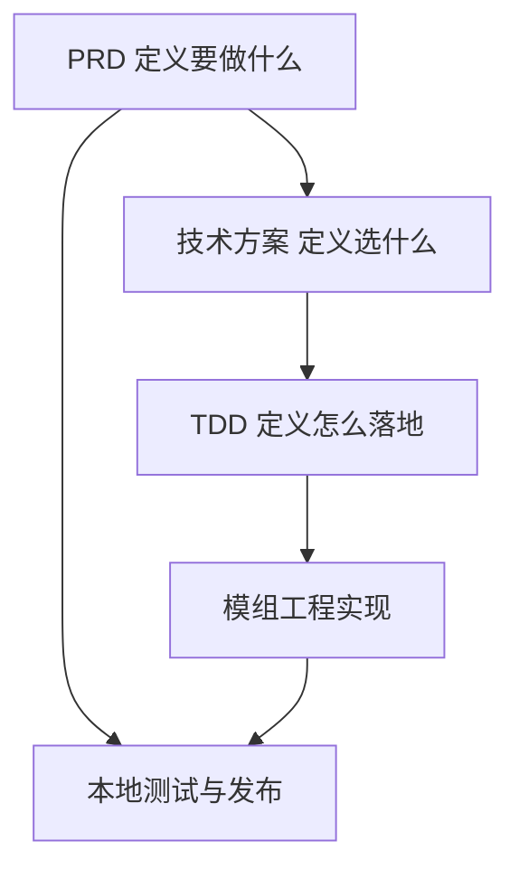

# Tetris3D 模组文档索引

面向生存战争插件版（Survivalcraft API）的主菜单《俄罗斯方块》小游戏模组。  
**文档先行**：本文档集可独立于模组源码仓库使用；实现时另建模组工程并引用此处。

| 项 | 说明 |
|----|------|
| **模组形态** | 主菜单入口 + 独立 `Screen`，不进入生存世界 |
| **发布物** | `.scmod` 模组包（不发布游戏本体） |
| **首版表现** | 经典规则 + 伪 3D / 立体方块绘制 |
| **文档版本** | 1.0.0 |
| **目标 API** | ≥ 1.9.x（编写时宿主为 `1.9.3.1`） |
| **语言** | 简体中文 |

## 文档导航

| 文档 | 读者 | 内容 |
|------|------|------|
| [PRD.md](PRD.md) | 产品 / 验收 / 作者 | 目标、范围、功能、里程碑、验收用例 |
| [Solution.md](Solution.md) | 架构 / 评审 | 选型、分层、接触面、风险与实施路径 |
| [TDD.md](TDD.md) | 开发 / 联调 | 架构、宿主集成、规则数值、构建测试发布 |

## 文档关系

## 快速闭环里程碑（摘要）

| 里程碑 | 目标 | 详情 |
|--------|------|------|
| **M0** | 空 Screen 进出 | [PRD §6](PRD.md#6-快速闭环里程碑) |
| **M1** | 可玩核心 | 下落 / 旋转 / 消行 |
| **M2** | 规则齐全 | Hold / Ghost / Next / 计分 / 等级 |
| **M3** | 表现打磨 | 伪 3D、音效、最高分、触屏 |
| **M4** | 打包发布 | `.scmod` + 全量验收 |

## 相关宿主文档

- [模组开发入门](../../HowToDevelopAMod.md)
- [modinfo 配置](../../ModInfoConfig.md)
- [UI 系统](../../UiSystem.md)
- [架构总览](../../Architecture.md)
- [开发与构建](../../Development.md)

## 示例模组工程起点

实现工程在本仓库 [`mods/Tetris3D/`](../../mods/Tetris3D/)。构建：`dotnet build mods/Tetris3D/Tetris3D.csproj`。
