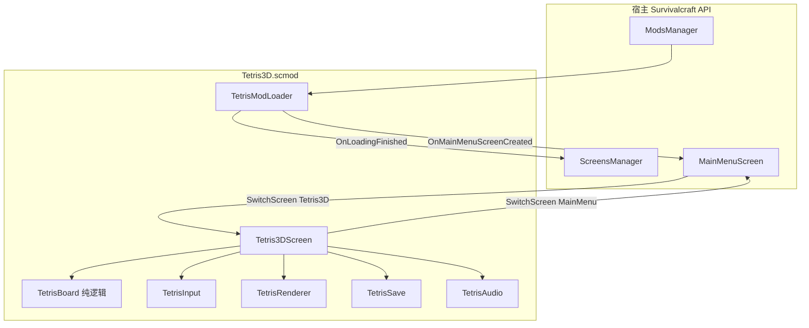
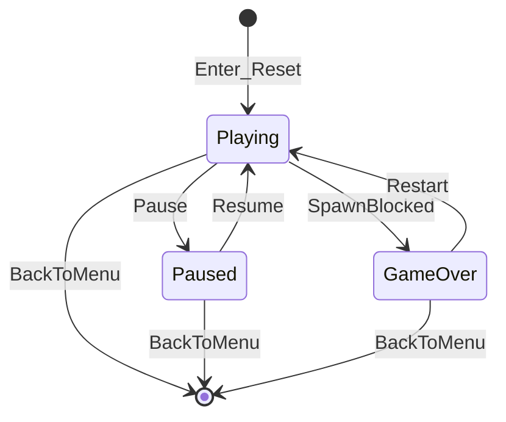

# Tetris3D 模组技术方案

| 字段 | 内容 |
|------|------|
| 文档版本 | 1.0.0 |
| 状态 | 已定稿（可按此开工） |
| 关联需求 | [PRD.md](PRD.md) |
| 关联详细设计 | [TDD.md](TDD.md) |
| 宿主 | Survivalcraft API 1.9.x（编写时 `1.9.3.1`） |
| 发布物 | `.scmod`（不发布游戏本体） |

本文回答：**在插件版约束下，用什么方案做成功能齐全、可快速闭环的主菜单俄罗斯方块**。  
类名、数值、Hook 骨架以 [TDD.md](TDD.md) 为准；需求与验收以 [PRD.md](PRD.md) 为准。

---

## 1. 方案目标与约束

### 1.1 要解决的问题

在生存战争插件版中增加一款**不依赖生存世界**的休闲小游戏：玩家从主菜单进入，完整体验一局经典俄罗斯方块（含伪 3D 表现），再返回主菜单。产物只发模组包。

### 1.2 硬约束

| 约束 | 影响 |
|------|------|
| 宿主是模组运行时，不是独立引擎工程 | 必须走 `ModLoader` + `ScreensManager`，不能改本体启动链 |
| Browser 不支持模组；iOS 不支持模组 dll | 首版只承诺 Windows / Linux，Android 触屏跟进 |
| 不得写入世界存档 | `NonPersistentMod = true`，持久化只用模组私有文件 |
| 快速闭环 | 架构必须允许 M0 空壳即可演示，再逐层加规则与表现 |
| 功能齐全但可控 | 采用 Guideline 经典规则；不做 T-Spin / 联机 / 世界内机台 |

### 1.3 成功判据（技术侧）

1. 未打开任何存档也能从主菜单进入并游玩。
2. 逻辑层可脱离 UI 单测（消行、7-bag、Hold、计分）。
3. 每个里程碑都能打出可安装的 `.scmod` 并重启验收。
4. 卸载模组不影响既有世界。

---

## 2. 总体方案选型

### 2.1 载体：独立 Screen，而不是世界内子系统

| 方案 | 结论 |
|------|------|
| A. 主菜单 `Screen` + 自管 Update/Draw | **采用**。与生存玩法解耦，M0 即可进出 |
| B. 世界内方块机台 / 实体 | 否。依赖 `Project`、存档、方块表，违背 Out of Scope |
| C. 主菜单 Dialog 内嵌 | 否。Dialog 适合弹层，不适合完整对局与返回栈 |

**决策**：注册全屏 `Tetris3DScreen`，名称为 `"Tetris3D"`，用 `ScreensManager.SwitchScreen` 与 `"MainMenu"` 互切。

### 2.2 规则：Guideline 经典集，旋转锁定 SRS

| 方案 | 结论 |
|------|------|
| 简化旋转（无踢墙） | 否。贴墙手感差，无法称为功能齐全 |
| 完整 Guideline + T-Spin / B2B / PC | 否。验收成本高，阻塞闭环 |
| SRS + 标准消行计分 + 等级加速 | **采用** |

**决策**：七种方块、7-bag、Next≥3、Hold、Ghost、软/硬降、500ms 锁延（最多重置 15 次）、每 10 行升级。计分见 PRD §4.5。

### 2.3 表现：伪 3D 批绘，而不是世界体素

| 方案 | 结论 |
|------|------|
| 世界里真摆方块 | 否。必须开存档，且与菜单版冲突 |
| 纯 2D 色块 | 仅作 M1 过渡；不满足 FR-60 |
| 每个 cell 画扁立方体（2D 批绘模拟厚度，或 `PrimitivesRenderer3D` 单位立方） | **采用** |

**决策**：M1 用矩形占位跑通规则；M3 换成伪 3D。cell 数 ≤ 10×22+4，批绘即可满足性能。

### 2.4 工程：独立模组仓库 + NuGet 引用 API

| 方案 | 结论 |
|------|------|
| 改本仓库 `Survivalcraft/` | 否。那是发游戏，不是发模组 |
| 独立模组工程，引用 `SurvivalcraftAPI.Survivalcraft` | **采用** |
| Harmony Patch 宿主 | 首版不需要 |

**决策**：从 [SurvivalcraftTemplateModForAPI](https://gitee.com/SC-SPM/SurvivalcraftTemplateModForAPI) 起步；本仓库只保留文档。

---

## 3. 系统架构

### 3.1 逻辑分层

| 层 | 模块 | 职责 | 依赖 |
|----|------|------|------|
| 集成 | `TetrisModLoader` | 注册 Screen、往右下角加入口 | 仅 Hook |
| 界面 | `Tetris3DScreen` | 生命周期、状态机、拼装子系统 | Widget / Screen |
| 领域 | `TetrisBoard` 等 | 规则、分数、等级 | 无引擎绘制 |
| 适配 | Input / Renderer / Save / Audio | 键位、伪 3D、最高分、音效 | Engine / Storage |

### 3.2 与宿主的接触面（最小化）

只使用两条必须 Hook：

1. **`OnLoadingFinished`**：把 `AddScreen("Tetris3D", …)` 放进 `actions`，避免 Screen 表尚未就绪。
2. **`OnMainMenuScreenCreated`**：`rightBottomBar.Children.Add` 入口按钮，**不 Clear、不删他人控件**。

入口点击：`OnMainMenuScreenCreated` 无每帧回调。锁定方案为 **入口按钮外包一层 `Widget`，在其 `Update` 里检测 `IsClicked` 再 `SwitchScreen`**。`AfterWidgetUpdate` 仅作备选，避免多模组抢同一 Hook 时逻辑分散。

明确不碰：`Database.xml`、方块表、`GameManager.Project`、Harmony。

### 3.3 对局状态机

- `Enter`：新开一局，读最高分，`MusicManager.CurrentMix = Menu`。
- `Leave`：停局内音效，必要时写最高分。
- `Paused` / `GameOver`：输入层过滤玩法动作，只放行继续 / 重开 / 返回。

---

## 4. 关键技术设计

### 4.1 规则内核

- 场地：**10 × 20 可见 + 2 缓冲行**；`y=0` 为底，渲染时翻转。
- 生成：Guideline 顶行居中；重叠即 Game Over。
- 随机：**7-bag**；内部队列 ≥ 5，UI 显示 3。
- Hold：每块落地前仅一次。
- Ghost：对当前块做无锁延硬降模拟，只读不改场地。
- 重力 / 锁延 / 分值：见 TDD §4.5～4.7 与 §5，实现不得另起一套数。

内核零 UI，便于 M1 起对消行、袋随机、Hold、计分做单测。

### 4.2 输入

| 端 | 方案 |
|----|------|
| 桌面 | `Engine.Input.Keyboard`，边沿触发旋转/硬降/Hold；左右 DAS 170ms / ARR 50ms |
| 触屏 | Screen 底部虚拟键，复用同一套动作枚举，不走世界 `ComponentInput` |

暂停与结束时由 `TetrisInput` 按 `TetrisState` 丢弃移动类动作。系统 Back 与返回按钮一律回 `"MainMenu"`。

### 4.3 伪 3D 绘制

1. 在 Screen 中央留一块非按钮区域（XML 或代码占位）。
2. 对每个非空 cell 画扁立方体：底面、上移顶面、两侧斜面；或 `PrimitivesRenderer3D` 单位立方 + 正交/微透视相机。
3. 绘制序：已锁定 → Ghost（Alpha≈0.35）→ 当前块 → Widget UI。
4. 七色固定（I 青 / O 黄 / T 紫 / L 橙 / J 蓝 / S 绿 / Z 红）。

M1 允许纯色矩形；M3 必须达到「有厚度、七色可辨」。

### 4.4 持久化

- 路径：`app:Tetris3D/save.json`（或模板工程等价的 `Storage` 可写目录）。
- 内容：`HighScore`、`SoundEnabled`。
- 时机：破纪录、切静音、`Leave`。
- 不用 `ModLoader.SaveSettings`，避免与「非持久模组 / 不写世界存档」语义混淆。

### 4.5 音频与语言

- 音效：移动 / 旋转 / 锁定 / 消行 / 四消 / Game Over；`SoundEnabled==false` 全部跳过。
- BGM：保持菜单混音，不强制自带循环曲。
- 文案：`Assets/Langs/zh-CN.json`、`en-US.json`，键名见 TDD §6.1。

### 4.6 资源与打包

模组包内含：程序集、`modinfo.json`、`Assets/`（Screen XML 可选、语言、音效）。  
csproj 在 Build 后 `ZipDirectory` 打成 `.scmod`。  
`ApiVersion` 必须与引用的 NuGet 版本一致。

`modinfo` 锁定：

| 字段 | 值 |
|------|-----|
| `PackageName` | `com.scspm.tetris3d` |
| `GameplayImpactLevel` | `Cosmetic` |
| `NonPersistentMod` | `true` |
| `LoadOrder` | `50000` |

---

## 5. 工程与实施路径

### 5.1 建议目录

见 [TDD §3](TDD.md#3-模组工程结构)：`Mod/`、`Game/`、`Screen/`、`Render/`、`Input/`、`Persistence/`、`Assets/`。

### 5.2 里程碑与技术切片

| 里程碑 | 技术方案切片 | 可演示结果 |
|--------|----------------|------------|
| **M0** | Loader 双 Hook + 空 Screen + 入口外包 Widget | 进/出主菜单 |
| **M1** | Board 基础碰撞消行 + 2D 矩形 + 键盘 | 能死能消一行 |
| **M2** | bag / Next / Hold / Ghost / SRS / 锁延 / 计分 / 暂停面板 | 完整经典规则 |
| **M3** | 伪 3D、存档、音效、触屏、中英 | 发布级体验 |
| **M4** | 打包、去调试、PRD §7 必测 | 可分发 `.scmod` |

主干始终保持「能进 Screen」。未完成项不得破坏进出。

### 5.3 本地验证

1. `dotnet build` → 复制 `.scmod` 到 `Survivalcraft.Windows/bin/Debug/Mods/` 或安装目录 `Mods/`。
2. 重启游戏（程序集不能热更）。
3. 资源迭代可用宿主 FastDebug 散文件；改 C# 仍须编译重启。
4. 有条件时 IDE 调试 `Survivalcraft.Windows` 并捕获异常。

---

## 6. 风险与对策

| 风险 | 等级 | 对策 |
|------|------|------|
| 入口按钮无每帧点击检测 | 高 | 外包 Widget；M0 专项验收 TC-01～03 |
| SRS 踢墙表抄错 | 中 | TDD 锁定标准表；M2 测 I 靠墙、T 槽内旋转 |
| 伪 3D 耗时 | 中 | M1 矩形占位；M3 用等距扁立方即可算达标 |
| 多模组抢右下角 | 低 | 只 Add 不 Clear |
| API 版本漂移 | 中 | `modinfo.ApiVersion` 与 NuGet 同步 |
| 安全模式 / FastDebug 限制 | 低 | 正式验收以打包 `.scmod` 为准 |

无技术备选需要在首版并行开发。若伪 3D 超时，降级为等距 2.5D 色块，仍对 FR-60 验收。

---

## 7. 质量与发布门禁

### 7.1 测试策略

| 类型 | 范围 |
|------|------|
| 逻辑单测 | 消行下沉、7-bag、Hold 限制、硬降分、生成失败 Game Over |
| 手工用例 | PRD TC-01～20 |
| M4 出门 | TC-01～16、TC-19 必过；TC-17/18/20 按平台 |

### 7.2 发布门禁

- 仅分发 `.scmod`，不附游戏本体。
- 发布说明写明 API 版本、键位、Android 触屏、Out of Scope。
- 干净 `Mods/` 仅本模组通过必测用例。

---

## 8. 文档分工

| 文档 | 回答 |
|------|------|
| [PRD.md](PRD.md) | 做什么、给谁、怎样算验收 |
| **本文 Solution.md** | 选什么方案、为何这样切、风险如何挡 |
| [TDD.md](TDD.md) | 类、Hook、数值、资源键、伪代码 |

实现者以 TDD 编码，以 PRD 验收，以本文约束「不许走世界内 / Harmony / 改本体」等架构红线。

---

## 9. 修订记录

| 版本 | 日期 | 说明 |
|------|------|------|
| 1.0.0 | 2026-09-20 | 首版：选型、分层、接触面、关键技术、里程碑切片、风险与门禁 |
