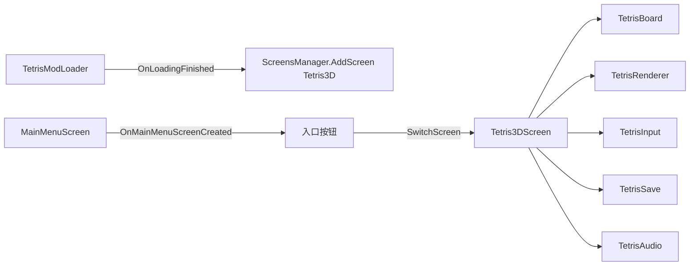
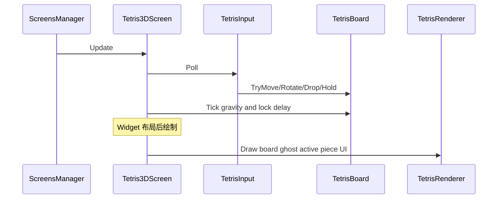

# Tetris3D 模组技术文档（TDD）

| 字段 | 内容 |
|------|------|
| 文档版本 | 1.0.0 |
| 关联需求 | [PRD.md](PRD.md) |
| 关联技术方案 | [Solution.md](Solution.md) |
| 宿主参考 | Survivalcraft API 1.9.x（编写时 `APIVersionString = 1.9.3.1`） |
| 实现状态 | 已实现于 [`mods/Tetris3D/`](../../../mods/Tetris3D/) |

---

## 1. 架构总览

### 1.1 设计原则

- **逻辑与表现分离**：`TetrisBoard` 零 UI / 零引擎绘制依赖，便于单测。
- **不进入 ECS**：无 `Project` / `Subsystem` / 方块表；仅 `Screen` + 模组资源。
- **宿主集成最小化**：2 个 Hook（`OnLoadingFinished`、`OnMainMenuScreenCreated`）+ 可选设置读写。

### 1.2 运行时结构



### 1.3 帧循环



---

## 2. 宿主集成

### 2.1 关键 API（本仓库）

| API | 路径 | 用途 |
|-----|------|------|
| `ScreensManager.AddScreen` / `SwitchScreen` | [Survivalcraft/Managers/ScreensManager.cs](../../../Survivalcraft/Managers/ScreensManager.cs) | 注册与切换全屏界面 |
| `OnLoadingFinished` | [Survivalcraft/ModsManager/ModLoader.cs](../../../Survivalcraft/ModsManager/ModLoader.cs) | 加载完成后注册 Screen |
| `OnMainMenuScreenCreated` | 同上；调用点 [MainMenuScreen.cs](../../../Survivalcraft/Screen/MainMenuScreen.cs) | 向 `rightBottomBar` 加按钮 |
| `BevelledButtonWidget` | Survivalcraft Widget | 入口 / 返回 / 暂停按钮 |
| `ContentManager.Get` | 资源 | 样式 XML、音效、语言 |
| `MusicManager` | 音频 | 保持 `Mix.Menu` |

### 2.2 ModLoader 骨架

```csharp
public class TetrisModLoader : ModLoader {
    public ButtonWidget m_menuButton;

    public override void __ModInitialize() {
        ModsManager.RegisterHook("OnLoadingFinished", this);
        ModsManager.RegisterHook("OnMainMenuScreenCreated", this);
    }

    public override void OnLoadingFinished(List<Action> actions) {
        actions.Add(() => {
            ScreensManager.AddScreen("Tetris3D", new Tetris3DScreen());
        });
    }

    public override void OnMainMenuScreenCreated(
        MainMenuScreen mainMenuScreen,
        StackPanelWidget leftBottomBar,
        StackPanelWidget rightBottomBar) {
        m_menuButton = new BevelledButtonWidget {
            Text = LanguageControl.Get("Tetris3D", "MenuButton"), // 或硬编码后补语言
            Style = ContentManager.Get<XElement>("Styles/ButtonStyle_310x60"),
            Margin = new Vector2(0f, 4f)
        };
        rightBottomBar.Children.Add(m_menuButton);
    }
}
```

**点击检测**：`OnMainMenuScreenCreated` 只执行一次，无每帧回调。推荐：

1. 自定义薄包装 `Widget`，在 `Update` 里检测子按钮 `IsClicked` 后 `ScreensManager.SwitchScreen("Tetris3D")`；或  
2. 使用 `AfterWidgetUpdate` Hook：当 `widget` 为主菜单且 `m_menuButton.IsClicked` 时切换。

返回：

```csharp
ScreensManager.SwitchScreen("MainMenu");
```

### 2.3 Screen 生命周期

| 方法 | 职责 |
|------|------|
| 构造 | `LoadContents`（若有 XML）或代码搭建 UI；查找按钮引用 |
| `Enter` | `MusicManager.CurrentMix = Menu`；`board.Reset()`；读最高分；取消暂停 |
| `Leave` | 停止局内音效循环；写回最高分（若需要） |
| `Update` | 若 `m_menuButton`/返回/暂停；否则 `input` → `board.Tick` |
| 绘制 | 调用 `TetrisRenderer`（可在自定义子 Widget 的 Draw 中） |

### 2.4 明确不使用的宿主能力

- `DatabaseManager` / `.xdb`
- `BlocksManager` / 方块 CSV
- `GameManager.Project` / 任意 `Subsystem`
- Harmony Patch（首版不需要）

---

## 3. 模组工程结构

建议独立仓库（自模板克隆），目录：

```
Tetris3DMod/
├── Tetris3DMod.csproj
├── modinfo.json
├── Assets/
│   ├── Screens/Tetris3DScreen.xml      # 可选
│   ├── Langs/zh-CN.json
│   ├── Langs/en-US.json
│   └── Audio/                          # move / rotate / lock / clear / gameover
├── Mod/
│   └── TetrisModLoader.cs
├── Game/
│   ├── TetrisBoard.cs
│   ├── TetrisPiece.cs
│   ├── TetrisBag.cs
│   ├── SevenBagRandomizer.cs
│   └── TetrisScoring.cs
├── Screen/
│   └── Tetris3DScreen.cs
├── Render/
│   └── TetrisRenderer.cs
├── Input/
│   └── TetrisInput.cs
└── Persistence/
    └── TetrisSave.cs
```

### 3.1 modinfo.json（示例）

```json
{
  "Name": "Tetris3D",
  "Version": "1.0.0",
  "ApiVersion": "1.9.3.1",
  "Description": "Main menu Tetris with pseudo-3D blocks. 主菜单俄罗斯方块（伪3D）",
  "ScVersion": "2.4.0.0",
  "PackageName": "com.scspm.tetris3d",
  "Author": "YourName",
  "NonPersistentMod": true,
  "GameplayImpactLevel": "Cosmetic",
  "LoadOrder": 50000,
  "Link": "https://example.com/tetris3d"
}
```

字段含义见 [ModInfoConfig.md](../../ModInfoConfig.md)。

### 3.2 csproj 打包（与官方教程一致）

```xml
<Target Name="PackageMod" AfterTargets="Build">
  <ZipDirectory SourceDirectory="$(OutputPath)"
                DestinationFile="$(OutputPath)..\$(AssemblyName).scmod"
                Overwrite="true" />
</Target>
```

`PackageReference`：`SurvivalcraftAPI.Survivalcraft`，版本与 `ApiVersion` 对齐。

---

## 4. 模块设计

### 4.1 TetrisBoard（纯逻辑）

**职责**：场地、当前块、Hold、Next、重力、锁延、消行、分数、等级、状态。

**建议公开 API**：

```csharp
public enum TetrisState { Playing, Paused, GameOver }

public sealed class TetrisBoard {
    public const int Width = 10;
    public const int VisibleHeight = 20;
    public const int BufferHeight = 2;          // 顶部隐藏行
    public int[,] Cells;                        // 0=空, 1..7=颜色/种类
    public TetrisPiece Active;
    public TetrisPiece? Hold;
    public bool HoldUsedThisTurn;
    public Queue<PieceType> NextQueue;          // 保持 Count >= 3
    public int Score, Lines, Level;
    public TetrisState State;

    public void Reset();
    public void Tick(float dt);
    public bool TryMove(int dx, int dy);
    public bool TryRotate(int dir);             // +1 CW, -1 CCW
    public void SoftDropStep();                 // 一格并计分
    public void HardDrop();
    public bool TryHold();
    public void SetPaused(bool paused);
}
```

**坐标约定**：

- `x ∈ [0, 9]`，`y ∈ [0, VisibleHeight + BufferHeight - 1]`
- `y` **向上增大**或**向下增大**须在实现中固定一处；推荐 **y=0 为底部**（与许多教程一致），渲染时再翻转。

### 4.2 方块定义

七种 `PieceType`：I O T L J S Z。  
每个类型 4 个旋转态，各含 4 个相对格子偏移（SRS 标准坐标）。

颜色索引（伪 3D 材质）：

| 类型 | 建议色 |
|------|--------|
| I | 青 Cyan |
| O | 黄 Yellow |
| T | 紫 Purple |
| L | 橙 Orange |
| J | 蓝 Blue |
| S | 绿 Green |
| Z | 红 Red |

### 4.3 SevenBagRandomizer

```csharp
// 洗牌 7 种 → 依次取出；袋空再洗
```

Next 队列：始终补足到 ≥ 5 内部缓存，UI 只显示 3。

### 4.4 旋转 SRS（首版锁定）

- 使用 Guideline **SRS** wall kick。
- 非 I 与 I 使用两套 kick 表（实现时抄录标准 JLSTZ / I 表）。
- 旋转成功条件：踢墙后 4 格均在界内且不与 `Cells` 重叠。
- **不做** T-Spin 检测（与 PRD 一致）。

### 4.5 锁定延迟

| 参数 | 首版值 |
|------|--------|
| Lock Delay | 500 ms |
| 触地后移动/旋转 | 重置剩余 Lock Delay |
| 最大重置次数 | 15（防无限拖） |
| 硬降 | 跳过锁延，立即锁定 |

### 4.6 重力（等级）

Level 从 1 开始。重力用「每格下落间隔秒」：

| Level | 间隔（秒） |
|-------|------------|
| 1 | 0.80 |
| 2 | 0.72 |
| 3 | 0.63 |
| 4 | 0.55 |
| 5 | 0.47 |
| 6 | 0.38 |
| 7 | 0.30 |
| 8 | 0.22 |
| 9 | 0.13 |
| ≥10 | max(0.05, 0.10 - 0.01×(Level-10)) |

升级：`Lines` 累计每 **10** 行 `Level++`（在计分结算后）。

软降：按住时使用固定间隔 **0.05 s/格**（覆盖自然重力），每成功下移 +1 分。

### 4.7 计分

与 [PRD §4.5](PRD.md#45-计分规则首版锁定) 一致，集中在 `TetrisScoring`：

```csharp
static int LineClearScore(int linesCleared, int level) => linesCleared switch {
    1 => 100 * level,
    2 => 300 * level,
    3 => 500 * level,
    4 => 800 * level,
    _ => 0
};
```

### 4.8 Tetris3DScreen

- 持有 `TetrisBoard`、`TetrisInput`、`TetrisRenderer`、`TetrisSave`、`TetrisAudio`。
- UI：返回、暂停、静音、Hold/Next 面板、分数标签；可用 XML 或纯代码。
- Game Over：显示面板 Widget，`IsVisible` 切换。

### 4.9 TetrisRenderer（伪 3D）

**方案（锁定）**：对每个实心 cell 绘制一个「扁立方体」——底面矩形 + 顶面略偏移矩形 + 两侧梯形（2D 批绘模拟立体），或使用 `PrimitivesRenderer3D` 画单位立方体。

约定：

| 项 | 值 |
|----|-----|
| Cell 逻辑边长 | 1.0 |
| 立体厚度比例 | 0.18～0.25 × 边长 |
| Ghost | 同几何，Alpha ≈ 0.35，无高光 |
| 相机 | 正交或轻微透视；场地居中 |

绘制顺序：场地已锁定块 → Ghost → 当前块 → UI（Widget 系统）。

### 4.10 TetrisInput

| 动作 | 桌面 | 触屏 |
|------|------|------|
| 移动 | 左右键，DAS/ARR：首次延迟 170ms，重复 50ms | 左右虚拟键，同样 DAS |
| 软降 | 按下连续 | 按住下键 |
| 硬降 | Space 边沿触发 | 硬降按钮 |
| 旋转 | CW/CCW 边沿 | 两按钮 |
| Hold | 边沿 | 按钮 |
| 暂停 | 边沿 | 按钮 |

状态为 `Paused` / `GameOver` 时，过滤玩法动作，仅放行 UI 命令。

### 4.11 TetrisSave

路径建议（宿主可写目录）：

```
app:Tetris3D/save.json
```

或 `ModsManager` / `Storage` 组合出的模组私有路径（实现时与模板一致即可）。

内容：

```json
{ "HighScore": 0, "SoundEnabled": true }
```

读：`Enter`；写：破纪录时、`Leave`、切换静音时。

亦可用 `ModLoader.SaveSettings` / `LoadSettings`（XElement）二选一；**首版锁定 JSON 文件**，逻辑简单且与存档解耦。

### 4.12 TetrisAudio

| 事件 | 资源键（示例） |
|------|----------------|
| 移动 | `Audio/Tetris/Move` |
| 旋转 | `Audio/Tetris/Rotate` |
| 锁定 | `Audio/Tetris/Lock` |
| 消行 | `Audio/Tetris/Clear` |
| 四消 | `Audio/Tetris/Tetris` |
| Game Over | `Audio/Tetris/GameOver` |

`SoundEnabled == false` 时全部跳过。BGM：优先 `MusicManager.Mix.Menu`，不强制自带循环 BGM。

---

## 5. 数据与规则速查

| 项 | 值 |
|----|-----|
| 宽 × 可见高 | 10 × 20 |
| 缓冲行 | 2 |
| Next 显示 | 3 |
| 7-bag | 是 |
| 旋转 | SRS |
| Lock Delay | 500 ms / 最多重置 15 次 |
| 升级 | 每 10 行 |
| T-Spin | 否 |
| 计分 | PRD §4.5 |

生成位置：水平居中偏上（标准 Guideline 生成坐标），在缓冲行内；若重叠 → `GameOver`。

---

## 6. 资源与本地化

### 6.1 语言键（示例）

| Key | zh-CN | en-US |
|-----|-------|-------|
| MenuButton | 俄罗斯方块 | Tetris |
| Back | 返回 | Back |
| Pause | 暂停 | Pause |
| Resume | 继续 | Resume |
| Restart | 重新开始 | Restart |
| Score | 分数 | Score |
| Level | 等级 | Level |
| Lines | 行数 | Lines |
| HighScore | 最高分 | High Score |
| Hold | 保留 | Hold |
| Next | 下一个 | Next |
| GameOver | 游戏结束 | Game Over |
| Sound | 音效 | Sound |

文件：`Assets/Langs/zh-CN.json`、`en-US.json`（格式遵循宿主语言合并规则）。

### 6.2 Screen XML（可选）

`Assets/Screens/Tetris3DScreen.xml`：顶栏按钮 + 侧栏标签容器；中央留空由 `TetrisRenderer` 绘制。布局系统见 [UiSystem.md](../../UiSystem.md)。

---

## 7. 里程碑实现清单（对照 PRD）

| 里程碑 | 代码任务 | 完成定义 |
|--------|----------|----------|
| M0 | Loader 双 Hook、空 `Tetris3DScreen`、返回 | TC-01～03（FR-01～04） |
| M1 | `TetrisBoard` 基础 + 简易 2D 矩形绘制 + 键盘 | TC-04～06（结束提示即可；FR-10～16, FR-30） |
| M2 | bag/Next/Hold/Ghost/锁延/SRS/计分/暂停/完整 Game Over 面板 | TC-07～14（FR-20～29, FR-31～34, FR-52） |
| M3 | `TetrisRenderer` 伪 3D、`TetrisSave`、音频、触屏、语言 | TC-15～18（FR-40～42, FR-51, FR-60～63） |
| M4 | 打包 `.scmod`、清理调试代码、跑通出门用例 | TC-01～16、TC-19 必过；TC-17/18/20 按平台 |

**快速闭环建议**：每完成一里程碑即复制 `.scmod` 到 `Mods/` 重启验证，再开下一里程碑。

---

## 8. 本地测试与调试

### 8.1 标准流程

1. `dotnet build` 生成 `.scmod`
2. 复制到：
   - 开发：`Survivalcraft.Windows/bin/Debug/Mods/`
   - 或已安装游戏根目录 `Mods/`
3. 启动 / 重启插件版
4. 模组管理确认启用
5. 主菜单验证入口与对局

参考：[GltfCreatureModTutorial.md §8](../../GltfCreatureModTutorial.md)、[Development.md](../../Development.md)。

### 8.2 FastDebug

宿主 `FastDebugModEntity` 会加载 `Mods/` 下**未打包**散文件（跳过 `.scmod`）。适合改 `Assets` / `modinfo`；**程序集变更仍需编译并重启**。安全模式下 FastDebug 受限。

### 8.3 日志与异常

- IDE 调试运行 `Survivalcraft.Windows`，开启捕获异常（Development 建议）。
- 关注加载期 `modinfo` 反序列化、程序集、Hook 注册错误。

### 8.4 逻辑单测（推荐）

对 `TetrisBoard` 建 .NET 测试项目（不引用 UI）：

- 消一行后堆叠下沉
- 7-bag 七唯一
- Hold 限制
- 硬降分数
- 生成失败 → GameOver

---

## 9. 构建与发布检查清单

- [ ] `modinfo.json`：`PackageName` 唯一，`ApiVersion` = NuGet 版本，`NonPersistentMod: true`，`GameplayImpactLevel: Cosmetic`
- [ ] `PackageMod` 产出单个 `.scmod`，内含 dll + Assets + modinfo
- [ ] 干净 Mods 目录仅本模组通过 PRD §7 必测用例
- [ ] 发布说明含：API 版本、键位、Android 触屏说明、Out of Scope
- [ ] 不附带游戏本体安装包

---

## 10. 风险与边界（技术）

| 项 | 处理 |
|----|------|
| 主菜单按钮点击 | 包装 Widget 或 `AfterWidgetUpdate` |
| SRS 表错误 | 固定用例：I 靠墙旋转、T 槽内旋转 |
| 伪 3D 性能 | cell 数量 ≤ 10×22 + 4，批绘即可 |
| 多模组抢右下角 | 只 `Children.Add`，不 Clear |
| iOS 无模组 dll | 不宣称支持；纯资源也无法提供本玩法 |
| Browser | 无模组，不支持 |

---

## 11. 附录 A：默认键位常量

```csharp
public static class TetrisKeys {
    // 实现时映射到 Engine.Input.Key
    // Left, Right, SoftDrop, HardDrop, RotateCW, RotateCCW, Hold, Pause
}
```

与 [PRD §4.7](PRD.md#47-输入) 表一致。

## 12. 附录 B：宿主集成伪代码（Screen 更新）

```csharp
public override void Update() {
    if (m_backButton.IsClicked || Input.Back) {
        ScreensManager.SwitchScreen("MainMenu");
        return;
    }
    if (m_pauseButton.IsClicked) {
        m_board.SetPaused(m_board.State != TetrisState.Paused);
    }
    if (m_board.State == TetrisState.GameOver) {
        if (m_restartButton.IsClicked) m_board.Reset();
        return;
    }
    if (m_board.State == TetrisState.Paused) return;

    m_input.Apply(m_board);
    m_board.Tick(Time.FrameDuration);
    if (m_board.Score > m_save.HighScore) {
        m_save.HighScore = m_board.Score;
        m_save.Write();
    }
}
```

---

## 13. 修订记录

| 版本 | 日期 | 说明 |
|------|------|------|
| 1.0.0 | 2026-09-20 | 首版：架构、集成、规则数值、M0–M4、测试发布 |
